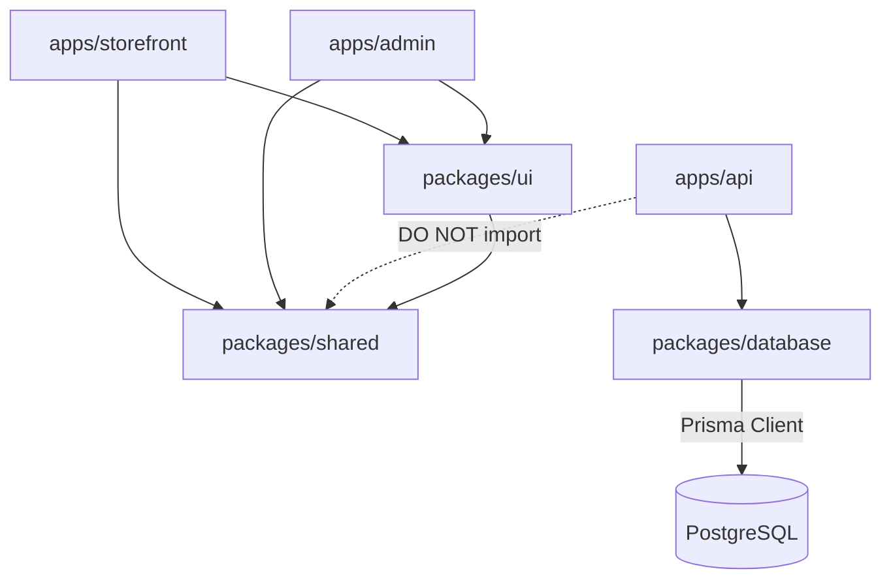
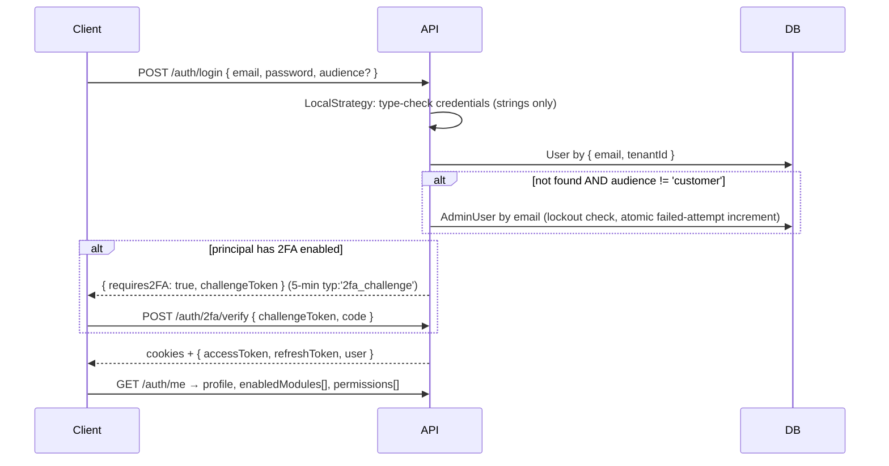

# Naro Fashion - Technical Guide

**Version**: 2.0
**Last Updated**: 2026-10-18
**Platform**: Naro Fashion Multi-Tenant SaaS E-Commerce
**Repository**: https://github.com/rjurio/naro-fashion

---

## Changes since 1.0

Version 1.0 (2026-03-28) predates the May–October 2026 security reviews, the AI admin agent, committed migrations and admin offline mode. The main changes in this edition:

| Area | What changed | Section |
|---|---|---|
| Security model | Guard stack is now `JwtAuthGuard → AdminGuard → PermissionGuard` with `@RequiresPermission()`; build-time shape specs enforce guard coverage; `ownerScope()` for customer resources; global `TenantGuard` and `AppThrottlerGuard` | 6 |
| Tokens | JWT `typ`/`tv` claims, `tokenVersion` revocation, `requireJwtSecret()` (no literal fallback secrets), per-tenant session lifetimes | 6.2–6.4, 6.11 |
| 2FA | Real TOTP 2FA for admins and platform admins (`TWO_FA_ENCRYPTION_KEY`) | 6.10 |
| Storefront login | Customer-only (`audience: 'customer'`); no self-service account deletion | 6.5, 6.12 |
| Data protection | Sanitize-on-write (`sanitizeRichText`), render-time sanitizers, `isSensitiveSettingKey`, secret masking, public select whitelists, private ID documents, per-request nonce CSP | 6.14–6.15, 8.12 |
| Tenant isolation | Runtime Prisma tenant-scope extension (`TENANT_SCOPE_ENFORCEMENT`), `assertSameTenant`, X-Tenant-Id ↔ JWT cross-validation | 5 |
| Lifecycle hooks | Request-scoped providers never run hooks/crons → seeders and crons live in singletons (enforced by spec) | 7.12 |
| Payments | Provider registry (Selcom + ClickPesa), `PaymentSettlementService`, raw-body HMAC, advisory locks, order refunds | 7.14 |
| Database | Committed Prisma migrations (`0_init` baseline), CI drift check; `db push` is for throwaway local experiments only | 9.5 |
| Frontend | Tailwind v4 `@theme` colour gotcha, no typography plugin, theme defaults from tenant `default_theme`, Quill/table handling, `authorizedFetch` / `tokenStore` | 8 |
| AI agent | Read tools, drafts, four-eyes approval workflow, in-admin assistant | 10.4 |
| Testing / CI | Jest suite (67 spec files, 900+ tests), CI `verify` job gates every deploy | 12 |
| Offline | Admin offline mode + replay-safe sync API | 15 |
| Secrets | Real passwords and production hosts were removed from this guide; see `.env.example` and your local `.env` | 2 |

---

## Related Documents

| Document | Description |
|---|---|
| [CLAUDE.md](../CLAUDE.md) | Project-level instructions — the most detailed, most current source of conventions |
| [apps/api/CLAUDE.md](../apps/api/CLAUDE.md), [apps/admin/CLAUDE.md](../apps/admin/CLAUDE.md), [apps/storefront/CLAUDE.md](../apps/storefront/CLAUDE.md), [packages/database/CLAUDE.md](../packages/database/CLAUDE.md) | Per-app notes |
| [SECURITY.md](./SECURITY.md) | Threat model, auth security, data isolation |
| [API_REFERENCE.md](./API_REFERENCE.md) | Endpoint reference |
| [DATABASE_SCHEMA.md](./DATABASE_SCHEMA.md) | Model reference and ER diagrams |
| [OPS/MIGRATIONS.md](./OPS/MIGRATIONS.md) | Prisma migration workflow (authoritative) |
| [OPS/DEPLOY.md](./OPS/DEPLOY.md), [OPS/BACKUPS.md](./OPS/BACKUPS.md), [OPS/MONITORING.md](./OPS/MONITORING.md) | Deploy pipeline, backups, monitoring |
| [DEPLOYMENT_GUIDE.md](./DEPLOYMENT_GUIDE.md) | Production server setup history and build troubleshooting |
| [CODE_REVIEW_2026-07.md](./CODE_REVIEW_2026-07.md), [CODE_REVIEW_2026-10.md](./CODE_REVIEW_2026-10.md) | Review registers (fixed + deferred findings) |
| [ai-agent/](./ai-agent/) | AI admin agent: implementation plan, Phase 3 design, approval workflow, tools, audit logging |
| [INSTAGRAM_INTEGRATION_GUIDE.md](./INSTAGRAM_INTEGRATION_GUIDE.md) | Facebook Graph API / Instagram feed |
| [3d-product-view-plan.md](./3d-product-view-plan.md) | 3D product viewer |
| [packages/shared/CLAUDE.md](../packages/shared/CLAUDE.md) | Shared package conventions |

---

## Table of Contents

1. [Introduction](#1-introduction)
2. [Development Setup](#2-development-setup)
3. [Monorepo Architecture](#3-monorepo-architecture)
4. [Project Structure](#4-project-structure)
5. [Multi-Tenancy Implementation](#5-multi-tenancy-implementation)
6. [Authentication, Authorization and Security](#6-authentication-authorization-and-security)
7. [API Development Guide](#7-api-development-guide)
8. [Frontend Development Guide](#8-frontend-development-guide)
9. [Database Guide](#9-database-guide)
10. [Module Reference](#10-module-reference)
11. [Scheduled Tasks](#11-scheduled-tasks)
12. [Testing and CI](#12-testing-and-ci)
13. [Common Tasks and Recipes](#13-common-tasks-and-recipes)
14. [Troubleshooting](#14-troubleshooting)
15. [Admin Offline Mode and Sync](#15-admin-offline-mode-and-sync)

---

## 1. Introduction

### Project Overview

Naro Fashion is a multi-tenant SaaS e-commerce platform built for fashion and clothing businesses in Tanzania. Multiple independent fashion businesses (tenants) run their own online stores from one shared infrastructure. Each tenant gets a storefront on its own domain, an admin dashboard, and a shared REST API backend. Data isolation is row-level (`tenantId` on every tenant-scoped model).

The platform targets the Tanzanian market with features including:

- **Local payment methods**: M-Pesa, Tigo Pesa / Mixx by YAS, Airtel Money, cards, bank transfer, cash on delivery — via Selcom and ClickPesa gateways
- **Bilingual storefront**: English and Swahili (custom i18n system, 100% key parity required)
- **Fashion rental system**: gown and formal-wear rentals with National ID verification, down payments, hold expiry and checklists
- **Point of Sale**: in-store POS with barcode scanning, shifts, split payments, layaway, exchanges and refunds — usable offline
- **3D product viewer**: Google `<model-viewer>` with AR on mobile
- **AI admin agent**: read tools, reversible drafts and four-eyes approval for risky product lifecycle changes
- **Admin offline mode**: device cache, outbox and conflict review (Section 15)

### Technology Stack

| Layer | Technology | Version | Purpose |
|---|---|---|---|
| Monorepo | Turborepo | 2.x | Task orchestration, caching, dependency graph |
| Package Manager | pnpm | 10.12.1 (pinned via `packageManager`) | Workspace management |
| Storefront | Next.js (App Router) | 15.5 | Customer-facing PWA |
| Admin Dashboard | Next.js (App Router) | 15.5 | Tenant admin + platform admin UI |
| API Backend | NestJS | 11 | REST API with modular architecture |
| Database | PostgreSQL | 17 local / 16 on the VPS and in CI | Primary data store |
| ORM | Prisma | 6.19.x (local CLI only — never global v7) | Schema, migrations, client |
| Language | TypeScript | 5.x | Strict mode across all packages |
| CSS Framework | Tailwind CSS | v4 | CSS-first configuration (`@theme`) |
| Authentication | Passport.js + JWT | — | Three-tier auth, access/refresh tokens, TOTP 2FA |
| Charts | Recharts | — | Analytics and financial charts (client-only) |
| Theming | next-themes | — | Storefront `data-theme`, admin `class` |
| Rich text | react-quill-new (Quill 2) | — | Admin editor (CMS pages, size guides, newsletters) |
| Tests | Jest + ts-jest | — | API unit and shape specs |
| React | React | 19 | UI library |
| Node.js | Node.js | 22 (`.nvmrc`, `engines >=22`) | Runtime |

### Prerequisites

| Tool | Minimum Version | Notes |
|---|---|---|
| Node.js | 22.x | `.nvmrc` pins 22 |
| pnpm | 10.12.1 | `corepack enable` picks up the pinned version |
| PostgreSQL | 16 or 17 | Local install |
| Git | 2.x | Shell scripts must stay LF (see `.gitattributes`) |

```bash
node --version   # v22.x.x
pnpm --version   # 10.12.1
psql --version   # 16.x or 17.x
```

---

## 2. Development Setup

### 2.1 Clone the Repository

```bash
git clone https://github.com/rjurio/naro-fashion.git
cd naro-fashion
pnpm install
```

### 2.2 Environment Variables

Start from the root `.env.example`, which lists every API key the code reads (with comments). Copy it to the locations below and fill in local values. Never commit real values.

| File | Used by | Minimum keys for local dev |
|---|---|---|
| `packages/database/.env` | Prisma CLI **and** the API at runtime (see warning) | `DATABASE_URL` |
| `apps/api/.env` | NestJS API | `DATABASE_URL`, `PORT=4000`, `STOREFRONT_URL`, `ADMIN_URL` |
| `.env` (root) | API (loaded too) | Same keys as `apps/api/.env` where duplicated |
| `apps/storefront/.env.local` | Storefront | `NEXT_PUBLIC_API_URL=http://localhost:4000/api/v1`, `NEXT_PUBLIC_TENANT_SLUG=<your tenant slug>` |
| `apps/admin/.env.local` | Admin | `NEXT_PUBLIC_API_URL=http://localhost:4000/api/v1` |

```env
# apps/api/.env (local dev sketch — placeholders, not real values)
DATABASE_URL="postgresql://<db_user>:<db_password>@localhost:5432/naro_fashion?schema=public"
PORT=4000
STOREFRONT_URL=http://localhost:3000          # comma-separated list allowed
ADMIN_URL=http://localhost:3001
# JWT_SECRET / JWT_REFRESH_SECRET: optional in dev (random per-process fallback),
# REQUIRED in production: >= 32 chars each and different from each other.
# TWO_FA_ENCRYPTION_KEY: needed only if you want to enrol 2FA locally.
```

> **Env file sprawl.** The API effectively loads three `.env` files (root, `apps/api/.env`, `packages/database/.env`). Prisma's own `dotenv` runs first and `dotenv` never overrides a key that is already set, so a stale value in `packages/database/.env` silently wins. Keep duplicated keys identical in all three.

> **JWT secrets in dev.** When `JWT_SECRET`/`JWT_REFRESH_SECRET` are unset outside production, `requireJwtSecret()` generates a random per-process value and warns once. Every API restart therefore logs everyone out — set your own dev secrets if that annoys you. The full variable list is in [Appendix A](#appendix-a-environment-variable-reference).

### 2.3 Database Setup

Create a database and a role that **owns** it (Prisma migrations run `ALTER TABLE`, which needs ownership, not just grants):

```bash
psql -U postgres -c "CREATE USER <db_user> WITH PASSWORD '<db_password>';"
psql -U postgres -c "CREATE DATABASE naro_fashion OWNER <db_user>;"
```

### 2.4 Prisma Setup (migrations)

The schema changes only through committed migrations in `packages/database/prisma/migrations/` (`0_init` baseline plus timestamped migrations). On a **fresh, empty** database:

```bash
cd packages/database
pnpm prisma migrate deploy     # applies 0_init and every later migration
pnpm prisma generate           # (migrate deploy does not generate)
```

If your local DB was created earlier with `db push` (no `_prisma_migrations` table), baseline it once instead of resetting — see [9.5](#95-schema-changes-migrations).

> Always run Prisma from `packages/database/` via `pnpm prisma …` (local v6.19.x). A global Prisma v7 CLI has breaking changes.

### 2.5 Seed the Database

Some reference data is seeded automatically **every time the API boots** (idempotent singletons): permissions, system roles (`SystemRolesSeeder`), expense categories, product sizes, and the AI agent roles. Tenant and demo data come from scripts, run in order:

```bash
cd packages/database
node prisma/migrate-to-multi-tenant.js   # first Tenant, PlatformAdmin, subscription plans, tenantId backfill
node prisma/seed-tenant.js               # site settings, CMS pages, branding, payment methods
node prisma/seed-mock-data.js            # optional demo customers, orders, rentals, reviews, expenses, events
```

Other one-off scripts live in `packages/database/prisma/` (`seed-cms-pages.js`, `seed-hero-slides.js`, `seed-demo.js`) and in `scripts/` (backfills such as `backfill-variant-tenant.js`, `backfill-product-images.js`). Data scripts are never run by `deploy.sh`.

### 2.6 Start Development

```bash
pnpm dev                # all apps
pnpm dev:api            # or one app: dev:storefront / dev:admin / dev:api
```

| App | URL |
|---|---|
| Storefront | http://localhost:3000 |
| Admin Dashboard | http://localhost:3001 (`/login`, `/platform-login`) |
| API | http://localhost:4000/api/v1 |
| Health | http://localhost:4000/api/v1/health |
| Swagger | http://localhost:4000/api/docs (off when `NODE_ENV=production` unless `ENABLE_SWAGGER=true`) |

The admin service worker is registered only in production builds (or with `NEXT_PUBLIC_ENABLE_SW=true`), so `next dev` is not affected by offline caching.

### 2.7 Accounts

`migrate-to-multi-tenant.js` creates a platform admin and the seeded tenant's SUPER_ADMIN. The default emails and passwords are in that script / the project `CLAUDE.md` and are for **local development only** — change them immediately on any shared or production database. Customers register through the storefront (customer accounts are per tenant; staff accounts cannot log in to the storefront).

---

## 3. Monorepo Architecture

### 3.1 Turborepo Configuration

`turbo.json` at the root:

```json
{
  "$schema": "https://turbo.build/schema.json",
  "globalDependencies": ["**/.env.*local"],
  "tasks": {
    "build":  { "dependsOn": ["^build"], "outputs": [".next/**", "!.next/cache/**", "dist/**"] },
    "dev":    { "cache": false, "persistent": true },
    "lint":   { "dependsOn": ["^build"] },
    "clean":  { "cache": false },
    "db:generate": { "cache": false },
    "db:push":     { "cache": false },
    "db:migrate":  { "cache": false },
    "db:studio":   { "cache": false, "persistent": true }
  }
}
```

- **`build`** depends on `^build` and caches `.next/` and `dist/`.
- **`dev`** is never cached and runs persistently.
- **`db:*`** tasks are never cached.

> Root `pnpm build` builds all apps **in parallel**. That is fine on a workstation but OOMs the 2 GB production VPS — production builds run sequentially inside `deploy.sh`. Never run `pnpm build` or `pm2 restart all` on the VPS.

### 3.2 pnpm Workspaces

`pnpm-workspace.yaml` registers `apps/*` and `packages/*`. Root `package.json` adds:

- `"packageManager": "pnpm@10.12.1"` and `"engines": { "node": ">=22" }`
- `pnpm.overrides` — same-major overrides for vulnerable transitive dependencies (CI fails on any **critical** prod advisory)
- `pnpm.onlyBuiltDependencies` — only Prisma, esbuild and `@nestjs/core` may run install scripts

### 3.3 Package Dependency Graph



**Critical**: `apps/api` must NOT import from `@naro/shared` (ESM/CJS mismatch → runtime crash). Duplicate the constant locally in the API (e.g. `CORE_MODULES` in `tenants/tenants.service.ts`).

### 3.4 Build Order

1. `packages/database` (Prisma client generation)
2. `packages/shared` (types, enums, `IMAGE_PRESETS`)
3. `packages/ui`
4. `apps/api`, `apps/storefront`, `apps/admin`

### 3.5 TypeScript Base Configuration

`tsconfig.base.json` (ES2022, `moduleResolution: bundler`, `strict: true`, `isolatedModules`, declarations + source maps) is extended by every package. Strict mode is enforced everywhere; both Next.js apps build with `typescript: { ignoreBuildErrors: false }` and CI runs `tsc --noEmit` for all three apps before any deploy.

---

## 4. Project Structure

### 4.1 Root Directory

```
naro-fashion/
├── apps/
│   ├── storefront/          # Customer-facing Next.js PWA (port 3000)
│   ├── admin/               # Admin dashboard Next.js (port 3001)
│   └── api/                 # NestJS REST API (port 4000)
├── packages/
│   ├── database/            # Prisma schema, migrations, client, seed scripts
│   ├── shared/              # Shared types, enums, constants, IMAGE_PRESETS
│   └── ui/                  # Shared UI components
├── scripts/                 # One-off data scripts (backfills, Instagram connect, repairs)
│   └── ops/                 # deploy-lib.sh, pg-backup.sh, offsite-backup.sh, rollback.sh, setup-backups.sh
├── docs/                    # Documentation (incl. OPS/ and ai-agent/)
├── .github/workflows/deploy-prod.yml   # CI verify job + deploy job
├── deploy.sh                # Production deploy (run by CI on push to `prod`)
├── ecosystem.config.js      # PM2 process definitions
├── .env.example             # Every env key the code reads
├── .gitattributes           # *.sh eol=lf
├── .nvmrc                   # 22
├── turbo.json, pnpm-workspace.yaml, tsconfig.base.json, package.json
└── CLAUDE.md                # Project instructions (most detailed reference)
```

### 4.2 API (`apps/api/src/`)

```
apps/api/src/
├── main.ts                  # rawBody, trust proxy, request-context ALS, helmet, compression,
│                            #   cookie-parser, CORS (comma lists), ValidationPipe, gated Swagger
├── app.module.ts            # Module imports + global AppThrottlerGuard
├── prisma/                  # PrismaService (returns $extends(tenantScopeExtension))
├── tenant/
│   ├── tenant.module.ts     # Registers global TenantInterceptor + TenantGuard
│   ├── tenant.context.ts    # Request-scoped TenantContext (requireId → 400)
│   ├── tenant.interceptor.ts# Extracts tenantId; cross-validates X-Tenant-Id vs JWT
│   ├── request-context.ts   # AsyncLocalStorage: currentRequestTenantId() for singletons
│   └── default-tenant.ts    # Default-tenant resolution (DEFAULT_TENANT_SLUG …)
├── tenant-scope/            # Runtime Prisma tenant-scope guard (+ allowlist, model list from dmmf)
├── auth/
│   ├── auth.controller.ts / auth.service.ts
│   ├── strategies/          # jwt.strategy.ts (cookie or Bearer), local.strategy.ts (audience)
│   ├── guards/              # jwt-auth, admin, permission, module, tenant, platform-admin, local-auth
│   ├── decorators/          # @Public, @CurrentUser, @RequiresModule, @RequiresPermission
│   ├── dto/                 # incl. password-policy.ts
│   ├── util/                # jwt-secrets.ts, ownership.ts, totp.ts, two-fa-crypto.ts, recovery-codes.ts
│   ├── admin-guard-coverage.shape.spec.ts   # every route: @Public / admin-guarded / allowlisted
│   └── req-user-sub.invariant.spec.ts       # bans req.user.sub
├── common/                  # sanitize-html.util.ts, offline-sync.util.ts, request-scope-lifecycle.shape.spec.ts
├── health/                  # GET /health, AppThrottlerGuard, swagger.util.ts
├── idempotency/             # Global IdempotencyInterceptor + retention cron
├── sync/                    # GET /sync/changes (admin offline mode)
├── ai/                      # AI admin agent: controllers, approval workflow, audit, sanitizer, guards
├── ai-assistant/            # In-admin chat over the AI tool surface
├── audit/                   # AdminActivityLog + /audit endpoints
├── tenants/                 # Tenants, subscriptions, billing, modules (platform)
├── products/, categories/, product-sizes/, size-guides/
├── orders/                  # Orders, order-refunds.service.ts, order-expiry.cron.ts
├── payments/                # Provider registry, Selcom, ClickPesa, settlement, reconciliation
├── payment-methods/         # DB-driven methods, secret-mask.util.ts
├── cart/, wishlist/, shipping/, reviews/, users/
├── rentals/, rental-checklists/, rental-policies/, id-verification/
├── flash-sales/, referrals/, promo-codes/, events/, newsletter/
├── cms/                     # Banners, pages, settings, hero slides, parallax, Instagram
├── analytics/               # Dashboard + visitor analytics, PageView retention
├── notifications/           # Email (Handlebars) + SMS
├── upload/                  # Public uploads + private ID documents
├── scheduler/               # Rental, cart, subscription, rental-hold, Instagram token crons
├── admin-users/, roles/, permissions/
├── inventory/, expenses/, expense-categories/, reports/
└── pos/                     # POS incl. offline sales and refunds
```

A module folder contains `*.module.ts`, `*.service.ts`, `*.controller.ts`, `dto/`, and colocated `*.spec.ts` files.

### 4.3 Storefront (`apps/storefront/`)

```
apps/storefront/
├── app/
│   ├── layout.tsx               # Reads x-nonce + getDefaultTheme(); ThemeProvider, I18nProvider, ParallaxProvider
│   ├── page.tsx                 # Homepage (hero, categories, new arrivals, flash sales, rentals, Instagram)
│   ├── products/, categories/, rentals/, events/, pages/[slug]/   # each with a server layout.tsx (generateMetadata)
│   ├── cart/, checkout/, orders/[id]/, flash-sales/
│   ├── auth/{login,register,forgot-password}/
│   ├── account/{orders,rentals,wishlist,settings,id-verification}/
│   ├── unsubscribe/
│   ├── manifest.ts, sitemap.ts, robots.ts   # per-tenant
├── components/{layout,products,social,effects,analytics,ui}/
├── contexts/                    # AuthContext, SiteSettingsContext, ParallaxContext, …
├── lib/
│   ├── api.ts                   # API client, tokenStore, refresh-on-401, domain APIs
│   ├── tenant-server.ts         # getServerTenantId / serverTenantHeaders / serverApiGet (SSR)
│   ├── settings-server.ts       # getBusinessProfile, getDefaultTheme (SSR)
│   ├── i18n.tsx                 # I18nProvider, useTranslation
│   ├── sanitize.ts              # sanitizeHtml, safeHttpsUrl
│   ├── safe-redirect.ts, password.ts, image-hosts.ts, seo-server.ts, use-dialog.ts
├── messages/{en,sw}.json        # Translations (must keep key parity)
├── middleware.ts                # Tenant resolution, nonce CSP, x-tenant-id forwarding
└── public/
```

### 4.4 Admin Dashboard (`apps/admin/`)

```
apps/admin/
├── app/
│   ├── layout.tsx               # Reads x-nonce; nonce'd theme script; Providers
│   ├── providers.tsx            # ThemeProvider, SiteSettings, Auth, SyncProvider, SW registrar
│   ├── login/, platform-login/, offline/
│   ├── dashboard/               # products, orders, customers, rentals, pos, inventory, financials,
│   │                            #   cms/*, newsletter/*, analytics/visitors, reports, users/roles,
│   │                            #   audit-log, recycle-bin, settings/*, ai/{assistant,approvals,role-assignments}
│   └── platform/                # dashboard, tenants, plans, payments, settings
├── components/
│   ├── layout/                  # Sidebar (requiredPermission), TopBar
│   ├── auth/                    # TwoFactorSettings, TwoFactorLoginStep
│   ├── offline/                 # SyncStatusBadge, SyncDrawer, ConflictReviewModal, StaleRecordDialog, …
│   ├── products/, rental/
│   └── ui/                      # DataTable, ServerPager, PresetImageUploadField, RichTextEditor,
│                                #   PrivateDocument, Modal, Toast, ConfirmDialog, PageHeader, …
├── contexts/                    # AuthContext, ToastContext, SyncContext, SiteSettingsContext
├── lib/
│   ├── api.ts                   # AdminApiClient, authorizedFetch, token storage helpers
│   ├── offline/                 # IndexedDB cache, outbox, sync engine, overlay (Section 15)
│   ├── pagination.ts, sanitize-html.ts, password-policy.ts, utils.ts
├── middleware.ts                # Nonce CSP
└── public/sw.js                 # Hand-written service worker
```

### 4.5 Packages

**`packages/database/`**

```
packages/database/
├── prisma/
│   ├── schema.prisma            # 76 models
│   ├── migrations/              # migration_lock.toml, 0_init/, <timestamp>_<name>/
│   ├── migrate-to-multi-tenant.js, seed-tenant.js, seed-mock-data.js, seed-*.js
├── src/index.ts                 # Re-exports Prisma client
└── package.json                 # db:migrate:dev / db:migrate:deploy / db:migrate:status / db:push …
```

**`packages/shared/`** — `src/index.ts` (enums, `PLATFORM_MODULES`, `CORE_MODULES`, `BRAND_COLORS`, types) and `src/image-presets.ts` (`IMAGE_PRESETS`, 13+ upload presets). Frontends only.

**`packages/ui/`** — shared UI components.

---

## 5. Multi-Tenancy Implementation

### 5.1 Architecture Overview

Shared database, row-level isolation: every tenant-scoped query includes `tenantId`. Isolation is enforced in layers:

1. **TenantInterceptor** (global) — resolves the request's tenant and rejects an `X-Tenant-Id` that disagrees with the caller's JWT.
2. **TenantGuard** (global) — 403 `TENANT_SUSPENDED` for SUSPENDED/DEACTIVATED tenants.
3. **TenantContext** (request-scoped) — `requireId` gives services the tenant.
4. **Service-layer scoping** — every Prisma read/write on a tenant-scoped model carries `tenantId` (or scopes through a parent relation).
5. **Runtime tenant-scope guard** — a Prisma extension that detects queries missing `tenantId` (5.9).

### 5.2 TenantContext (Request-Scoped Injectable)

**File**: `apps/api/src/tenant/tenant.context.ts`

- `id` → tenant from `request.tenantId`, `request.user.tenantId`, or `X-Tenant-Id`. On `@Public()` routes (where `req.user` is never populated) it verifies the Bearer token itself with `requireJwtSecret('JWT_SECRET', …)`, and rejects a mismatching header with 403.
- `requireId` → the id, or **400 `BadRequestException`** ("Tenant context is required. Provide X-Tenant-Id header or a valid Authorization token.").
- `isPlatformAdmin` → whether the caller is a platform admin.

```typescript
@Injectable()
export class ProductsService {
  constructor(
    private readonly prisma: PrismaService,
    private readonly tenantContext: TenantContext,
  ) {}

  findAll() {
    return this.prisma.product.findMany({
      where: { tenantId: this.tenantContext.requireId, isActive: true, deletedAt: null },
    });
  }
}
```

> Injecting `TenantContext` makes your provider **request-scoped**, which has consequences for lifecycle hooks and crons — see [7.12](#712-request-scoped-providers-never-get-lifecycle-hooks).

Singletons that need the tenant of the in-flight request (e.g. email branding) use `currentRequestTenantId()` from `tenant/request-context.ts` (AsyncLocalStorage set by `requestContextMiddleware` in `main.ts`) instead of becoming request-scoped.

### 5.3 TenantInterceptor (Global)

**File**: `apps/api/src/tenant/tenant.interceptor.ts` — registered as `APP_INTERCEPTOR` **inside `TenantModule`** (so it can inject `JwtService` + `ConfigService`).

- Sets `request.tenantId` from the JWT or the `X-Tenant-Id` header.
- When a Bearer token **and** `X-Tenant-Id` are both present, the token is verified and a mismatch returns `403 X-Tenant-Id does not match authenticated tenant`. Anonymous storefront calls (header only) keep working.

### 5.4 TenantGuard (Global)

**File**: `apps/api/src/auth/guards/tenant.guard.ts` — `APP_GUARD` in `TenantModule`. You do **not** add it to controllers.

- Resolves the tenant from a verified access token (refresh tokens ignored) else `X-Tenant-Id`.
- SUSPENDED / DEACTIVATED → 403 `{ code: 'TENANT_SUSPENDED' }`. TRIAL and GRACE pass. Platform admins bypass.
- Always passes: `/health`, `/auth/{login,platform-login,forgot-password,reset-password,refresh,logout}`, `/tenants/resolve`.
- 60-second status cache, invalidated by `TenantsService` via `TenantGuard.invalidate(id)`; fails open on DB error.

### 5.5 Storefront Tenant Resolution

**File**: `apps/storefront/middleware.ts`

```mermaid
sequenceDiagram
    participant Browser
    participant MW as Storefront middleware
    participant Cache as LRU (500 hosts, 60s; misses 10s)
    participant API as NestJS API

    Browser->>MW: GET /products (Host: shop.example.com)
    MW->>MW: strip leading "www."
    MW->>Cache: lookup host
    alt miss
        MW->>API: GET /tenants/resolve?domain=...
        API-->>MW: { id, slug, status } or 404
    end
    alt unknown host in production (not in STOREFRONT_DEFAULT_HOSTS)
        MW-->>Browser: 404
    else SUSPENDED
        MW-->>Browser: 503
    else ok
        MW->>MW: forward request header x-tenant-id (overwrites any client value)
        MW->>MW: set tenantId cookie + X-Tenant-Id response header, nonce CSP
        MW-->>Browser: continue
    end
```

- `NEXT_PUBLIC_TENANT_SLUG` is a fallback **only** for `localhost`/`127.0.0.1` outside production, or hosts listed in `STOREFRONT_DEFAULT_HOSTS`.
- Server code (server components, `generateMetadata`, `manifest.ts`, `sitemap.ts`) reads the tenant with `getServerTenantId()` / `serverTenantHeaders()` / `serverApiGet()` from `lib/tenant-server.ts` (request header first, cookie second) and fetches with `cache: 'no-store'` so tenant A's payload is never served to tenant B.
- Client code uses `lib/api.ts`, which injects `X-Tenant-Id` from the cookie. Do not write raw `fetch()` calls to the API.

### 5.6 Admin Tenant Resolution

- **Tenant admins**: `AdminUser.tenantId` is in the JWT; requests are scoped automatically.
- **Platform admins**: JWT has `isPlatformAdmin: true` and no `tenantId`; they bypass tenant guards and the runtime tenant-scope check.

### 5.7 Database Conventions for Multi-Tenancy

```prisma
model Product {
  id        String   @id @default(cuid())
  tenantId  String?  // nullable in schema; services treat it as required
  slug      String
  tenant    Tenant?  @relation(fields: [tenantId], references: [id])

  @@unique([tenantId, slug])
  @@index([tenantId])
}
```

- **Per-tenant uniqueness** is the norm: `@@unique([tenantId, slug])`, `[tenantId, sku]`, `[tenantId, orderNumber]`, `[tenantId, key]`, `[tenantId, transactionRef]` (Payment), `[tenantId, instagramMediaId]`, `[tenantId, providerCode, providerEventId, eventType]` (WebhookEvent).
- **Globally unique**: `AdminUser.email`, `Permission.code`. Customer `User.email` is unique per tenant.
- **NULL tenant rows**: system roles are shared rows with `tenantId = NULL`. Postgres treats NULLs as distinct, so `@@unique([tenantId, name])` does **not** prevent duplicates among NULL-tenant rows — see [6.7](#67-rbac-role-based-access-control).
- `ProductVariant.tenantId` must be set on every create (legacy NULL rows: `scripts/backfill-variant-tenant.js`).

### 5.8 Service-Layer Scoping Rules

Route guards (Section 6) prove the caller may hit a route; they do not stop a correctly guarded admin endpoint from reading another tenant's row by id. Every service must:

- Put `tenantId` in **every** `findFirst/findUnique/update/delete/updateMany/count` where-clause on a tenant-scoped model. Prefer `findFirst({ where: { id, tenantId } })` + `updateMany({ where: { id, tenantId } })` over `update({ where: { id } })`.
- Scope **child models without `tenantId`** through their parent: e.g. `RentalChecklistEntry` → `where: { id, rentalOrder: { tenantId } }`. Verify the parent's tenant before mutating a child by id.
- Verify **client-supplied foreign ids** (`categoryId`, `parentId`, `sizeGuideId`, `productIds`, `variantId`, `shippingZoneId`, `customerId`, `roleId`, …) with `assertSameTenant` / `assertAllSameTenant` from `apps/api/src/products/util/tenant-ownership.ts`.
- Use explicit `select` whitelists on `@Public()` reads of models with internal or secret columns (`publicProductListSelect`, payment-methods display fields).

### 5.9 Runtime Tenant-Scope Guard

**Files**: `apps/api/src/tenant-scope/`, `apps/api/src/prisma/prisma.service.ts`

`PrismaService`'s constructor returns `this.$extends(tenantScopeExtension)` (Prisma 6 has no `$use` middleware), so every injector — including interactive `$transaction(tx => …)` clients — gets the guarded client.

- **Scope**: models with a `tenantId` column (derived at runtime from `Prisma.dmmf`), only inside a tenant HTTP request. Crons, seeders, scripts and platform-admin requests are not checked.
- **Rules**: where-operations need `tenantId` at top level, inside `AND`, in **every** `OR` branch, through a relation filter, or via a compound key. `NOT`/`none`/`every`/`isNot` and `tenantId: undefined` do not count. Creates need `data.tenantId` or `data.tenant.connect`. An explicit tenantId different from the request's is a cross-tenant mismatch and is always logged.

| `TENANT_SCOPE_ENFORCEMENT` | Behaviour |
|---|---|
| `warn` (default) | Logs `[TENANT_SCOPE] unscoped Model.op … at src/file.ts:line` once per call site |
| `strict` | Unscoped → 500 `Tenant scope violation`; mismatch → 403. By-id lookups only warn unless `TENANT_SCOPE_STRICT_BY_ID=true` |
| `off` | Extension not installed (break-glass, needs restart) |

Exceptions go in `tenant-scope.allowlist.ts` (model + ops + call-site regex + mandatory reason). The right fix for a warning is almost always adding `tenantId`, not an allowlist entry. Production runs `warn`; the plan is to switch to `strict` once `pm2 logs naro-api | grep TENANT_SCOPE` is clean.

Unit specs mock Prisma, so the guard does not fire during the normal jest run — check your new queries yourself.

### 5.10 Adding a New Tenant-Scoped Entity (Checklist)

1. **Schema** — add the model in `packages/database/prisma/schema.prisma` with `tenantId String?`, the `Tenant` relation, `@@index([tenantId])` and per-tenant `@@unique` constraints.
2. **Migration** — from `packages/database/`: `pnpm prisma migrate dev --name add_promotions`; read the SQL; commit schema + migration folder together ([9.5](#95-schema-changes-migrations)).
3. **Service** — inject `PrismaService` + `TenantContext`; every query scoped (5.8).

   ```typescript
   @Injectable()
   export class PromotionsService {
     constructor(private readonly prisma: PrismaService, private readonly tenantContext: TenantContext) {}

     findAll() {
       return this.prisma.promotion.findMany({
         where: { tenantId: this.tenantContext.requireId, deletedAt: null },
         orderBy: { createdAt: 'desc' },
       });
     }

     create(dto: CreatePromotionDto) {
       return this.prisma.promotion.create({ data: { ...dto, tenantId: this.tenantContext.requireId } });
     }
   }
   ```

4. **Controller** — admin endpoints get `@UseGuards(JwtAuthGuard, AdminGuard, PermissionGuard)` + `@RequiresPermission(...)`; optional modules add `ModuleGuard` + `@RequiresModule()`. Do **not** add `TenantGuard` (it is global).

   ```typescript
   @RequiresModule('promotions')
   @UseGuards(JwtAuthGuard, AdminGuard, ModuleGuard, PermissionGuard)
   @Controller('promotions')
   export class PromotionsController {
     constructor(private readonly service: PromotionsService) {}

     @Get()
     @RequiresPermission('promotions:view')
     findAll() { return this.service.findAll(); }

     @Post()
     @RequiresPermission('promotions:manage')
     create(@Body() dto: CreatePromotionDto) { return this.service.create(dto); }
   }
   ```

5. **Permissions** — add the codes to `PERMISSIONS` in `apps/api/src/permissions/permissions.service.ts` (seeded on boot); add to `MANAGER_DEFAULT_GRANTS` if managers should get them by default.
6. **Register** the module in `app.module.ts`.
7. **Optional module** — add the code to `PLATFORM_MODULES` in `packages/shared/src/index.ts` (frontends) — see [10.3](#103-adding-a-new-optional-module).
8. **Tests** — run `pnpm --filter api exec jest`; the guard-coverage shape spec must stay green.

---

## 6. Authentication, Authorization and Security

### 6.1 Three-Tier Auth Overview

| Tier | Model | Login endpoint | JWT fields | Scope |
|---|---|---|---|---|
| Platform admin | `PlatformAdmin` | `POST /auth/platform-login` | `isPlatformAdmin: true` | All tenants |
| Tenant staff | `AdminUser` (SUPER_ADMIN / MANAGER / STAFF + custom roles) | `POST /auth/login` (admin app) | `isAdmin: true, tenantId, role` | One tenant |
| Customer | `User` | `POST /auth/login` with `X-Tenant-Id` and `audience: 'customer'` (storefront) | `tenantId` | One tenant |

`AdminUser.email` is globally unique; `User.email` is unique per tenant. A person may have a staff account and a separate customer account with the same email.

### 6.2 JWT Strategy and Secrets

**File**: `apps/api/src/auth/strategies/jwt.strategy.ts`

Tokens are read from the `access_token` httpOnly cookie, then the `Authorization: Bearer` header. `validate()` checks `typ === 'access'`, the token version (6.11), and loads the principal by tier: `isPlatformAdmin` → `PlatformAdmin`; `isAdmin` → `AdminUser`; otherwise `User`. The returned **Prisma row** becomes `req.user` — so the performer id is `req.user.id`, never `req.user.sub` (6.12).

All sign/verify call sites resolve secrets through `requireJwtSecret('JWT_SECRET' | 'JWT_REFRESH_SECRET', config)` (`auth/util/jwt-secrets.ts`):

- **Production**: missing or < 32 chars → the API refuses to start (`openssl rand -hex 48` to generate). It also refuses if `JWT_SECRET === JWT_REFRESH_SECRET`.
- **Development**: random per-process fallback with a one-time warning.

### 6.3 JWT Payload

```typescript
interface JwtPayload {
  sub: string;              // principal id
  email: string;
  tenantId?: string;        // absent for platform admins
  isAdmin?: boolean;        // AdminUser
  isPlatformAdmin?: boolean;// PlatformAdmin
  role?: string;            // AdminUser.role / PlatformAdmin.role
  typ: 'access' | 'refresh' | '2fa_challenge';
  tv: number;               // tokenVersion of the principal at issue time
}
```

`typ` stops a refresh token or a 2FA challenge token being used as an access token (`isTokenTypeAllowed`).

### 6.4 Token Lifetimes

| Token | Default | Override |
|---|---|---|
| Access | `15m` (`JWT_ACCESS_EXPIRES`) | Per tenant: SiteSetting `auth_access_token_expires` (30s–24h) |
| Refresh | `7d` (`JWT_REFRESH_EXPIRES`) | Per tenant: SiteSetting `auth_refresh_token_expires` (1m–90d) |

Admins edit these at `/dashboard/settings` → Security → Session Timing. `generateTokens()` returns the expiry alongside the token and cookie `maxAge` is computed from the same value via `parseDurationMs()`, so cookie and `exp` can never drift. Tokens are returned in the body too; both frontends store them per "Remember me" (`localStorage` when checked, `sessionStorage` otherwise) and refresh transparently on 401.

> `@nestjs/jwt` v11 types `expiresIn` as `number | StringValue`; a duration read from config/SiteSetting needs `expiresIn: value as any`.

### 6.5 Auth Flow



- The **storefront always sends `audience: 'customer'`**, which skips the AdminUser fallback: staff credentials on the storefront fail like a wrong password (no admin session on the public site, no lockout burn). The storefront `AuthContext` also drops any stored session whose `/auth/me` reports `isAdmin`/`isPlatformAdmin`. The admin app omits `audience`.
- Customer login, register and forgot-password are tenant-scoped; registering without a tenant is rejected.
- `POST /auth/refresh` accepts the refresh token from the `refresh_token` cookie or the JSON body.
- `POST /auth/logout` is `@Public()` and takes `{ refreshToken }`, so revocation works even with an expired access token.

### 6.6 Guards

#### The guard stack

| Order | Guard | Scope | Purpose |
|---|---|---|---|
| global | `AppThrottlerGuard` (`health/app-throttler.guard.ts`) | `APP_GUARD` in AppModule | Rate limit, 100 req/min per IP (6.16) |
| global | `TenantGuard` | `APP_GUARD` in TenantModule | Suspended-tenant gate (5.4) |
| 1 | `JwtAuthGuard` | per controller/route | Valid access token; short-circuits `@Public()` routes |
| 2 | `AdminGuard` | per controller/route | `user.isAdmin \|\| user.isPlatformAdmin` — blocks customer JWTs |
| 3 | `ModuleGuard` + `@RequiresModule('code')` | optional modules | Module enabled for the tenant (5-min cache) |
| 4 | `PermissionGuard` + `@RequiresPermission('a','b')` | sensitive admin routes | RBAC codes (OR semantics), 60-s cache |
| — | `PlatformAdminGuard` | platform routes | `isPlatformAdmin` only |
| — | `@AiSecured()` | AI controllers | Bundles `JwtAuthGuard, AdminGuard, AiPermissionGuard` + AI exception filter |

```typescript
@UseGuards(JwtAuthGuard, AdminGuard, PermissionGuard)
@Controller('admin-users')
export class AdminUsersController {
  @Post()
  @RequiresPermission('admins:create')
  create(@Body() dto: CreateAdminUserDto, @CurrentUser('id') performedById: string) { … }
}
```

**Order matters**: `JwtAuthGuard` first (it populates `request.user`), then `AdminGuard`. Because `JwtAuthGuard` returns early for `@Public()`, putting `AdminGuard` at class level does not break public reads on the same controller.

#### `@Public()`

Marks a route as anonymous. On these routes `req.user` is never set; `TenantContext` verifies the token itself and `ModuleGuard` does an unverified base64 decode (advisory — the `TenantModule` table lookup is the real gate).

#### `PermissionGuard`

**File**: `apps/api/src/auth/guards/permission.guard.ts`. Resolves the caller's codes from `AdminUserRole → Role → RolePermission → Permission`, ignoring other tenants' and soft-deleted roles. **Bypass**: platform admins, and any AdminUser whose JWT `role` is `SUPER_ADMIN` (so the primary admin can never be locked out). Applied to admin-users, roles, audit, payments, payment-methods, POS refunds/exchanges, expenses, expense-categories, reports, financial periods, newsletter send, privileged CMS settings, review moderation, customer suspend, ai-assistant, permanent product delete, Instagram connect, and more.

#### `ModuleGuard` + `@RequiresModule('code')`

```typescript
@RequiresModule('rentals')
@UseGuards(JwtAuthGuard, AdminGuard, ModuleGuard)
@Controller('rentals/admin')
export class RentalsAdminController { … }
```

Platform admins bypass. Disabled module → 403.

### 6.7 RBAC (Role-Based Access Control)

```
Permission (code "products:create")
  → RolePermission → Role (SUPER_ADMIN | MANAGER | STAFF | custom)
  → AdminUserRole → AdminUser   (AdminUser.role string kept in the JWT for compatibility)
```

- **Permissions** (`module:action`) are declared in `PERMISSIONS` in `permissions/permissions.service.ts` and upserted on boot. October 2026 added `payments:manage`, `payment-methods:manage`, `pos:refund`, `finance:close`, `recycle-bin:purge`, `newsletter:send`, `orders:refund`, among others; AI codes are `ai-agent:use|read|write-drafts|approve`.
- **System roles** (SUPER_ADMIN, MANAGER, STAFF, `isSystem: true`) exist **exactly once, as shared rows with `tenantId = NULL`**. Because Postgres NULLs are distinct, `@@unique([tenantId, name])` cannot enforce that, so `SystemRolesSeeder` (`roles/system-roles.seeder.ts`, `onApplicationBootstrap`) runs `mergeTenantScopedCopies()` every boot: any legacy tenant-scoped `isSystem` copy is folded into the shared row (assignments moved, copy and its grants deleted, `Merged tenant-scoped …` logged).
- MANAGER receives `MANAGER_DEFAULT_GRANTS` on boot; STAFF must be granted permissions explicitly. AI permissions are never auto-granted (except SUPER_ADMIN's `:use/:read/:write-drafts`).
- SUPER_ADMIN may only be assigned by a SUPER_ADMIN or platform caller.
- **Self-protection**: an admin cannot change their own roles, disable or delete their own account (service-layer checks on `targetId === performedById`; the admin UI hides those buttons on your own row).

### 6.8 Account Lockout

AdminUser and PlatformAdmin: 5 failed attempts → `lockedUntil = now + 30 min`. Counters use atomic increments; attempts are logged to `LoginAttempt`. Wrong 2FA codes share the same budget. Admins can unlock accounts from the Users page (`admins:unlock`).

### 6.9 Password Reset and Policy

- Reset tokens: `crypto.randomBytes(32)` → only the SHA-256 hash is stored, 30-minute expiry, single use. The forgot-password response never reveals whether the email exists.
- **Policy** (`auth/dto/password-policy.ts`, mirrored client-side in `apps/admin/lib/password-policy.ts` and `apps/storefront/lib/password.ts`): 8–128 characters, at least one letter and one digit.

### 6.10 Two-Factor Authentication (TOTP)

For `AdminUser` and `PlatformAdmin` (not customers).

- RFC 6238 via Node `crypto` (`auth/util/totp.ts`; 30-s step, 6 digits, ±1 window). No third-party OTP library; the admin UI shows the secret for manual entry (no QR library).
- The secret is AES-256-GCM encrypted with **`TWO_FA_ENCRYPTION_KEY`** (`auth/util/two-fa-crypto.ts`). Required in production to enable 2FA. **Never rotate it after enrolment** — existing secrets would become undecryptable.
- 10 recovery codes, stored as SHA-256 hashes (`twoFARecoveryCodes`).
- Endpoints: `POST /auth/2fa/setup`, `/enable`, `/disable`, `/recovery-codes/regenerate`, `/verify`.
- Step replay is rejected in memory (valid for the single-instance deployment).
- Lost device: reset `is2FAEnabled`, `twoFASecret`, `twoFARecoveryCodes` and bump `tokenVersion` for that admin in SQL (exact statement in root `CLAUDE.md`).

### 6.11 Token Revocation (`tokenVersion`)

`User`, `AdminUser` and `PlatformAdmin` carry `tokenVersion`; tokens carry it as `tv`. Logout, password change, password reset and customer suspension increment it, so every older token dies (`isTokenVersionCurrent`). `POST /auth/change-password` therefore returns fresh tokens — clients **must** store them (`adminApi.changePassword()` and the storefront `tokenStore.set` do).

### 6.12 Customer Ownership and Identity

- **`ownerScope(user)`** (`auth/util/ownership.ts`) returns `{ userId: user.id }` for customers and `{}` for admins. Spread it into the where-clause of every customer-facing read/mutation: `where: { id, tenantId, ...ownerScope(user) }`. Tenant-only scoping on a customer resource is an IDOR.
- Customers may only move their own order to `CANCELLED`, and not once it is PAID/PARTIAL.
- **Use `@CurrentUser('id')`** to get the performer id. `req.user.sub` is `undefined` (req.user is the Prisma row), which silently anonymises audit columns and defeats self-protection checks. `req-user-sub.invariant.spec.ts` fails the build if `req.user.sub`/`user.sub` appears outside `auth.service.ts` and `jwt.strategy.ts`.
- **PDPA**: customers can export their data (`GET /users/me/export`). There is **no** `DELETE /users/me` — self-service deletion was removed by owner decision (Oct 2026). Only tenant admins suspend/activate customers.

### 6.13 Build-Time Shape Specs

Several jest specs read source files and fail the build when a structural invariant breaks:

| Spec | Invariant |
|---|---|
| `auth/admin-guard-coverage.shape.spec.ts` | Every route is `@Public()`, admin-guarded (AdminGuard / PlatformAdminGuard / `@AiSecured`), or listed in `CUSTOMER_ROUTE_ALLOWLIST` (`<file>#<method>` → reason). Stale allowlist entries also fail. |
| `auth/req-user-sub.invariant.spec.ts` | No `req.user.sub` / `user.sub` |
| `common/request-scope-lifecycle.shape.spec.ts` | Files that inject `TenantContext`/`REQUEST` declare no lifecycle hooks or `@Cron/@Interval/@Timeout` |
| `pos/pos-tenant-scope.shape.spec.ts` | POS variant lookups tenant-scoped; atomic guarded stock decrements; bounded refunds |
| `ai/controllers/ai-controllers.shape.spec.ts`, `ai/phase-3-foundation.spec.ts` | AI controllers expose only the sanctioned write routes; `@RequiresApproval` count matches the wired tools |
| `admin-users/admin-users.controller.shape.spec.ts`, `size-guides/size-guides.controller.shape.spec.ts`, `ai/admin-*-ui.shape.spec.ts` | Controller/UI wiring pins |

**When the guard-coverage spec fails, add the guard — not an allowlist entry.** Allowlist entries are only for customer-mutable routes whose service enforces ownership with `@CurrentUser('id')` + `ownerScope(user)`.

### 6.14 Data Protection Patterns

- **Sanitize admin-authored HTML on write**: `sanitizeRichText()` (`apps/api/src/common/sanitize-html.util.ts`, backed by the CJS `xss` package — not `sanitize-html`, whose ESM subdependency breaks jest). Applied to CMS `Page.content`, `SizeGuide.content`/`contentSwahili`, `Newsletter.bodyHtml`. Any new HTML field rendered with `dangerouslySetInnerHTML` must be sanitized on write.
- **Sanitize again on render**: storefront `sanitizeHtml()` (`lib/sanitize.ts`) and admin `sanitizeHtml()` (`lib/sanitize-html.ts`) — DOMParser allow-lists, no dependencies. User-submitted links go through `safeHttpsUrl()` with `rel="noopener noreferrer nofollow"`. JSON-LD escapes `< > &` (`serializeJsonLd`).
- **Secret-valued SiteSettings**: public `GET /cms/settings` strips keys matched by `isSensitiveSettingKey()` (`cms/cms.service.ts`): `*_secret`, `*_token` (but not `*_token_expires`), and keys containing `password`, `client_secret` or `api_key`. Name new secret settings so the matcher catches them.
- **Payment-method secrets** are masked in admin responses (`payment-methods/secret-mask.util.ts`, `••••abcd`); a masked value sent back means "unchanged". Public `GET /payment-methods` selects display fields only.
- **Public select whitelists**: public product endpoints use `publicProductListSelect` / `publicProductDetailSelect` (no cost, supplier, barcode or tenant columns).
- **Private ID documents**: stored under `PRIVATE_UPLOAD_DIR` (default `apps/api/private-uploads/`, never web-served) as `private://id-documents/<tenantId>/<file>`, magic-byte checked; admins view them through the audited `GET /upload/id-document/:key`. Never render a `private://` ref as ``.
- **Credential type checks**: login inputs are type-checked before any Prisma query (operator-injection guard).

### 6.15 Content Security Policy (nonce)

Both Next.js apps generate a **per-request nonce** in `middleware.ts` and send `script-src 'self' 'nonce-…' 'strict-dynamic'` — no script `'unsafe-inline'`. `style-src` still allows inline styles (Tailwind, next-themes, Quill, Recharts). The root layouts read the `x-nonce` request header and pass it to theme scripts and JSON-LD:

```tsx
const nonce = (await headers()).get('x-nonce') ?? undefined;
<script nonce={nonce} dangerouslySetInnerHTML={{ __html: '…' }} />
```

**Any new inline `<script>` must carry the nonce or the browser blocks it** (the POS receipt popup was changed to call `print()` directly for this reason). Other headers (X-Frame-Options, nosniff, Referrer-Policy, Permissions-Policy, HSTS) are in `next.config.js` `headers()`; `connect-src`/`img-src` read `NEXT_PUBLIC_API_URL` **at build time**. A new external script, iframe or API host needs a CSP update.

### 6.16 Rate Limiting

`AppThrottlerGuard` enforces 100 req/min per `req.ip` (`main.ts` sets `trust proxy = 1`; loopback calls without `X-Forwarded-For` — the AI assistant's tool loop — are exempt). Tighter `@Throttle()` limits: auth routes 3–5/min, `POST /analytics/track` 60/min, `POST /ai-assistant/chat` 10/min, `POST /cms/contact` 5/min, `POST /cms/instagram/connect` 5/min, `GET /sync/changes` 30/min. `GET /health` is `@SkipThrottle()`.

---

## 7. API Development Guide

### 7.1 NestJS Module Structure

| File | Purpose |
|---|---|
| `*.module.ts` | DI container, imports/exports |
| `*.service.ts` | Business logic, tenant-scoped Prisma queries |
| `*.controller.ts` | Routes, guards, decorators |
| `dto/*.dto.ts` | class-validator request validation |
| `*.spec.ts` | Colocated jest specs |

### 7.2 Creating a New API Module

**Step 1 — DTO** (`apps/api/src/wishlists/dto/create-wishlist-item.dto.ts`):

```typescript
import { IsString, IsNotEmpty } from 'class-validator';
import { ApiProperty } from '@nestjs/swagger';

export class CreateWishlistItemDto {
  @ApiProperty({ description: 'Product ID to add to wishlist' })
  @IsString()
  @IsNotEmpty()
  productId: string;
}
```

**Step 2 — Service** (customer resource → scope by tenant **and** owner; verify the foreign id belongs to the tenant):

```typescript
@Injectable()
export class WishlistsService {
  constructor(private readonly prisma: PrismaService, private readonly tenantContext: TenantContext) {}

  findAll(userId: string) {
    return this.prisma.wishlistItem.findMany({
      where: { userId, product: { tenantId: this.tenantContext.requireId } },
      include: { product: { include: { images: { take: 1 } } } },
    });
  }

  async create(userId: string, dto: CreateWishlistItemDto) {
    const tenantId = this.tenantContext.requireId;
    const product = await this.prisma.product.findFirst({ where: { id: dto.productId, tenantId, deletedAt: null } });
    if (!product) throw new NotFoundException('Product not found');
    try {
      return await this.prisma.wishlistItem.create({ data: { userId, productId: product.id } });
    } catch (error: any) {
      if (error.code === 'P2002') throw new ConflictException('Item already in wishlist');
      throw error;
    }
  }
}
```

**Step 3 — Controller**:

```typescript
@ApiTags('wishlists')
@ApiBearerAuth('JWT')
@UseGuards(JwtAuthGuard)          // TenantGuard is global — don't add it
@Controller('wishlists')
export class WishlistsController {
  constructor(private readonly service: WishlistsService) {}

  @Get()
  findAll(@CurrentUser('id') userId: string) { return this.service.findAll(userId); }

  @Post()
  create(@CurrentUser('id') userId: string, @Body() dto: CreateWishlistItemDto) {
    return this.service.create(userId, dto);
  }
}
```

Because these are customer-reachable routes, add both to `CUSTOMER_ROUTE_ALLOWLIST` in `admin-guard-coverage.shape.spec.ts` (`'wishlists.controller.ts#findAll': 'own wishlist, scoped by userId'`). An admin-only module would instead use `@UseGuards(JwtAuthGuard, AdminGuard, PermissionGuard)` and need no allowlist entry.

**Step 4 — Module** imports `TenantModule`, declares controller + service. **Step 5** — add it to `app.module.ts`.

### 7.3 DTO Validation

The global `ValidationPipe` (`main.ts`) runs with `whitelist`, `forbidNonWhitelisted`, `transform` and `enableImplicitConversion`. **Any undeclared field returns `400 property X should not exist`** — when you add a filter/body field, update the DTO in the same commit (frontends often swallow the 400 as "empty results").

```typescript
export class ExampleDto {
  @IsString() @IsNotEmpty() @MaxLength(100) name: string;
  @IsOptional() @IsString() description?: string;
  @IsEnum(['ACTIVE', 'INACTIVE']) status: string;
  @Type(() => Number) @IsNumber() @Min(0) price: number;
  @IsOptional() @IsDateString() expectedUpdatedAt?: string;   // optimistic concurrency (Section 15)
}
```

### 7.4 Error Handling

Use Nest exceptions; map Prisma codes: `P2002` → `ConflictException` (409), `P2025` → `NotFoundException` (404). Conventions:

- 400 with a readable `message` (frontends display it — e.g. order-create failures).
- 403 for RBAC (`Missing required permission: X`) and `TENANT_SUSPENDED`.
- 404 (not 403) for another tenant's resource, to avoid leaking existence.
- 409 `{ code: 'CONFLICT', current }` for stale `expectedUpdatedAt` / `expectedStatus` — build it with `conflictException(current)` from `common/offline-sync.util.ts`.
- Use `findFirst({ where: { id, tenantId } })` + explicit `NotFoundException` rather than relying on `P2025` from an unscoped `update`.

### 7.5 File Upload

Uploads go through `apps/api/src/upload/` (Multer must be an explicit dependency of the API). Each image context has a preset in `packages/shared/src/image-presets.ts` (output size, quality, minimum source size, max file size, mimes) and a matching `POST /upload/<endpoint>` route; the admin crops/resizes client-side via `PresetImageUploadField`, and the server is a passthrough writer:

- `image-size` probe rejects rasters larger than 4000×4000 (decompression-bomb guard). No `sharp` (native binary + OOM risk on the 2 GB VPS).
- 3D models (`.glb/.gltf`, 25 MB) are checked by extension **and** bytes.
- ID documents go to private storage (6.14), magic-byte checked (jpg/png/webp/pdf, 8 MB).
- Public files are served by `ServeStaticModule` at `/uploads`.

Adding a context: add a preset key, add the `/upload/<endpoint>` route in `upload.controller.ts`, and add the admin API client method.

### 7.6 Pagination Pattern

```typescript
const page = query.page || 1;
const limit = Math.min(query.limit || 20, 100);
const where = { tenantId: this.tenantContext.requireId, deletedAt: null };
const [data, total] = await Promise.all([
  this.prisma.product.findMany({ where, skip: (page - 1) * limit, take: limit, orderBy: { createdAt: 'desc' } }),
  this.prisma.product.count({ where }),
]);
return { data, meta: { total, page, limit, totalPages: Math.ceil(total / limit) } };
```

The admin uses server-side pagination for orders, products and customers (`lib/pagination.ts`, `ADMIN_PAGE_SIZE = 25`, `normalizePaginated()` accepts `{data, meta}`, flat and bare-array shapes).

### 7.7 Soft Delete Pattern

Major entities use `deletedAt DateTime?` (items appear in the admin Recycle Bin). Keep every step tenant-scoped:

```typescript
async remove(id: string) {
  const tenantId = this.tenantContext.requireId;
  const { count } = await this.prisma.product.updateMany({
    where: { id, tenantId, deletedAt: null },
    data: { deletedAt: new Date(), isActive: false },
  });
  if (!count) throw new NotFoundException('Product not found');
}

findDeleted() {
  return this.prisma.product.findMany({
    where: { tenantId: this.tenantContext.requireId, deletedAt: { not: null } },
    orderBy: { deletedAt: 'desc' },
  });
}
```

Public queries must include `deletedAt: null`. Permanent purge is gated by `recycle-bin:purge`. Products also have `archivedAt` (AI lifecycle) — archive is **not** a soft delete.

### 7.8 Rate Limiting

See [6.16](#616-rate-limiting). Use `@Throttle({ default: { limit, ttl } })` on routes that need a tighter limit and `@SkipThrottle()` for probes.

### 7.9 Bootstrap (`main.ts`)

- `NestFactory.create(AppModule, { rawBody: true })` — `req.rawBody` is needed for webhook HMAC checks.
- `app.set('trust proxy', 1)` — real client IP behind nginx (throttling, geo lookup).
- `requestContextMiddleware` — AsyncLocalStorage request context (tenant for singletons, tenant-scope guard).
- `helmet` (`crossOriginResourcePolicy: cross-origin`), `compression`, `cookie-parser`.
- CORS from `STOREFRONT_URL` + `ADMIN_URL`, each a **comma-separated list** (apex and `www` both needed in production); `credentials: true`; exposes `Idempotency-Replayed`.
- Global prefix `api/v1`; global `ValidationPipe`.

### 7.10 Swagger Documentation

Swagger is mounted at `/api/docs` only when `isSwaggerEnabled()` (`health/swagger.util.ts`) is true: always outside production, and in production only with `ENABLE_SWAGGER=true`. Decorate controllers with `@ApiTags`, `@ApiBearerAuth('JWT')`, `@ApiOperation`, `@ApiResponse`.

### 7.11 Critical ESM/CJS Warning

**Do NOT import from `@naro/shared` in the API** — the NestJS CommonJS build crashes on it at runtime. Define constants locally. Next.js apps may import it freely.

### 7.12 Request-Scoped Providers Never Get Lifecycle Hooks

Injecting `TenantContext` or `REQUEST` makes a provider (and everything that injects it) request-scoped. Nest **silently never calls** `onModuleInit` / `onApplicationBootstrap` / `onModuleDestroy` on such providers and **never registers** their `@Cron` / `@Interval` / `@Timeout` handlers. This is why system roles, expense categories and product sizes were never seeded in production until October 2026.

Rule: seeders and crons live in **singleton** classes that inject only `PrismaService` (and other singletons). Examples: `SystemRolesSeeder`, `ExpenseCategoriesSeeder`, `ProductSizesSeeder`, `AiRolesSeederService`, `OrderExpiryCron`, `PageViewRetentionService`, `IdempotencyRetentionService`, `ApprovalExpiryCron`. Enforced by `common/request-scope-lifecycle.shape.spec.ts`. A singleton that needs the current tenant reads `currentRequestTenantId()`; a cron iterates tenants explicitly.

### 7.13 Concurrency and Money Patterns

- **Stock**: atomic guarded decrement inside the transaction — never write an absolute stock computed from a pre-transaction read.

  ```typescript
  const { count } = await tx.productVariant.updateMany({
    where: { id: variantId, tenantId, stock: { gte: qty } },
    data: { stock: { decrement: qty } },
  });
  if (!count) throw new BadRequestException('Insufficient stock');
  ```

- **Serialization with advisory locks** (inside `$transaction`): order checkout per user, payment initiation per order/rental, rental booking per product, refunds per order.

  ```typescript
  await tx.$executeRaw`SELECT pg_advisory_xact_lock(hashtext(${lockKey}))`;
  ```

- **Bounded refunds**: POS partial refunds are capped by `OrderItem.refundedQuantity` (cumulative per line) and a total-cash cap; online order refunds by Σ COMPLETED − Σ REFUNDED.
- **Conditional status updates**: `updateMany({ where: { id, tenantId, status: expected } })` so a COMPLETED/REFUNDED payment is never downgraded and concurrent transitions lose cleanly.
- **Server-computed prices**: checkout ignores client `shippingFee`; shipping comes from `deliveryMethod` (standard / express / pickup, overridable by SiteSetting `delivery_fee_<method>`), and promo codes and flash-sale prices are applied server-side.
- **Business dates** use Africa/Dar_es_Salaam (`reports/eat-time.util.ts`). Rental status transitions are forward-only (`rentals/rental-rules.ts`).

### 7.14 Payments

| Piece | File | Notes |
|---|---|---|
| Provider registry | `payments/payment-provider.registry.ts` | `resolve(code)` → `SELCOM` or `CLICKPESA_MIXX` provider |
| Selcom | `payments/selcom.provider.ts` | Global env creds (`SELCOM_*`). **Fails closed in production** when unset (no simulated success, webhook rejected). HMAC over the raw body. |
| ClickPesa (Mixx by YAS) | `payments/clickpesa.provider.ts`, `clickpesa.checksum.ts` | Per-tenant creds in `PaymentMethod.integrationParams`; per-tenant token cache; webhook `POST /payments/webhook/clickpesa/:tenantSlug`; invalid checksum rejected **before** the idempotency row is written |
| Settlement | `payments/payment-settlement.service.ts` | **The single settlement path** for webhooks, polling and the reconciliation cron: amount verification (short amounts held as PROCESSING), conditional status updates, order/rental roll-up |
| Reconciliation | `payments/payments.reconciliation.ts` | Every 30 s; checks gateway status **before** age-failing a payment |
| Webhook idempotency | `WebhookEvent` model | Unique `(tenantId, providerCode, providerEventId, eventType)` |
| Order refunds | `orders/order-refunds.service.ts` | `POST /orders/:id/refunds` (`orders:refund`), advisory lock, recorded as a `REFUNDED` Payment row; gateways have no refund API, so `method: GATEWAY` is rejected and payouts are manual |

Rules: never re-implement payment roll-up outside `PaymentSettlementService` (a duplicate copy caused the July `CONFIRMED` bug); webhook lookups filter by `providerCode`; payment initiation rejects cancelled or fully-paid targets and caps the cumulative amount against what is due.

### 7.15 Idempotency and Replay Safety

`IdempotencyInterceptor` (`apps/api/src/idempotency/`, global singleton) honours an `Idempotency-Key` header (8–128 chars `[A-Za-z0-9_-]`) on admin/platform POST/PUT/PATCH/DELETE: a replay returns the stored 2xx body with `Idempotency-Replayed: true`; the same key with a different request → 422 `IDEMPOTENCY_KEY_REUSED`; still running → 409 `IDEMPOTENCY_IN_PROGRESS`; a handler error deletes the row so retries run. Customer requests ignore the header. Combined with optional `expectedUpdatedAt` / `expectedStatus` and client-supplied ids, this is the contract the admin offline outbox relies on — see Section 15 before adding an offline-writable endpoint.

---

## 8. Frontend Development Guide

### 8.1 Next.js App Router

Both apps use Next.js 15 App Router with `output: 'standalone'`, `eslint.ignoreDuringBuilds`, `typescript.ignoreBuildErrors: false`, and `export const dynamic = "force-dynamic"` in the root layout.

Storefront root layout (simplified):

```tsx
export const dynamic = 'force-dynamic';

export default async function RootLayout({ children }: { children: React.ReactNode }) {
  const nonce = (await headers()).get('x-nonce') ?? undefined;
  const defaultTheme = await getDefaultTheme();          // tenant default_theme, SSR, 1.5 s timeout
  return (
    <html lang={locale} suppressHydrationWarning>
      <body>
        <ThemeProvider
          attribute="data-theme"
          defaultTheme={defaultTheme}
          themes={['light', 'dark', 'standard']}
          enableSystem
          storageKey="naro-theme"
          nonce={nonce}
        >
          <I18nProvider>{children}</I18nProvider>
        </ThemeProvider>
      </body>
    </html>
  );
}
```

`next/headers` `cookies()` / `headers()` are async in Next 15 — `await` them.

### 8.2 Tailwind CSS v4

CSS-first configuration: no `tailwind.config.ts`; tokens live in `@theme` in `app/globals.css`, custom utilities in `@utility`.

- **A colour utility only exists if its `--color-*` variable is declared inside `@theme`.** Variables defined only in `:root` / `[data-theme]` blocks generate no classes. Until October 2026 `bg-card`, `bg-muted`, `text-muted-foreground`, `border-border` were silent no-ops on the storefront. Semantic colours are now registered in `@theme` with light defaults and overridden per theme. When you add a semantic colour, add it in **both** places.
- **The typography plugin is not installed** — `prose-*` classes do nothing. CMS pages and size guides render inside `className="cms-content"`, styled in `globals.css` (headings, lists, links, size-chart tables).
- Arbitrary values use `_` for spaces: `grid-cols-[1fr_auto_auto]`, not commas (a comma broke the sync panel layout).
- Storefront gold text on light surfaces uses `text-gold-text`; keep `gold-500` for fills and dark sections.

### 8.3 Theme System

| App | Mechanism | Themes | Default |
|---|---|---|---|
| Storefront | next-themes, `attribute="data-theme"`, `enableSystem`, `storageKey="naro-theme"` | `system`, `light`, `dark`, `standard` | Tenant SiteSetting `default_theme` via `getDefaultTheme()` (`lib/settings-server.ts`); falls back to `system` |
| Admin | next-themes, `attribute="class"`, `enableSystem={false}`, nonce'd pre-hydration script in `app/layout.tsx` | `light`, `dark`, `luxury` | First visit follows `prefers-color-scheme`, then the saved choice |

- A visitor's own toggle choice (stored under `naro-theme`) wins over the tenant default. The storefront toggle cycles Auto → light → dark → standard.
- next-themes injects its own pre-hydration script carrying the CSP nonce; the storefront no longer has a custom inline theme script (the old one saved the auto-detected theme under `theme` and pinned visitors forever — the storage key change resets everyone onto the tenant default).
- The `default_theme` setting is edited at Admin → CMS → Settings → General (values `system|light|dark|standard`; legacy label values are matched case-insensitively).

### 8.4 Storefront API Client

**File**: `apps/storefront/lib/api.ts`

- Generic `api.get/post/put/patch/delete` plus domain APIs (`productsApi`, `categoriesApi`, `cartApi`, `wishlistApi`, `ordersApi`, `rentalsApi`, `reviewsApi`, `flashSalesApi`, `cmsApi`, `authApi`, `idVerificationApi`, `shippingApi`, `newsletterApi`, …).
- Injects `Authorization: Bearer` from **`tokenStore`** and `X-Tenant-Id` from the `tenantId` cookie. Access and refresh tokens live in the same storage (`localStorage` with "Remember me", otherwise `sessionStorage`); never read `localStorage.token` directly.
- On 401: one shared in-flight `POST /auth/refresh { refreshToken }`, then one replay. A 4xx refresh purges tokens and fires `auth:expired`; a network/5xx refresh keeps them.
- `authApi.login` always sends `audience: 'customer'`. `logout()` posts the refresh token to `/auth/logout` then clears both storages.
- Multipart goes through `uploadMultipart`/`uploadApi`; any unavoidable raw `fetch` uses `clientAuthHeaders()`.
- Cart mutations call `notifyCartUpdated()` (`cart:updated` event) so the header badge refreshes; other code paths that change the cart must dispatch it themselves.
- Checkout posts `{ paymentMethod, deliveryMethod, shippingAddress, promoCode? }` — never `shippingFee` — and charges `order.total` from the response.
- SSR code uses `lib/tenant-server.ts` (5.5), not this client.

### 8.5 Admin API Client

**File**: `apps/admin/lib/api.ts` (`AdminApiClient`, exported as `adminApi`)

- **`adminApi.authorizedFetch(url, init)`** is the single fetch path: bearer injection, shared single-flight `/auth/refresh` and one replay on 401. JSON calls (`request()`), multipart uploads (`uploadMultipart()`) and blob downloads all use it. Never write a raw `fetch` with a hand-built `Authorization` header (it would also bypass offline caching and queuing).
- Refresh is skipped only for `/auth/login|platform-login|refresh|forgot-password|reset-password`. Tokens are purged only when refresh is rejected with 4xx; network/5xx/429 refresh failures throw `ApiError(503)` and keep the session.
- Token helpers: `getAuthToken()`, `getRefreshToken()`, `storeAuthTokens(access, refresh, remember)`, `clearAuthTokens()`. Pages never touch storage keys.
- `ApiError` carries the HTTP status, the server `code` and body (`isConflictError`, `isOfflineError`).
- RBAC 403s are rewritten to "You don't have permission to perform this action" and dispatch `API_FORBIDDEN_EVENT`; `ToastProvider` shows one toast.
- `adminApi.changePassword()` stores the fresh tokens the API returns.
- `GET` responses are cached in IndexedDB and allow-listed writes queue offline — see Section 15.

### 8.6 Image Handling

- Resolve API-relative paths with `API_ORIGIN = NEXT_PUBLIC_API_URL.replace('/api/v1', '')` + a `resolveImg()` helper.
- Storefront `next/image` `remotePatterns` are restricted (API host, localhost, Instagram/Facebook CDNs, Cloudinary); mirror list in `lib/image-hosts.ts`. For tenant-supplied URLs pass `unoptimized={!isOptimizableImage(src)}`.
- Admin uploaders use `<PresetImageUploadField presetKey="…" />` (validation → optional crop → upload → preview). `cropperjs` is pinned to 1.6.2.
- API product fields: `basePrice`, `compareAtPrice`, `avgRating`, `images[0].url`.

### 8.7 i18n (Internationalization)

The **storefront** is fully bilingual; the admin UI is English-only.

```tsx
import { useTranslation } from '@/lib/i18n';

function AddToCart() {
  const { t, locale } = useTranslation();        // or useTranslation('cart') for a namespace
  return <button>{t('product.addToCart')}</button>;
}
```

- Files: `apps/storefront/messages/en.json` and `sw.json` (~830 keys each). **Key parity is mandatory** — every key added to one file must be added to the other (828/828, no missing keys, at the time of writing).
- `t()` has no interpolation: `t('key').replace('{count}', String(n))`.
- Arrays of translated options (sort options, delivery methods, steps…) must be built **inside** the component so `t()` re-runs on language change.
- `<html lang>` comes from the `locale` cookie, mirrored by `I18nProvider`.

### 8.8 Component Conventions (Admin)

| Component | Location | Purpose |
|---|---|---|
| `Toast` / `useToast()` | `components/ui/Toast.tsx`, `contexts/ToastContext.tsx` | Notifications |
| `ConfirmDialog` / `useConfirm()` | `components/ui/ConfirmDialog.tsx` | Confirmations |
| `Modal` | `components/ui/Modal.tsx` | sm/md/lg/xl, focus trap, Escape |
| `DataTable` + `ServerPager` | `components/ui/` | Tables; pass `pageSizeOptions={[ADMIN_PAGE_SIZE]}` with server pagination |
| `PageHeader` | `components/ui/PageHeader.tsx` | **Named** export, breadcrumbs + actions |
| `FormField`, `InfoLabel` | `components/ui/` | Form layout, tooltip labels |
| `Skeleton`, `EmptyState`, `Badge`, `StatsCard` | `components/ui/` | States and stats |
| `PresetImageUploadField` | `components/ui/` | Unified image upload |
| `RichTextEditor` | `components/ui/RichTextEditor.tsx` | Quill editor (8.11) |
| `PrivateDocument` | `components/ui/PrivateDocument.tsx` | Renders private ID docs from a blob URL |

Rules:

- Never `alert()`, `window.confirm()` or `window.prompt()`.
- **Every API-calling action button has a loading state** (`disabled={loadingId === item.id}` + `Loader2` spinner).
- Formatters must not throw (`formatDate()` returns `'—'` for missing/invalid dates). When you un-break an API call, check every consumer of its response shape.
- Tolerate legacy and Prisma-native field names (`cat.name ?? cat.nameEn`, `_count?.products ?? productCount ?? 0`) and use `?? 0` / `|| []` fallbacks.
- Alias lucide's `Image` as `ImageIcon` when `next/image` is also imported.

### 8.9 Dynamic Imports

Recharts and `<model-viewer>` use browser-only APIs: import them with `next/dynamic` and `{ ssr: false }`. `<model-viewer>` also needs `types/model-viewer.d.ts` in each app.

### 8.10 Admin Auth Context

**File**: `apps/admin/contexts/AuthContext.tsx` — provides `user`, `login(email, password, rememberMe)`, `platformLogin`, `verify2FA`, `logout`, `refreshUser`, `isPlatformAdmin`, `enabledModules`, `isModuleEnabled()`, `hasPermission(...codes)`, `connectionError`.

- On load, if either token exists, `GET /auth/me` runs (refreshing transparently). 4xx → tokens cleared → login. Network/5xx → `connectionError`, and the layouts show a Retry screen instead of bouncing to `/login`.
- Logins that return `{ requires2FA, challengeToken }` show `TwoFactorLoginStep` (TOTP or recovery code).
- `hasPermission()` hides Sidebar items (`requiredPermission`) only when `/auth/me` returns `permissions[]`; SUPER_ADMIN and platform admins always pass. The API remains the real gate.
- `logout()` calls `POST /auth/logout` best-effort, then clears tokens, the response cache and sync metadata (the offline outbox is kept per user — Section 15).

### 8.11 Rich Text (Quill)

`RichTextEditor` (react-quill-new, Quill 2) is used for CMS pages, size guides and newsletters.

- **Quill cannot represent tables.** Loading table HTML in Visual mode flattens every cell to `<p>` (the size guide was lost this way). Content containing table markup opens in **HTML mode**, Visual is disabled for it, and a sanitized live preview is shown.
- `onChange` is propagated only for `source === 'user'` — Quill's own normalisation on load (`source: 'api'`) used to rewrite stored content silently.
- Quill 2.0.3 emits spaces as `&nbsp;` (stops wrapping on the storefront); `normalizeQuillHtml()` converts them back.
- Repair script for the size guide: `node scripts/restore-size-guide-tables.js <tenantSlug> [--dry-run]`.

### 8.12 Frontend Security Helpers

- Nonce CSP — see [6.15](#615-content-security-policy-nonce).
- Post-login `?redirect=` passes through `safeRedirectPath()` (`lib/safe-redirect.ts`): same-origin paths only.
- Storefront modals use `useDialog()` (`lib/use-dialog.ts`) for focus trap, Escape, scroll lock and focus restore, with `role="dialog" aria-modal="true"`.
- Per-route SEO: server `layout.tsx` files export `generateMetadata` via `lib/seo-server.ts`; product JSON-LD is server-rendered; `sitemap.ts`/`robots.ts` are per tenant.

---

## 9. Database Guide

### 9.1 Prisma Schema Overview

`packages/database/prisma/schema.prisma` — 76 models, PostgreSQL, `prisma-client-js`. Full reference: [DATABASE_SCHEMA.md](./DATABASE_SCHEMA.md).

### 9.2 Model Categories

**Platform-level (no `tenantId`)**: `Tenant`, `PlatformAdmin`, `TenantBranding`, `SubscriptionPlan`, `TenantSubscription`, `TenantPayment`, `TenantModule`, `Permission`.

**Tenant-scoped (`tenantId String?`)**:

| Domain | Models |
|---|---|
| Users & audit | `User`, `AdminUser`, `LoginAttempt`, `AdminActivityLog`, `AgentAuditLog`, `AgentApprovalRequest` |
| Catalog | `Product`, `Category`, `ProductVariant`, `ProductSize`, `SizeGuide` |
| Commerce | `Order`, `Payment`, `WebhookEvent`, `PaymentMethod`, `ShippingZone`, `Shipment`, `Invoice`, `Review` |
| Rentals | `RentalOrder`, `RentalChecklistTemplate`, `RentalPolicy`, `CustomerIDDocument` |
| CMS | `Banner`, `HeroSlide`, `ParallaxSection`, `Page`, `SiteSetting`, `InstagramPost`, `PageView` |
| Marketing | `FlashSale`, `ReferralCode`, `PromoCode`, `Newsletter`, `NewsletterSubscriber`, `CustomerEvent`, `AbandonedCartReminder`, `ContactSubmission` |
| Finance & inventory | `InventoryTransaction`, `ExpenseCategory`, `BusinessExpense`, `FinancialPeriod` |
| POS | `PosSession`, `HeldSale`, `Layaway`, `PosExchange` |
| RBAC | `Role` (system roles have `tenantId = NULL`) |
| Other | `PickupPoint`, `IdempotencyKey` (keyed by principal) |

**Child models (no `tenantId`, scoped via parent)**: `Address`, `CartItem`, `WishlistItem` (User); `OrderItem` (Order); `ProductImage`, `ProductVideo` (Product); `ShippingRate`; `ReviewImage`; `FlashSaleItem`; `RentalChecklistTemplateItem`; `RentalChecklistEntry`, `RentalPreparationReminder` (RentalOrder); `Referral`; `EventMedia`; `NewsletterDelivery`, `NewsletterProduct`; `PromoCodeUsage`; `RolePermission`, `AdminUserRole`.

The runtime tenant-scope guard derives its model list from `Prisma.dmmf`, so new tenant-scoped models are covered automatically.

### 9.3 Uniqueness Constraints

See [5.7](#57-database-conventions-for-multi-tenancy). Remember the NULL-distinct rule: a `@@unique([tenantId, x])` does not deduplicate rows whose `tenantId` is NULL — enforce such invariants in code (as `SystemRolesSeeder` does for system roles) or with a partial unique index in a migration.

### 9.4 Indexing

Every tenant-scoped model has `@@index([tenantId])`; high-traffic tables add composite indexes matching their query shapes (e.g. `PageView (tenantId, createdAt|path|country|sessionId)`, `AgentAuditLog (tenantId, createdAt)`). Add indexes in the same migration as the query that needs them.

### 9.5 Schema Changes (Migrations)

Since October 2026 the schema changes **only through committed migrations**. Authoritative workflow: [OPS/MIGRATIONS.md](./OPS/MIGRATIONS.md).

```
packages/database/prisma/migrations/
  migration_lock.toml
  0_init/                                  # baseline (whole schema as of Oct 2026)
  20261004120000_admin_2fa_columns/
  20261018120000_admin_offline_sync/
```

**Day-to-day**

```bash
# 1. edit packages/database/prisma/schema.prisma
cd packages/database
pnpm prisma migrate dev --name add_order_gift_note   # writes + applies + regenerates client
# 2. READ the generated SQL; hand-edit if needed (e.g. backfill before SET NOT NULL)
# 3. commit schema.prisma AND the migration folder together
```

Alternative when you cannot use a dev DB: `pnpm prisma migrate diff --from-schema-datasource prisma/schema.prisma --to-schema-datamodel prisma/schema.prisma --script > prisma/migrations/<timestamp>_<name>/migration.sql`.

**Baseline an old local DB** (created with `db push`) once instead of resetting it:

```bash
pnpm prisma migrate diff --from-schema-datasource prisma/schema.prisma --to-schema-datamodel prisma/schema.prisma --exit-code   # must print "No difference detected."
pnpm prisma migrate resolve --applied 0_init
pnpm prisma migrate status
```

**Guards**

- CI's "Migrations match schema" step diffs `prisma/migrations` against `schema.prisma` on a throwaway Postgres and fails on any difference.
- `deploy.sh` takes a `pg_dump`, runs `prisma migrate deploy`, then diffs the live DB against `schema.prisma`; a non-empty diff aborts the deploy before building.
- `pnpm prisma db push` still exists for throwaway local experiments only — never for a change you intend to ship.

**Rules**

- Never edit a migration that has been applied in production — add a new one.
- Destructive or narrowing changes use **expand/contract** across two releases (app rollback does not roll the DB back). Renames are add + copy + drop, never `RENAME` in one step. New unique constraints: deduplicate first, then constrain.

### 9.6 Seeding

| What | How |
|---|---|
| Permissions, system roles, MANAGER grants, expense categories, product sizes, AI roles | Automatic on every API boot (idempotent singleton seeders) |
| First tenant, platform admin, plans | `node prisma/migrate-to-multi-tenant.js` |
| Tenant settings, CMS pages, branding, payment methods | `node prisma/seed-tenant.js` |
| Demo data | `node prisma/seed-mock-data.js` |
| Backfills / repairs | `scripts/*.js` (run by hand, once; scripts resolve Prisma from `packages/database/node_modules/@prisma/client`) |

### 9.7 Important Warnings

- **Prisma CLI version**: always `pnpm prisma …` from `packages/database/` (local 6.19.x). Global v7 / `npx prisma` may pick a breaking version.
- **OneDrive EPERM** on `prisma generate`: retry, or pause OneDrive sync (13.7).
- **Table ownership**: migrations need the runtime DB user to own the tables. A restore made as `postgres` needs the ownership fix in `packages/database/CLAUDE.md` ("PostgreSQL ownership").
- **Typed include/select objects**: shared Prisma objects with literals need `'asc' as const` (and `satisfies Prisma.XInclude`), otherwise the build fails on `string` vs `SortOrder`.
- **`_count` at every nesting level**: counts declared only on the parent return 0 deeper down; filter counted relations by `deletedAt: null`.

---

## 10. Module Reference

### 10.1 Complete Module Table

| Module | Type | Gate | Description |
|---|---|---|---|
| `products` | Core | Admin routes: AdminGuard (+ permission for permanent delete) | Catalog, variants (upsert by id; referenced variants soft-disabled), images, bulk CSV import, public select whitelist |
| `categories` | Core | AdminGuard on mutations | 3-level tree, rolled-up counts, fallback images |
| `orders` | Core | Customer: `ownerScope`; admin: AdminGuard | Checkout transaction, server-computed totals, refunds, expiry cron |
| `cart`, `wishlist` | Core | Customer (allowlisted) | Cart and wishlist |
| `cms` | Core | AdminGuard + permissions for privileged settings | Banners, pages, settings, hero slides, parallax, Instagram, contact, storefront stats |
| `auth` | Core | Mixed | Login, 2FA, refresh, logout, password flows |
| `users` | Core | Customer self-service + admin list/suspend | Profile, addresses, PDPA export |
| `shipping` | Core | AdminGuard on mutations | Zones, rates, shipments |
| `payments` | — | Customer `ownerScope`; admin `payments:manage` | Providers, settlement, webhooks, reconciliation |
| `payment-methods` | — | `payment-methods:manage` | DB-driven methods, masked secrets |
| `rentals` | Optional | `@RequiresModule('rentals')` | Booking, availability, forward-only status, hold expiry, late fees |
| `rental-checklists`, `rental-policies` | Optional | `@RequiresModule(...)` | Dispatch/return checklists, policies |
| `id-verification` | Optional | `@RequiresModule('id-verification')` | Private ID document submit + review |
| `pos` | Optional | `@RequiresModule('pos')`; refunds `pos:refund` | Shifts, sales (incl. offline), layaway, exchanges, refunds |
| `analytics` | Optional | `@RequiresModule('analytics')` | Dashboard stats + first-party visitor analytics |
| `inventory`, `expenses`, `expense-categories`, `reports` | Optional | Module + permissions (`reports:view`, `finance:close`) | Stock, expenses, P&L, financial periods |
| `flash-sales`, `referrals`, `events`, `promo-codes` | Optional | `@RequiresModule(...)` | Marketing features |
| `reviews` | — | Moderation via permission | Reviews and ratings |
| `newsletter` | — | `newsletter:send` for sending | Campaigns, subscribers, delivery tracking |
| `size-guides`, `product-sizes` | — | AdminGuard on mutations | Size guides (sanitized HTML), size catalog |
| `upload` | — | AdminGuard (id-document submit allowlisted for customers) | Public uploads + private ID documents |
| `notifications` | Internal | — | Email (Handlebars) + SMS |
| `audit` | — | `audit:view`, `audit:export` | Admin activity log + CSV export |
| `admin-users`, `roles`, `permissions` | — | `admins:*`, `roles:*` | Staff accounts and RBAC |
| `tenants` | Platform | `PlatformAdminGuard` (`/tenants/resolve` public) | Tenants, plans, billing, modules |
| `ai` | — | `@AiSecured()` + `ai-agent:*` | AI admin agent tools + approvals (10.4) |
| `ai-assistant` | — | AdminGuard + `ai-agent:use` | In-admin chat over the AI tools |
| `idempotency`, `sync` | — | Admin | Offline replay safety, `GET /sync/changes` |
| `health` | — | Public | `GET /health` → `{ status, db, uptime, commit }` |
| `scheduler` | Internal | — | Crons (Section 11) |

### 10.2 Core Modules

Core modules are always enabled and cannot be disabled: `products`, `categories`, `orders`, `cart`, `wishlist`, `cms`, `auth`, `users`, `shipping`. The list exists twice — `CORE_MODULES` in `packages/shared/src/index.ts` (frontends) and a local `CORE_MODULES` in `apps/api/src/tenants/tenants.service.ts` (the API cannot import `@naro/shared`). Keep them in sync.

### 10.3 Adding a New Optional Module

1. Build the NestJS module (7.2) with `@RequiresModule('my-module')` + `ModuleGuard` on its controllers (and the usual Admin/Permission guards).
2. Add `'my-module'` to `PLATFORM_MODULES` in `packages/shared/src/index.ts`.
3. Register the module in `app.module.ts`; seed its permission codes.
4. Admin sidebar: show the item with `isModuleEnabled('my-module')` and, if relevant, `requiredPermission`.
5. Enable it for tenants from the platform admin (Platform → Tenants → Modules) — avoid hand-written SQL inserts.
6. If AI tools wrap the module, the AI controller must also wire `ModuleGuard` + `@RequiresModule()`.

### 10.4 AI Admin Agent

Code: `apps/api/src/ai/` and `apps/api/src/ai-assistant/`. Design and operator docs: [docs/ai-agent/](./ai-agent/) (`IMPLEMENTATION_PLAN.md`, `PHASE_3_DESIGN.md`, `APPROVAL_WORKFLOW.md`, `AI_TOOLS.md`, `AUDIT_LOGGING.md`, `PRODUCT_LIFECYCLE.md`, `TESTING_PLAN.md`). The operator skill is `.claude/skills/naro-fashion-admin/SKILL.md`.

| Phase | Status | What |
|---|---|---|
| 1 | Live | 17 read-only `GET /api/v1/ai/*` tools wrapping existing services |
| 2 | Live | Reversible drafts (e.g. `POST /ai/products/draft`, order notes, size entries) |
| 3.1 | Live | Approval-gated product lifecycle: `publish_product`, `archive_product`, `restore_product`, `update_draft_product` |
| 3.2 | Live | SUPER_ADMIN no longer holds `ai-agent:approve` (`AiSuperAdminDemotionService`; break-glass `AI_PHASE_3_2_DEMOTION_ENABLED=false`) |
| 4 | Planned | Permanent delete, refunds, multi-approver |

Architecture:

- `@AiSecured()` = `JwtAuthGuard → AdminGuard → AiPermissionGuard` + `AiExceptionFilter`. `ai-agent:use` is never auto-granted; operators assign `AI_AGENT_OPERATOR` / `AI_AGENT_APPROVER` at `/dashboard/ai/role-assignments` (one admin cannot hold both).
- Every call goes through `AiToolRunner.run()` (timing → sanitised audit row in `AgentAuditLog` → stable envelope `{ success, tool, data, approvalRequired, auditId }`). Never write the audit table directly; reuse existing services rather than re-implementing business logic.
- **Approval workflow**: `POST /ai/products/:id/<verb>/request-approval` (initiator) → a *different* admin approves (`POST /ai/approvals/:id/approve`, four-eyes, self-approval → 403) → raw 64-hex token returned once, only its SHA-256 stored → initiator executes with the token. Execution re-checks `expectedUpdatedAt` and the payload hash, caps attempts at 3, and claims the approval with a compare-and-swap inside the same transaction as the product write. HIGH risk = 2-minute TTL, MEDIUM = 5 minutes; `ApprovalExpiryCron` expires stale rows every minute. Cross-tenant lookups return 404.
- There are **no direct write routes** for approval-gated verbs; the shape specs fail the build if one appears.
- `ai-assistant` (`POST /ai-assistant/chat`, `GET /ai-assistant/status`) runs a server-side Anthropic tool-use loop over the read + draft tools only (approval-gated writes stay in `/dashboard/ai/approvals`), forwarding the operator's token so all guards apply. Needs `ANTHROPIC_API_KEY`; model via `AI_ASSISTANT_MODEL`; daily cap `AI_ASSISTANT_DAILY_REQUEST_LIMIT`.

---

## 11. Scheduled Tasks

### 11.1 Cron Job Reference

All crons use `@nestjs/schedule` and live in **singleton** providers (7.12). Times are server-local.

| Name / class | Schedule | File | Description |
|---|---|---|---|
| `rental-prep-reminder` | `0 8 * * *` | `scheduler/scheduler.service.ts` | Upcoming pickups within the prep window → admin + customer reminders (`RentalPreparationReminder`) |
| `pending-return-reminder` | `0 30 8 * * *` | same | Returns due within 3 days → customer reminders |
| `overdue-rental-check` | `0 9 * * *` | same | ACTIVE rentals past `returnDate` → admin alert |
| `abandoned-cart-recovery` | `0 * * * *` | same | 1h/24h/72h reminders — **only when `ABANDONED_CART_EMAIL_ENABLED=true`** |
| `rental-hold-expiry` | `0 */30 * * * *` | same | Cancels unpaid rental holds older than `RENTAL_HOLD_TTL_HOURS` (48) |
| `subscription-lifecycle` | `0 6 * * *` | same | Expiry reminders (7/3/1 days), ACTIVE → GRACE (7 days) → EXPIRED + tenant SUSPENDED; expired trials suspended |
| `instagram-token-refresh` | `0 3 * * *` | same | `InstagramService.checkAllTenantTokens()` — validates each tenant's token; logs `INSTAGRAM_TOKEN_INVALID` / `INSTAGRAM_TOKEN_EXPIRING` |
| `instagram-sync-per-tenant` | `15 * * * *` | `cms/instagram.service.ts` | Syncs each non-suspended tenant whose own `instagram_sync_interval` has elapsed |
| `OrderExpiryCron` | every 10 min | `orders/order-expiry.cron.ts` | Cancels unpaid non-COD online orders after `ORDER_PAYMENT_TTL_HOURS` (24) |
| `PaymentsReconciliation` | every 30 s | `payments/payments.reconciliation.ts` | Polls PROCESSING payments; settles via `PaymentSettlementService` |
| `ApprovalExpiryCron` | every minute | `ai/services/approval-expiry.cron.ts` | Expires AI approvals past their TTL |
| `pageview-retention` | `30 3 * * *` | `analytics/pageview-retention.service.ts` | Deletes `PageView` rows older than `PAGEVIEW_RETENTION_DAYS` (400) |
| `idempotency-retention` | `45 3 * * *` | `idempotency/idempotency-retention.service.ts` | Prunes old `IdempotencyKey` rows |

### 11.2 Writing a New Cron

- Put it in a class that injects only singletons (`PrismaService`, config, other singletons). A cron on a class that injects `TenantContext` never runs, and the lifecycle shape spec fails.
- Iterate tenants explicitly and pass `tenantId` into every query (the runtime tenant-scope guard does not check crons, so nothing else will catch a missing filter).
- Never age-fail something before checking its real state (the payment reconciliation lesson).

### 11.3 Subscription Lifecycle Flow

```
ACTIVE ──(reminders at 7/3/1 days)──► endDate passed ──► GRACE (endDate + 7 days)
       ──► EXPIRED ──► Tenant.status = SUSPENDED   (global TenantGuard then returns 403 TENANT_SUSPENDED)
TRIAL (trialEndsAt passed) ──► Tenant.status = SUSPENDED
```

`subscribeTenant` is transactional: it cancels GRACE/TRIAL rows, reactivates the tenant and clamps month addition.

---

## 12. Testing and CI

### 12.1 Current State

The API has a Jest + ts-jest suite: **67 spec files with 900+ test cases** (root `CLAUDE.md` records 925/925 green at the October 2026 pass; offline-sync specs were added since). The suite must stay fully green — any failure is a real regression. There are no automated frontend tests yet (Playwright smoke tests are a deferred item).

```bash
pnpm --filter api test                 # whole suite
pnpm --filter api exec jest src/pos    # a folder / pattern
pnpm --filter api test:watch
```

Config: `apps/api/jest.config.js` (`rootDir: src`, `testRegex: .*\.spec\.ts$`). Specs are colocated with source. Service specs mock Prisma and `TenantContext`; no database is booted. (`prisma/prisma.service.spec.ts` has an interactive-transaction case that runs only with `TENANT_SCOPE_DB_TEST=1` and a reachable DB.)

### 12.2 Kinds of Specs

| Kind | Examples | Purpose |
|---|---|---|
| Unit (mocked Prisma) | `payment-settlement.service.spec.ts`, `approval.service.spec.ts`, `auth.service.spec.ts`, `two-factor.spec.ts` | Business rules, money, lifecycle |
| Shape / invariant specs | See [6.13](#613-build-time-shape-specs) | Parse source files to enforce structural rules (guards, `req.user.sub`, lifecycle hooks, approval wiring) |
| Regression specs | `cms/sensitive-settings.spec.ts`, `products/util/foreign-id-tenant.spec.ts`, `common/offline-concurrency.spec.ts`, `idempotency.interceptor.spec.ts`, `pos/pos-offline.spec.ts`, `roles/roles.system-roles.spec.ts` | Lock in specific fixed bugs |

A minimal service spec:

```typescript
describe('PromotionsService', () => {
  const prisma = { promotion: { findMany: jest.fn() } };
  const tenantContext = { get requireId() { return 'tenant-1'; } };
  let service: PromotionsService;

  beforeEach(async () => {
    const module = await Test.createTestingModule({
      providers: [
        PromotionsService,
        { provide: PrismaService, useValue: prisma },
        { provide: TenantContext, useValue: tenantContext },
      ],
    }).compile();
    service = module.get(PromotionsService);
  });

  it('scopes by tenant', async () => {
    prisma.promotion.findMany.mockResolvedValue([]);
    await service.findAll();
    expect(prisma.promotion.findMany).toHaveBeenCalledWith(
      expect.objectContaining({ where: expect.objectContaining({ tenantId: 'tenant-1' }) }),
    );
  });
});
```

When you fix a bug, add a spec that fails without the fix. When you add a structural rule ("every X must Y"), prefer a shape spec so it cannot regress silently.

### 12.3 CI Pipeline

`.github/workflows/deploy-prod.yml` runs on every pull request and every push to `prod`.

**`verify` job** (must pass before any deploy):

1. `bash -n` + ShellCheck (`--severity=error`) on `deploy.sh` and `scripts/ops/*.sh`
2. `pnpm install --frozen-lockfile`
3. `prisma generate`
4. **Migrations match schema** — `prisma migrate diff --from-migrations … --to-schema-datamodel … --exit-code` against a throwaway Postgres 16 service
5. `tsc --noEmit` for `apps/api`, `apps/storefront`, `apps/admin`
6. `pnpm --filter api exec jest --ci`
7. `pnpm audit --prod --audit-level=critical`

**`deploy` job** (push to `prod` only, serialized by a concurrency group): SSH with a pinned host-key fingerprint → `deploy.sh` with `EXPECTED_SHA`. The deploy resets to `origin/prod`, asserts the SHA, takes a `pg_dump`, runs `prisma migrate deploy` + drift check, builds api → storefront → admin sequentially **in place** (live builds copied aside and restored on failure), copies standalone static assets, reloads PM2, and health-checks the API plus a real `/_next/static` asset per app — rolling back automatically on failure. Details: [OPS/DEPLOY.md](./OPS/DEPLOY.md).

Run the same checks locally before pushing:

```bash
npx tsc --noEmit -p apps/api/tsconfig.json
npx tsc --noEmit -p apps/storefront/tsconfig.json
npx tsc --noEmit -p apps/admin/tsconfig.json
pnpm --filter api exec jest
```

After a deploy, verify **live behaviour** (an endpoint that exercises the change), not just the commit SHA.

### 12.4 Manual Testing Checklist

**Auth**: admin login (with and without 2FA), platform login, customer register/login on the storefront, staff credentials rejected on the storefront, token refresh after access expiry, logout revokes tokens, password reset, lockout after 5 failures.

**Multi-tenancy**: storefront resolves the right tenant; unknown host 404 in a production build; `X-Tenant-Id` mismatch with the JWT → 403; module guard blocks disabled modules; suspended tenant → 503 storefront / 403 API.

**Security**: a customer JWT gets 401/403 on admin routes; a STAFF account without a permission gets 403 on a `@RequiresPermission` route; public `GET /cms/settings` contains no `*_token`/`*_secret` keys.

**Commerce**: browse/filter, cart, checkout (server-computed delivery fee and promo), payment status polling, order history, refund recording.

**Rentals**: availability, booking, hold expiry, checklists, forward-only status, late fee.

**Offline (admin)**: see the checklist in [15.5](#155-checklist-adding-a-new-offline-capable-route).

---

## 13. Common Tasks and Recipes

### 13.1 Adding a New Product Field

**Scenario**: add `weight` (grams).

1. **Schema**: `weight Int?` on `Product` in `schema.prisma`.
2. **Migration**: `cd packages/database && pnpm prisma migrate dev --name add_product_weight`; commit schema + migration.
3. **DTOs**: add `@IsOptional() @IsInt() @Min(0) weight?: number;` to `create-product.dto.ts` and `update-product.dto.ts` (forgetting this gives `400 property weight should not exist`).
4. **Public responses**: if the storefront needs it, add `weight: true` to **both** `publicProductListSelect` and `publicProductDetailSelect` in `products.service.ts`.
5. **AI draft tool** (if editable via AI): consider `UPDATE_DRAFT_ALLOWED_FIELDS`.
6. **Admin form** (`components/products/ProductForm.tsx`):

   ```tsx
   <FormField label="Weight (grams)" hint="Used for shipping">
     <input type="number" min="0" value={form.weight ?? ''}
       onChange={(e) => setForm({ ...form, weight: e.target.value ? parseInt(e.target.value, 10) : undefined })}
       className="input" />
   </FormField>
   ```

7. **Offline overlay**: if the request key differs from the response key, add a `FIELD_MAPPERS` entry (15.3).
8. **Storefront**: render it, and add any label to **both** `en.json` and `sw.json`.

### 13.2 Adding a New Admin Endpoint

1. `@UseGuards(JwtAuthGuard, AdminGuard, PermissionGuard)` at class or method level (`JwtAuthGuard` first).
2. `@RequiresPermission('module:action')` with a code seeded in `PERMISSIONS` (and `MANAGER_DEFAULT_GRANTS` if appropriate).
3. `@RequiresModule()` + `ModuleGuard` for optional modules.
4. Use `@CurrentUser('id')` for the performer; audit significant changes with `AuditService.log(...)`.
5. Scope every query by tenant; verify foreign ids with `assertSameTenant`.
6. If the endpoint will be used offline, follow 15.5.
7. Run jest — the guard-coverage spec should pass without touching the allowlist.

### 13.3 Adding a Customer-Mutable Endpoint

1. `@UseGuards(JwtAuthGuard)`, thread `@CurrentUser() user` into the service.
2. Service where-clauses: `{ id, tenantId, ...ownerScope(user) }`; throw `ForbiddenException`/`NotFoundException` on mismatch.
3. Add `'<file>.controller.ts#<method>': '<one-line reason>'` to `CUSTOMER_ROUTE_ALLOWLIST`.
4. Restrict state transitions customers may make (e.g. orders: only `CANCELLED`, not when paid).

### 13.4 Adding a New Admin Page

Create `apps/admin/app/dashboard/coupons/page.tsx`:

```tsx
'use client';

import { useEffect, useState } from 'react';
import { PageHeader } from '@/components/ui/PageHeader';
import { useToast } from '@/contexts/ToastContext';
import { adminApi } from '@/lib/api';

export default function CouponsPage() {
  const [coupons, setCoupons] = useState<any[]>([]);
  const [isLoading, setIsLoading] = useState(true);
  const { toast } = useToast();

  useEffect(() => {
    adminApi.get<any[]>('/promo-codes')
      .then((data) => setCoupons(data || []))
      .catch((e) => toast({ type: 'error', message: e.message || 'Failed to load coupons' }))
      .finally(() => setIsLoading(false));
  }, []);

  return (
    <div>
      <PageHeader title="Coupons" breadcrumbs={[{ label: 'Dashboard', href: '/dashboard' }, { label: 'Coupons' }]} />
      {/* DataTable / cards; every action button gets a loading state */}
    </div>
  );
}
```

Then add the Sidebar entry (`components/layout/Sidebar.tsx`) gated by `isModuleEnabled('promo-codes')` and `requiredPermission` if applicable, and add typed methods to `AdminApiClient` if needed (`adminApi` is both the named and default export of `lib/api.ts`).

### 13.5 Adding a New Storefront Page

- Client page: use `lib/api.ts` domain APIs and `useTranslation()`; add every string to `en.json` **and** `sw.json`.
- Server-rendered data or metadata: use `serverApiGet()` / `serverTenantHeaders()` from `lib/tenant-server.ts` with `cache: 'no-store'`; add a `layout.tsx` with `generateMetadata` via `lib/seo-server.ts`.
- Rich text from the API: render inside `className="cms-content"` after `sanitizeHtml()`.

### 13.6 Adding a Payment Method or Gateway

- **New method (no new gateway)**: Admin → Settings → Payment Methods (name, code, icon via preset uploader, description, `integrationParams` JSON). Secrets come back masked; leave masked values untouched to keep them.
- **ClickPesa for a tenant**: create/activate code `CLICKPESA_MIXX` with `{ clientId, apiKey, checksumSecret, usePreview, webhookIpAllowlist }` in `integrationParams`.
- **New gateway**: implement the `PaymentProvider` interface (`payments/payment-provider.types.ts`), register it in `PaymentProviderRegistry`, verify webhooks over `req.rawBody`, write a `WebhookEvent` row only after the signature check, and route every status change through `PaymentSettlementService`. Fail closed when credentials are missing in production.

### 13.7 Creating a New Tenant

Use the platform admin UI: `/platform-login` → Platform → Tenants → New (company, slug, admin user, plan, branding). It creates the Tenant, SUPER_ADMIN AdminUser, TenantBranding, TenantSubscription and core modules, plus the plan's optional modules. Scripts should only be used for bulk/backfill work, and must never hard-code passwords (read them from an env var or prompt).

### 13.8 Adding a SiteSetting

- Read it with a tenant-scoped query (`{ tenantId, key }`), provide a default, and expose it in the admin CMS settings page if editable.
- **Secret values**: name the key `*_secret`, `*_token` or `*_api_key` so `isSensitiveSettingKey()` strips it from the public `GET /cms/settings` — or extend the matcher and its spec.
- Privileged settings get a permission in `cms/settings-permissions.ts`.

### 13.9 Debugging Tenant Resolution

1. `curl "http://localhost:4000/api/v1/tenants/resolve?slug=<slug>"` (or `?domain=<host>`).
2. Check the tenant row and status: `SELECT id, name, slug, domain, status FROM "Tenant";`
3. Check `apps/storefront/.env.local` (`NEXT_PUBLIC_API_URL`, `NEXT_PUBLIC_TENANT_SLUG`). The slug fallback works only for localhost in dev or hosts in `STOREFRONT_DEFAULT_HOSTS`.
4. Restart the storefront to clear the in-memory LRU cache (60-s TTL, misses cached 10 s).
5. DevTools → Application → Cookies → `tenantId`; Network → request header `X-Tenant-Id`.
6. 403 `X-Tenant-Id does not match authenticated tenant` → a stored customer token belongs to another tenant; log out / clear storage.

### 13.10 Handling Prisma EPERM Errors (OneDrive)

```
Error: EPERM: operation not permitted, unlink '...\node_modules\.prisma\client\...'
```

Retry `pnpm prisma generate`; stop running dev servers that hold the engine file; or pause OneDrive sync (tray icon → Pause syncing) and retry.

---

## 14. Troubleshooting

### 14.1 Build Errors

**TypeScript errors** — strict mode everywhere; CI and `next build` fail on any error. Run `npx tsc --noEmit -p apps/<app>/tsconfig.json` to see them fast. Common fixes: null checks, `?? 0` / `|| []` for possibly-undefined API fields, explicit interfaces.

**`Type 'string' is not assignable to type 'SortOrder'`** — a shared Prisma include/select object with `orderBy: { createdAt: 'asc' }`. Use `'asc' as const` and `satisfies Prisma.XInclude`.

**`expiresIn` type error with `@nestjs/jwt` v11** — `expiresIn: value as any` for durations from config/SiteSettings.

**Prod still on old code after a "green" deploy** — historically a build error aborted `deploy.sh` (`set -e`) before restart. The current pipeline type-checks in CI and health-checks after deploy, but if behaviour looks stale, compare `GET /api/v1/health` → `commit` with the pushed SHA.

### 14.2 Database Connection

- `ECONNREFUSED 127.0.0.1:5432` → start PostgreSQL (`net start postgresql-x64-17` on Windows, `sudo systemctl start postgresql` on Linux).
- `password authentication failed` → check `DATABASE_URL` in **all three** `.env` files (Prisma's copy wins).
- `must be owner of table` during migrate → fix table ownership (9.7).
- `database "naro_fashion" does not exist` → create it owned by your DB user (2.3).

### 14.3 Authentication and Token Issues

| Symptom | Likely cause |
|---|---|
| 401 right after an API restart (dev) | No `JWT_SECRET` set → random per-process secret; log in again or set dev secrets |
| 401 on every token after logout/password change elsewhere | `tokenVersion` bumped — expected |
| Change password works, next request 401 | Client didn't store the fresh tokens returned by `/auth/change-password` |
| Staff login fails on the storefront | By design (`audience: 'customer'`); use a customer account |
| 403 `TENANT_SUSPENDED` | Tenant SUSPENDED/DEACTIVATED (subscription lapsed) |
| 403 `Missing required permission: X` | Role lacks the permission code — grant it in Users → Roles |
| 403 `X-Tenant-Id does not match authenticated tenant` | Stale token from another tenant |
| API refuses to boot in production | `JWT_SECRET`/`JWT_REFRESH_SECRET` missing, < 32 chars, or equal |
| Can't enable 2FA | `TWO_FA_ENCRYPTION_KEY` not set |
| Account locked | 5 failures → wait 30 min or unlock from Users (`admins:unlock`) |

### 14.4 Upload Issues

- `Cannot read properties of undefined (reading 'filename')` → Multer missing: `pnpm add multer @types/multer --filter api`.
- Uploaded files 404 → check `apps/api/uploads/<folder>/` exists and `ServeStaticModule` serves `/uploads`.
- "Image too large" → rasters over 4000×4000 are rejected by design; the admin preset cropper resizes before upload.
- ID document preview broken → `private://` refs are not URLs; the admin loads them via `adminApi.fetchPrivateIdDocument()`.

### 14.5 ESM/CJS Incompatibility

`Named export 'X' not found … '@naro/shared'` in the API → remove the import and define the constant locally (7.11).

### 14.6 Prisma Version Mismatch

`Prisma CLI version (7.x) does not match @prisma/client (6.x)` → run `pnpm prisma …` from `packages/database/`, never `prisma …` / `npx prisma …`.

### 14.7 Recharts SSR Issues

`window is not defined` → import charts with `next/dynamic` and `{ ssr: false }`.

### 14.8 model-viewer Issues

`Property 'model-viewer' does not exist on type 'JSX.IntrinsicElements'` → add `types/model-viewer.d.ts` in the app, and load the viewer with `ssr: false`.

### 14.9 CORS Errors

- Check `STOREFRONT_URL` / `ADMIN_URL` — comma-separated lists are supported and production needs both apex and `www` origins.
- Keep the value identical in all three `.env` files; `packages/database/.env` wins otherwise.
- The browser can only read `Idempotency-Replayed` because CORS exposes it; add any new custom response header to `exposedHeaders`.

### 14.10 Next.js Prerender Errors

`Error occurred prerendering page` / `Dynamic server usage` → the root layout already exports `dynamic = "force-dynamic"`; add it to the specific page if needed.

### 14.11 Cropperjs Version Issue

Broken crop modal styling → `pnpm add cropperjs@1.6.2 --filter admin` (v2 breaks react-cropper).

### 14.12 Windows `next build` fails with `EPERM … symlink`

Fails at "Collecting build traces": the standalone trace copy needs symlink privileges (enable Windows Developer Mode). Compile, type-check and page generation already passed by that point; it does not happen on the Linux VPS.

### 14.13 `$'\r': command not found` in shell scripts

The script was checked out with CRLF. `.gitattributes` forces `*.sh eol=lf`; re-checkout (`git rm --cached -r . && git reset --hard` on a clean tree) or convert with `dos2unix`. CI's `bash -n` + ShellCheck step catches syntax problems before deploy.

### 14.14 Inline Script Blocked by CSP

Console: `Refused to execute inline script because it violates … script-src`. Add `nonce={nonce}` (from `headers().get('x-nonce')`) to the `<script>`, or avoid the inline script entirely. New external hosts need the CSP in `middleware.ts` / `next.config.js` updated.

### 14.15 Tailwind Class Has No Effect

The `--color-*` variable is not declared in `@theme` (only in `:root`/`[data-theme]`), the class is a `prose-*` class (plugin not installed), or an arbitrary value uses commas instead of `_`. See 8.2.

### 14.16 Rich Text Lost Its Table / Spacing

Quill flattens tables and emits `&nbsp;`; see 8.11. Edit table content in HTML mode, and restore the size guide with `scripts/restore-size-guide-tables.js`.

### 14.17 Seeder or Cron Never Runs

The class (or something it injects) is request-scoped. Move the hook/cron to a singleton (7.12). `request-scope-lifecycle.shape.spec.ts` should have flagged it.

### 14.18 `[TENANT_SCOPE] unscoped Model.op` in Logs

A query on a tenant-scoped model lacks `tenantId` (or one `OR` branch lacks it). Add the filter or scope via the parent relation; only allowlist with a written reason (5.9).

### 14.19 `400 property X should not exist`

The DTO does not declare the field (global `forbidNonWhitelisted`). Add it to the DTO.

### 14.20 Migration / Drift Failures

- CI "Migrations match schema" fails → you changed `schema.prisma` without a migration: run `pnpm prisma migrate dev --name …` and commit the folder.
- `migrate dev` wants to reset your local DB → it was created with `db push`; baseline it (9.5).
- A migration failed in production → follow "A migration failed in production" in [OPS/MIGRATIONS.md](./OPS/MIGRATIONS.md).

### 14.21 Admin Shows Stale Pages or Data

- Production build: the service worker caches `/_next/static` and pages; hard-reload or unregister it in DevTools → Application. `NEXT_PUBLIC_ENABLE_SW=false` unregisters it.
- `next dev` with `NEXT_PUBLIC_ENABLE_SW=true` serves stale chunks (dev chunk names are stable) — test offline behaviour with a production build.
- Data marked "pending" → queued offline writes not yet synced; open the sync drawer (Section 15).

---

## 15. Admin Offline Mode and Sync

The admin app (`apps/admin`) keeps working without a connection. Reads come from a device cache; allow-listed writes are queued in an outbox and replayed when the API is reachable again. Offline-writable: POS sales, products & categories (create/update, incl. photos), order and rental status, expenses. Everything else is read-only offline. Conflicts are flagged for review, never silently overwritten. Design plan: `C:\Users\rjurio\.claude\plans\admin-offline-sync.md`.

### 15.1 Architecture

```
Page ──► AdminApiClient.request()  (apps/admin/lib/api.ts — single choke point)
           │ GET  ── network ──► response cache (IndexedDB `responses`) ──► pending overlay ──► page
           │      └ offline / network error ──► cached copy ──► pending overlay ──► page
           │ write on OFFLINE_ROUTES ── always sends Idempotency-Key (+ client id on creates)
           │      └ offline / failed mid-flight / 502-504 ──► outbox (IndexedDB `outbox`) ──► optimistic result
           │ uploadMultipart (product/category photo) ── offline ──► `blobs` store ──► { url: 'offline-blob://<id>' }
           ▼
Sync engine (lib/offline/sync-engine.ts) ── online event / every 60 s / "Sync now" / right after enqueue
           │ 1. upload offline photos (own Idempotency-Key), rewrite offline-blob:// URLs, persist body
           │ 2. send the queued write with its stored Idempotency-Key
           │ 3. 2xx → done · 409 CONFLICT → conflicts store · 4xx → failed · 5xx/network → backoff
```

| Module | Responsibility |
|--------|----------------|
| `public/sw.js` | Hand-written service worker: `/_next/static` cache-first, pages network-first with cache fallback, `/offline` fallback page. Never caches API calls or non-GET. Production only (or `NEXT_PUBLIC_ENABLE_SW=true`). |
| `lib/offline/db.ts` | IndexedDB `naro-admin-offline` v2: `responses`, `outbox`, `conflicts`, `meta`, `blobs`. Upgrades only add missing stores. |
| `lib/offline/response-cache.ts` | Per-user GET cache keyed `tenant|platform:userId:path`. Only network failures fall back to it (never HTTP 4xx/5xx). Wiped on logout. |
| `lib/offline/sync-store.ts`, `contexts/SyncContext.tsx` | Connectivity (`GET /health` probe every 30 s), cached-since, last sync, outbox/conflict counts; polls `GET /sync/changes` every 60 s for "newer online changes". |
| `lib/offline/outbox.ts` | `OFFLINE_ROUTES` allow-list, `prepareOfflineMutation`, `enqueue`, `isQueuedResult`, retry/discard/keepMine/keepOnline, cross-tab `subscribe`. |
| `lib/offline/sync-engine.ts` | Ordered replay, per-record blocking, backoff, Web Locks single runner, blob upload, chained-edit rebase. |
| `lib/offline/pending-overlay.ts` | **Pure** functions that merge unsynced outbox entries into GET responses. |
| `lib/offline/blobs.ts` | Offline photo store + `findBlobRefs` / `replaceBlobRefs` (pure) + release/GC. |
| `lib/offline/pos-catalog.ts` | POS catalog snapshot (`GET /pos/catalog`) for offline search/barcode with local stock. |
| `lib/offline/use-outbox-version.ts` | Hook that bumps when the outbox changes — add it to fetch-effect deps. |
| `lib/offline/use-offline-blob.ts`, `components/offline/OfflineImage.tsx` | Preview `offline-blob://` images via object URLs. |
| `components/offline/*` | Status badge (TopBar + POS header), offline banner, sync drawer, conflict review, logout guard, `PendingSyncPill`, `StaleRecordDialog`. |

Server side (API): `IdempotencyInterceptor` (7.15), optional `expectedUpdatedAt` / `expectedStatus`, client ids on creates, offline POS sales (`POST /pos/sales` with `offline: true, clientCreatedAt, sessionId`), and `GET /sync/changes?since=` (per-entity change counts). Migration `20261018120000_admin_offline_sync`.

### 15.2 Outbox entry lifecycle

```
           enqueue                 2xx / Idempotency-Replayed
 (offline) ───────► pending ──► syncing ─────────────────────────► done (last 50 kept)
                      ▲  │          │ 409 CONFLICT ──► conflict ── Keep mine ──► pending (new key, new expected*)
                      │  │          │                          └─ Keep online ─► deleted
                      │  │          │ 4xx ──────────► failed ──── Retry ──────► pending (same key)
                      │  │          │                          └─ Discard ────► deleted (+ its blobs)
                      │  │          │ network/5xx/408/429/409 IN_PROGRESS ──► pending + backoff (5s, 15s, 1m, 5m)
                      └─ 401 that refresh can't fix: engine pauses ("Sign in again"), entry kept
```

- Entries are partitioned by `scope` (`tenantId|platform:userId`); only the owner's session replays them, and they survive logout (logout clears only `responses` + `meta`).
- Entries for the same record (`entityType:entityId`) replay strictly in order; a failed/conflicted entry blocks later ones for that record only.
- **Chained edits**: when a create/update of record X syncs, later pending updates of X that carried the same `expectedUpdatedAt` are moved to the server's new `updatedAt`, so the operator's own earlier change never makes their next change "conflict".
- **Offline photos**: `offline-blob://<id>` strings anywhere in a body are uploaded first; the real URL is remembered on the blob record (`uploadedUrl`) so it is never uploaded twice; the rewritten body is persisted before sending; blobs are deleted when no unsynced entry references them (and orphans older than 24 h are garbage-collected at start-up).
- **Offline POS**: the shift must have been opened online (the cached `sessionId` is sent). Cash, or mobile money/bank transfer with a reference; card payments need a connection. Short stock is accepted and the order flagged `oversold` for review. Held sales, layaway, exchanges and shift close are disabled offline.

### 15.3 Pending overlay

`AdminApiClient.request()` calls `matchOverlayTarget(path)` for every GET; for the list/detail endpoints of products, categories, expenses, orders and rentals it runs the response (network or cache) through `applyPendingOverlay(target, data, outboxEntries)`:

- updates/status changes are merged onto the record with the same id (lists, category trees, detail responses);
- creates are prepended to the first page when no search/filter param could exclude them (expenses: `period` is checked per record; categories are inserted under their parent);
- overlaid records carry `__pending: true`, `__syncState` (`pending|failed|conflict`) and, for local creates, `__localOnly: true`;
- a detail GET for a record that only exists locally (cache miss or server 404) is answered by `synthesizeDetail()` so its edit page opens.

Request-body keys that differ from the response shape are translated by `FIELD_MAPPERS` (product `price`→`basePrice`, `published`→`isActive`, image strings→`{url}`; category `nameEn`/`nameSw`→`name`/`nameSwahili`). The module has no I/O and never mutates its inputs.

Pages: render `<PendingSyncPill record={row} />`, show `SAVED_OFFLINE_MESSAGE` when `isQueuedResult(result)`, add `useOutboxVersion()` to their fetch deps, and disable online-only actions with `useSyncStatus().online` + `needsInternetTitle()` (and for `isLocalOnly(row)` rows).

### 15.4 Concurrency on the client

- Product, category and expense edit forms send `expectedUpdatedAt` = the `updatedAt` of the record as loaded — online too.
- Order and rental status changes send `expectedStatus` = the status on screen. Rental returns may carry `returnedAt` (≤ 30 days old, ≤ 5 min in the future) so an offline return does not accrue late fees for the sync delay.
- An online 409 `{ code: 'CONFLICT' }` surfaces as `isConflictError(err)` (`ApiError.serverCode` / `ApiError.data.current`); pages open `StaleRecordDialog` ("Someone else changed this since you opened it" → **Reload latest**) and never retry silently. Queued writes that conflict go to the sync panel instead.

### 15.5 Checklist: adding a new offline-capable route

1. **Server — idempotency-safe**: the endpoint is an admin mutation (so the global `IdempotencyInterceptor` applies) and replaying the same request is harmless. Creates accept an optional client `id` (`^[a-z0-9][a-z0-9_-]{19,40}$`, 409 `ID_CONFLICT` on collision).
2. **Server — concurrency field**: updates accept `expectedUpdatedAt` (atomic conditional `updateMany`), status-like transitions accept `expectedStatus`; mismatch → 409 `{ code:'CONFLICT', current }` via `conflictException()`. Add specs next to `common/offline-concurrency.spec.ts`.
3. **Server — time-sensitive effects**: if the server stamps "now" (e.g. a return date that drives a fee), accept a bounded client timestamp (see `returnedAt` on rental status, `clientCreatedAt` on offline POS sales).
4. **Server — change feed**: if the entity should appear in "newer online changes", count it in `sync/sync.service.ts`.
5. **Client — `OFFLINE_ROUTES`** in `lib/offline/outbox.ts`: method, path regex, `kind`, `entityType`, `clientId` for creates; add a label in `defaultLabel()`.
6. **Client — overlay mapping** in `lib/offline/pending-overlay.ts`: list path in `LIST_PATHS`, detail route in `DETAIL_ROUTES` (with reserved words), a `FIELD_MAPPERS` entry if body keys differ from the response.
7. **Client — page**: send the concurrency field, handle `isQueuedResult` / `isConflictError`, pending pill, `useOutboxVersion`, disable online-only actions.
8. **Photos**: if the form uploads images, add the endpoint to `OFFLINE_UPLOAD_ENDPOINTS` (`lib/offline/blobs.ts`) and pass `allowOffline` in its `uploadMultipart` call; render previews with `OfflineImage`.
9. Verify with a production build (`NEXT_PUBLIC_ENABLE_SW=true` for dev) and DevTools → Network → Offline.

### 15.6 Known limits

Data and pages never opened on a device are not available offline; login needs internet; editing an offline-created record while online before its create syncs can 404; late offline sales on a closed shift do not recompute that shift's `expectedCash`; the admin UI is English-only.

---

## Appendix A: Environment Variable Reference

Values are never documented here. `.env.example` (root) lists the keys with comments.

### API (`apps/api/.env`, root `.env`, `packages/database/.env` — keep duplicates identical)

| Variable | Required | Default | Description |
|---|---|---|---|
| `DATABASE_URL` | Yes | — | PostgreSQL connection string |
| `PORT` | No | `4000` | API port |
| `NODE_ENV` | Prod | — | `production` turns on fail-closed checks |
| `JWT_SECRET`, `JWT_REFRESH_SECRET` | **Prod** | dev: random per process | ≥ 32 chars, must differ |
| `JWT_ACCESS_EXPIRES`, `JWT_REFRESH_EXPIRES` | No | `15m`, `7d` | Fallback token lifetimes (per-tenant SiteSettings override) |
| `TWO_FA_ENCRYPTION_KEY` | **Prod (for 2FA)** | — | Encrypts TOTP secrets; never rotate after enrolment |
| `STOREFRONT_URL`, `ADMIN_URL` | No | localhost:3000 / 3001 | CORS origins, comma-separated |
| `API_PUBLIC_URL` | No | — | Public API base used in generated links |
| `TENANT_SCOPE_ENFORCEMENT` | No | `warn` | `off` / `warn` / `strict` |
| `TENANT_SCOPE_STRICT_BY_ID` | No | `false` | Strict mode also throws on by-id lookups |
| `ENABLE_SWAGGER` | No | — | `true` enables `/api/docs` in production |
| `GIT_SHA` | No | — | Set by `deploy.sh`; reported by `/health` |
| `PRIVATE_UPLOAD_DIR` | No | `apps/api/private-uploads` | ID document storage (back it up, encrypted) |
| `DEFAULT_TENANT_SLUG` | No | — | Default tenant for legacy fallbacks (Instagram env token, email branding) |
| `SELCOM_API_KEY`, `SELCOM_API_SECRET`, `SELCOM_VENDOR`, `SELCOM_BASE_URL` | For Selcom | — | Selcom fails closed in production when unset |
| `CLICKPESA_BASE_URL`, `CLICKPESA_TOKEN_TTL_MINUTES`, `CLICKPESA_POLL_INTERVAL_SECONDS`, `CLICKPESA_RECONCILE_CUTOFF_MINUTES` | No | see code | Shared ClickPesa defaults (per-tenant creds live in `PaymentMethod.integrationParams`) |
| `SMTP_HOST`, `SMTP_PORT`, `SMTP_USER`, `SMTP_PASS`, `SMTP_FROM` | For email | — | Outbound email |
| `AT_API_KEY`, `AT_USERNAME`, `AT_SENDER_ID` | For SMS | — | Africa's Talking |
| `FACEBOOK_APP_ID`, `FACEBOOK_APP_SECRET` | For Instagram connect | — | Graph API token exchange |
| `INSTAGRAM_ACCESS_TOKEN`, `INSTAGRAM_BUSINESS_ACCOUNT_ID` | No | — | Legacy fallback for the default tenant only (tokens normally live in tenant SiteSettings) |
| `ANTHROPIC_API_KEY` | For AI assistant | — | `/ai-assistant` reports "not configured" without it |
| `AI_ASSISTANT_MODEL` | No | see code | Assistant model id |
| `AI_ASSISTANT_DAILY_REQUEST_LIMIT` | No | `200` | Per-tenant daily cap |
| `AI_PHASE_3_2_DEMOTION_ENABLED` | No | enabled | `false` skips the SUPER_ADMIN `:approve` demotion (break-glass) |
| `ORDER_PAYMENT_TTL_HOURS` | No | `24` | Unpaid online order expiry |
| `MAX_OPEN_COD_ORDERS` | No | `3` | Open COD orders per customer |
| `RENTAL_HOLD_TTL_HOURS` | No | `48` | Unpaid rental hold expiry |
| `PAGEVIEW_RETENTION_DAYS` | No | `400` | Visitor analytics retention |
| `ABANDONED_CART_EMAIL_ENABLED` | No | `false` | Enables the abandoned-cart cron |

`.env.example` also lists keys for integrations that are not wired into the current flows (Cloudinary, Flutterwave, Google/Facebook OAuth) — check the code before relying on them.

### Storefront (`apps/storefront/.env.local`)

| Variable | Description |
|---|---|
| `NEXT_PUBLIC_API_URL` | API base URL — also baked into the CSP `connect-src` **at build time** |
| `NEXT_PUBLIC_TENANT_SLUG` | Tenant slug fallback for localhost in development |
| `STOREFRONT_DEFAULT_HOSTS` | Comma list of hosts allowed to use the slug fallback in production |

### Admin (`apps/admin/.env.local`)

| Variable | Description |
|---|---|
| `NEXT_PUBLIC_API_URL` | API base URL — baked into the CSP at build time |
| `NEXT_PUBLIC_ENABLE_SW` | `true` registers the service worker in dev; `false` unregisters it |

---

## Appendix B: API Endpoint Quick Reference

Full list: [API_REFERENCE.md](./API_REFERENCE.md). Swagger in development: `/api/docs`.

### Auth (`/api/v1/auth`)

| Method | Endpoint | Auth | Description |
|---|---|---|---|
| POST | `/auth/register` | Public + tenant | Register customer |
| POST | `/auth/login` | Public | Login (customer with `audience: 'customer'`, or admin); may return `{ requires2FA, challengeToken }` |
| POST | `/auth/platform-login` | Public | Platform admin login |
| POST | `/auth/2fa/verify` | Public (challenge token) | Complete a 2FA login |
| POST | `/auth/refresh` | Public (refresh token) | New token pair |
| POST | `/auth/logout` | Public (`{ refreshToken }`) | Revoke (bumps `tokenVersion`) |
| GET / PATCH | `/auth/me` | JWT | Profile (`enabledModules`, `permissions`) / update |
| POST | `/auth/change-password` | JWT | Returns fresh tokens |
| POST | `/auth/2fa/setup`, `/enable`, `/disable`, `/recovery-codes/regenerate` | JWT (admin) | Manage TOTP |
| POST | `/auth/forgot-password`, `/auth/reset-password` | Public | Password reset |

### Products (`/api/v1/products`)

| Method | Endpoint | Auth | Description |
|---|---|---|---|
| GET | `/products` | Public | List (whitelisted fields, `categoryId`/`categorySlug` include descendants) |
| GET | `/products/:slug` | Public | Detail |
| GET | `/products/admin` | Admin | Admin list (includes inactive) |
| GET | `/products/by-id/:id` | Admin | Edit view |
| POST | `/products` | Admin | Create (optional client `id`) |
| PATCH | `/products/:id` | Admin | Update (optional `expectedUpdatedAt`) |
| POST | `/products/bulk-import` | Admin | CSV import |
| DELETE / PATCH | `/products/:id`, `/products/:id/restore` | Admin | Soft delete / restore |

### Orders (`/api/v1/orders`)

| Method | Endpoint | Auth | Description |
|---|---|---|---|
| POST | `/orders` | Customer | Checkout (server-computed totals) |
| GET | `/orders`, `/orders/:id` | Customer (own) / Admin | History / detail |
| GET | `/orders/admin`, `/orders/stats` | Admin | Admin list, stats |
| PATCH | `/orders/:id/status` | Customer (cancel only) / Admin | Status (optional `expectedStatus`) |
| POST / GET | `/orders/:id/refunds` | Admin `orders:refund` | Record / list refunds |

### Platform, health, sync

| Method | Endpoint | Auth | Description |
|---|---|---|---|
| GET | `/tenants/resolve` | Public | Resolve tenant by domain or slug |
| GET / POST / PATCH | `/tenants`, `/tenants/:id` | Platform | Tenant CRUD |
| PATCH | `/tenants/:id/modules/:code/toggle` | Platform | Toggle module |
| GET | `/health` | Public | `{ status, db, uptime, commit }` |
| GET | `/sync/changes?since=` | Admin | Change counts for offline mode |

---

## Appendix C: Useful Commands

```bash
# Development
pnpm dev                                   # all apps
pnpm dev:api | dev:storefront | dev:admin  # one app
pnpm --filter api build                    # build one app

# Quality gates (same as CI)
npx tsc --noEmit -p apps/api/tsconfig.json
npx tsc --noEmit -p apps/storefront/tsconfig.json
npx tsc --noEmit -p apps/admin/tsconfig.json
pnpm --filter api exec jest

# Database (always from packages/database, local Prisma)
cd packages/database
pnpm prisma migrate dev --name <change>    # create + apply a migration
pnpm prisma migrate deploy                 # apply committed migrations
pnpm prisma migrate status
pnpm prisma generate
pnpm prisma studio
pnpm prisma format

# Packages
pnpm add <pkg> --filter api                # never run pnpm install on the VPS by hand
pnpm add -D <pkg> -w

# Seeding (local)
cd packages/database
node prisma/migrate-to-multi-tenant.js
node prisma/seed-tenant.js
node prisma/seed-mock-data.js

# Production (see docs/OPS/DEPLOY.md): push to `prod`; CI verifies then runs deploy.sh.
# Manual rollback on the VPS: bash scripts/ops/rollback.sh --yes
```

---

*Naro Fashion Technical Guide, version 2.0 (2026-10-18). Deployment and operations: [OPS/DEPLOY.md](./OPS/DEPLOY.md) and [OPERATIONS_RUNBOOK.md](./OPERATIONS_RUNBOOK.md).*
