# Naro Fashion Platform -- User Guide Manual

**Version:** 3.0
**Last Updated:** October 18, 2026
**Platform:** Naro Fashion Multi-Tenant SaaS E-Commerce Platform
**Domain:** narofashion.co.tz

---

## Related Documents

| Document | Description |
|----------|-------------|
| [DEPLOYMENT_GUIDE.md](./DEPLOYMENT_GUIDE.md) | Server deployment and CI/CD pipeline |
| [SYSTEM_DESIGN.md](./SYSTEM_DESIGN.md) | Architecture and technical design |
| [DATABASE_SCHEMA.md](./DATABASE_SCHEMA.md) | Database models and relationships |
| [SECURITY.md](./SECURITY.md) | Security policies and authentication |
| [OPERATIONS_RUNBOOK.md](./OPERATIONS_RUNBOOK.md) | Operational procedures and troubleshooting |
| [INSTAGRAM_INTEGRATION_GUIDE.md](./INSTAGRAM_INTEGRATION_GUIDE.md) | Instagram feed integration setup |

---

## What's New in Version 3.0

This edition brings the guide up to date with the platform as of October 2026. The main changes since version 2.0 (March 2026):

**For customers (storefront)**
- **Stronger passwords:** 8-128 characters with at least one letter and one number.
- **Customer-only login:** staff/admin details no longer work on the storefront. "Remember me for 30 days" keeps you signed in on your own device.
- **"Auto" / "Device" theme:** the store can follow your phone's or computer's light/dark setting. The header button cycles Auto → Light → Dark → Standard.
- **Download my data** in Account > Settings. Accounts can no longer be deleted by customers themselves -- contact the store to close an account.
- **Checkout:** the delivery fee is chosen at checkout (Standard, Express, Pickup) and confirmed by the store; promo codes work in the cart and at checkout; clearer mobile money payment screens; unpaid online orders expire; a limit on open Cash on Delivery orders.
- **Rentals:** front and back of ID required (NIDA, passport or driver's licence; images or PDF); unpaid bookings are released automatically.
- **Size guides and pages** now show measurement charts as proper tables. Customers can submit their own Real Weddings galleries.

**For store staff (admin dashboard)**
- **Two-factor authentication** with an authenticator app and recovery codes; **Session Timing** settings; clearer lockout rules.
- **Roles & permissions** are now enforced for sensitive actions (refunds, payment settings, newsletters, customer suspension and more); a single shared Super Admin role; you cannot disable or delete your own account; new **Audit Log**.
- **Order refunds** are recorded in the new Refunds panel; new payment statuses such as **Refund pending**.
- **Bulk product import** from CSV, new **Sizes** list, improved image upload with automatic size checks and cropping.
- **CMS:** Parallax Sections, 3:4 hero slides, Instagram Connection card (permanent connection), Default Theme setting, table-safe page editor (HTML mode with live preview), contact-message replies.
- **Visitor analytics** (Analytics > Visitors).
- **Working offline** with automatic sync and conflict review.
- **AI Assistant** and **AI Approvals** with the four-eyes rule.

**For platform admins**
- Two-factor authentication on platform accounts (Platform Settings); suspended stores show "This store is temporarily unavailable"; updated tenant, plan and payment screens.

> **About the screenshots:** Screenshots were taken in March 2026. Screens that have changed significantly since then are described in text instead of shown.

---

## Table of Contents

- **[PART 1: STOREFRONT -- CUSTOMER GUIDE](#part-1-storefront----customer-guide)**
  - [1.1 Getting Started](#11-getting-started)
    - [Creating an Account](#creating-an-account)
    - [Logging In](#logging-in)
    - [Language Selection](#language-selection)
    - [Theme Switching](#theme-switching)
  - [1.2 Browsing Products](#12-browsing-products)
    - [Homepage Overview](#homepage-overview)
    - [Shop Page](#shop-page)
    - [Category Pages](#category-pages)
    - [Product Detail Page](#product-detail-page)
  - [1.3 Shopping](#13-shopping)
    - [Adding Items to Cart](#adding-items-to-cart)
    - [Managing Your Cart](#managing-your-cart)
    - [Wishlist](#wishlist)
    - [Flash Sales](#flash-sales)
  - [1.4 Checkout and Payments](#14-checkout-and-payments)
    - [Multi-Step Checkout](#multi-step-checkout)
    - [Payment Methods](#payment-methods)
    - [Promo Codes](#promo-codes)
  - [1.5 Renting Fashion Items](#15-renting-fashion-items)
    - [Understanding Rentals](#understanding-rentals)
    - [ID Verification](#id-verification)
    - [Booking a Rental](#booking-a-rental)
    - [Rental Status Flow](#rental-status-flow)
    - [Late Fees and Deposits](#late-fees-and-deposits)
  - [1.6 Your Account](#16-your-account)
  - [1.7 Other Features](#17-other-features)
- **[PART 2: TENANT ADMIN GUIDE](#part-2-tenant-admin-guide)**
  - [2.1 Getting Started](#21-getting-started)
    - [Logging In](#logging-in-1)
    - [Dashboard Overview](#dashboard-overview)
    - [Sidebar Navigation](#sidebar-navigation)
  - [2.2 Product Management](#22-product-management)
    - [Product List](#product-list)
    - [Importing Products from a CSV File](#importing-products-from-a-csv-file)
    - [Creating a Product](#creating-a-product)
    - [Editing a Product](#editing-a-product)
    - [Deactivating and Deleting Products](#deactivating-and-deleting-products)
    - [SKU and Barcode](#sku-and-barcode)
    - [Categories](#categories)
    - [Size Guides](#size-guides)
  - [2.3 Order Management](#23-order-management)
    - [Order List](#order-list)
    - [Order Status Workflow](#order-status-workflow)
    - [Updating Order Status Step by Step](#updating-order-status-step-by-step)
    - [Recording a Refund](#recording-a-refund)
  - [2.4 Rental Management](#24-rental-management)
    - [Rental Dashboard](#rental-dashboard)
    - [Processing a Rental Request](#processing-a-rental-request)
    - [Checklists](#checklists)
    - [Rental Policies](#rental-policies)
    - [Automated Reminders](#automated-reminders)
  - [2.5 Customer Management](#25-customer-management)
  - [2.6 Point of Sale (POS)](#26-point-of-sale-pos)
    - [Opening a Shift](#opening-a-shift)
    - [POS Interface](#pos-interface)
    - [Key POS Operations](#key-pos-operations)
    - [Closing a Shift](#closing-a-shift)
    - [Sales History](#sales-history)
  - [2.7 Marketing and Promotions](#27-marketing-and-promotions)
    - [Flash Sales](#flash-sales-1)
    - [Promo Codes](#promo-codes-1)
    - [Referral Program](#referral-program)
    - [Customer Events](#customer-events)
  - [2.8 CMS (Content Management)](#28-cms-content-management)
    - [Hero Slides](#hero-slides)
    - [Parallax Sections](#parallax-sections)
    - [Banners](#banners)
    - [Instagram Posts](#instagram-posts)
    - [Pages](#pages)
    - [Size Guides (CMS)](#size-guides-cms)
    - [Contact Submissions](#contact-submissions)
    - [Site Settings](#site-settings)
  - [2.9 Analytics and Reports](#29-analytics-and-reports)
    - [Analytics Dashboard](#analytics-dashboard)
    - [Visitor Analytics](#visitor-analytics)
    - [Rental Reports](#rental-reports)
  - [2.10 Inventory Management](#210-inventory-management)
  - [2.11 Financial Management](#211-financial-management)
  - [2.12 Newsletter](#212-newsletter)
    - [Newsletter Dashboard](#newsletter-dashboard)
    - [Subscribers](#subscribers)
    - [Compose Newsletter](#compose-newsletter)
    - [Sent Newsletters](#sent-newsletters)
  - [2.13 User and Role Management](#213-user-and-role-management)
    - [Admin Users](#admin-users)
    - [Roles and Permissions](#roles-and-permissions)
    - [Audit Log](#audit-log)
  - [2.14 Settings](#214-settings)
    - [Admin Settings](#admin-settings)
    - [Business Profile](#business-profile)
    - [Payment Methods](#payment-methods-1)
  - [2.15 Recycle Bin](#215-recycle-bin)
  - [2.16 Admin Profile](#216-admin-profile)
  - [2.17 Working Offline](#217-working-offline)
  - [2.18 AI Assistant and AI Approvals](#218-ai-assistant-and-ai-approvals)
    - [AI Assistant](#ai-assistant)
    - [AI Approvals](#ai-approvals)
    - [AI Role Assignments](#ai-role-assignments)
  - [2.19 Image Upload Guidelines](#219-image-upload-guidelines)
- **[PART 3: PLATFORM ADMIN GUIDE](#part-3-platform-admin-guide)**
  - [3.1 Platform Login](#31-platform-login)
  - [3.2 Platform Dashboard](#32-platform-dashboard)
  - [3.3 Tenant Management](#33-tenant-management)
    - [Tenant List](#tenant-list)
    - [Creating a New Tenant](#creating-a-new-tenant)
    - [Tenant Detail](#tenant-detail)
  - [3.4 Subscription Plans](#34-subscription-plans)
  - [3.5 Module Management](#35-module-management)
  - [3.6 Billing and Payments](#36-billing-and-payments)
  - [3.7 Three-Tier User Hierarchy](#37-three-tier-user-hierarchy)
- **[Appendices](#appendix-a-keyboard-shortcuts)** -- A: Keyboard Shortcuts, B: Regions, C: Payment Method Codes, D: Order Status, E: Rental Status, F: Glossary, G: FAQ, H: Troubleshooting, I: Screenshot Index

---

# PART 1: STOREFRONT -- CUSTOMER GUIDE

This section covers everything a customer needs to know about browsing, purchasing, and renting fashion items through the Naro Fashion storefront. Whether you are shopping for yourself or renting a designer gown for a special occasion, this guide will walk you through every step.

---

## 1.1 Getting Started

### Creating an Account

To create an account on any Naro Fashion-powered store, follow these steps:

1. **Navigate to the store URL** in your web browser (for example, `narofashion.co.tz`).
2. **Click the user icon** in the top-right corner of the header. On desktop, this is a person silhouette icon. On mobile, open the hamburger menu first.
3. **Click "Sign Up" / "Jisajili"** on the login page to switch to the registration form.

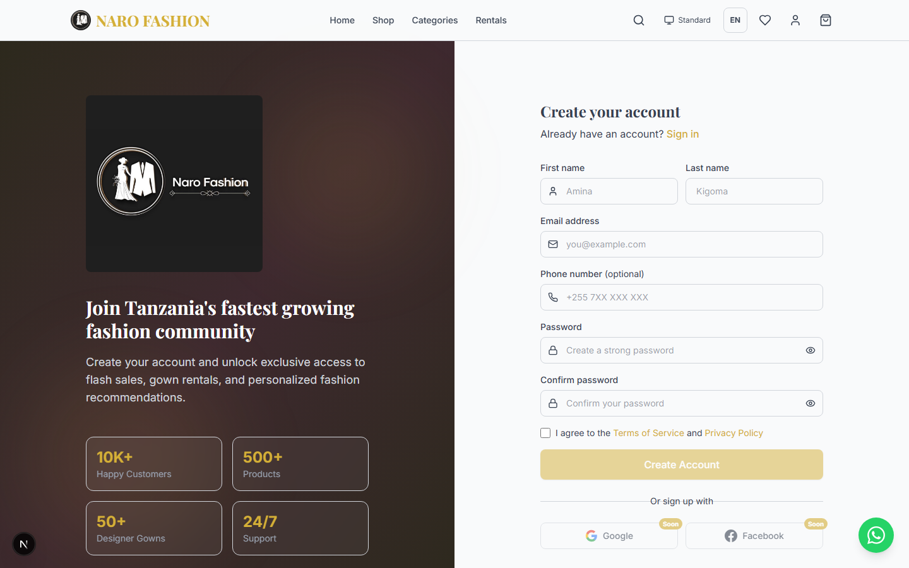
*Figure 1: The customer registration form. Fill in all required fields to create your account.*

4. **Fill in your details:**
   - **First name** -- Your given name (required)
   - **Last name** -- Your family name (required)
   - **Email address** -- Must be a valid email format (e.g., `jane@example.com`). Your email is unique per store. (required)
   - **Phone number** -- Your Tanzanian mobile number (e.g., `+255 7XX XXX XXX`) (optional)
   - **Password** -- **8 to 128 characters, with at least one letter and one number** (required). A strength meter shows Weak / Medium / Strong as you type.
   - **Confirm password** -- Must match the password above (required)
   - **Tick "I agree to the Terms of Service and Privacy Policy"** (required)
5. **Click "Create Account" / "Tengeneza Akaunti"** to submit.
6. **Account activation** is immediate -- you will be logged in and redirected to the homepage.

> **Tip:** Keep your email address accurate. It is used for order confirmations, rental updates, and password recovery -- and it **cannot be changed later** from your account settings.

> **Note for shop staff:** The storefront login is for **customers only**. Staff/admin login details do not work on the storefront. If you work at the shop and also want to buy, create a normal customer account (you may use the same email address).

### Logging In

If you already have an account:

1. **Navigate to the store URL** (e.g., `narofashion.co.tz`).
2. **Click the user icon** in the header (top-right corner).
3. You will be taken to the **login page** at `/auth/login`.

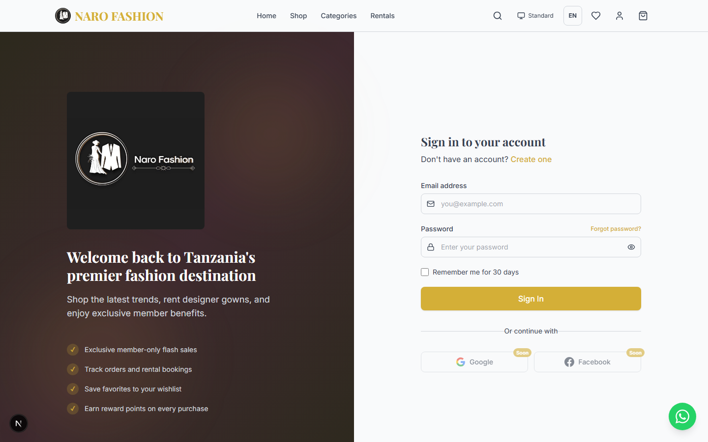
*Figure 2: The customer login page. Enter your email and password to access your account.*

4. **Enter your email address** in the email field.
5. **Enter your password** in the password field.
6. **"Remember me for 30 days" / "Nikumbuke kwa siku 30"** (optional):
   - **Ticked** -- you stay signed in on this device even after closing the browser (until the store's sign-in period ends). Use this only on your own phone or computer.
   - **Not ticked** -- you are signed out automatically when you close the browser. Use this on shared or public devices.
7. **Click "Sign In" / "Ingia"** to log in.
8. You will be redirected to the homepage with your account active. The user icon in the header will now show your initials (e.g., "JD" for Jane Doe).

If you see **"Invalid email or password. Please try again."**, check your details. Remember that staff/admin login details do not work on the storefront.

**Troubleshooting -- Forgot Password:**

1. On the login page, click **"Forgot password?" / "Umesahau neno la siri?"**.
2. Enter the **email address** associated with your account.
3. Click **"Send Reset Link" / "Tuma Kiungo cha Kuweka Upya"**.
4. Check your email inbox for a password reset link.
5. Click the link and enter your **new password** twice to confirm (8-128 characters, with a letter and a number).
6. Click **"Go to Sign In"** and sign in with your new password.

> **Security:** Changing or resetting your password signs you out on your other devices.

> **Note:** If you do not receive the reset email within a few minutes, check your spam or junk folder.

### Language Selection

The Naro Fashion storefront supports two languages:

- **English (EN)** -- Default language
- **Kiswahili (SW)** -- Swahili translation

**To switch languages:**

1. Look for the **language button** in the header. It displays either "EN" or "SW" depending on your current language.
2. **Click the button** to toggle between English and Swahili.
3. The entire interface updates **immediately** -- all navigation labels, buttons, product descriptions, and page content will switch to the selected language.

On mobile devices, the language switcher is available in the mobile menu (tap the hamburger icon to open it).

> **Kumbuka (Remember):** Baadhi ya maelezo ya bidhaa yanaweza kuonyeshwa kwa Kiingereza tu ikiwa duka halijatoa tafsiri ya Kiswahili. (Some product descriptions may remain in English if the store has not provided a Swahili translation.)

### Theme Switching

The storefront offers four theme choices:

| Theme | Description |
|-------|-------------|
| **Auto** (called **Device** / **Kifaa** in Account Settings) | Follows your phone's or computer's own light/dark setting, and changes with it automatically (for example, when your phone switches to dark mode at night). |
| **Light** | White background with dark text. Clean and bright. |
| **Dark** | Dark background with light text. Easy on the eyes at night. |
| **Standard** | Brand-specific styling with the store's signature colors (gold and black accents). |

**To switch themes:**

1. Look for the **theme toggle button** in the header. On larger screens it also shows the current theme name (e.g., "Auto"). Hover over it to see the current theme and the next one.
2. **Click the button** to cycle through the themes: **Auto → Light → Dark → Standard** and back to Auto.
3. The page updates **immediately** with the new color scheme.
4. Your choice is **saved on this device** and will persist when you return to the site.

You can also choose the theme in **Account > Settings > Theme Preference** (Device, Light, Dark, Standard).

> **Tip:** Until you pick a theme yourself, the store uses the default theme chosen by the shop (usually **Device**, so it matches your phone or computer).

---

## 1.2 Browsing Products

### Homepage Overview

The homepage is your gateway to the store. It presents a curated overview of everything the store has to offer, organized into distinct sections that you can scroll through. (The homepage was redesigned after the March 2026 screenshots were taken, so it is described here in text.)

**Section-by-section breakdown:**

1. **Hero Section** -- A large showcase at the top with the store's headline (for example, "Elevate Your Style, Define Your Story"), **"Shop Now"** and **"Rent a Gown"** buttons, and rotating featured photos shown as a portrait card over a soft blurred background. Live counters (Products, Gowns for Rent, Happy Customers) appear only when the store has real numbers to show.

2. **Shop by Category** -- Up to four featured categories displayed as tall image cards, showing the category name and how many items it contains (including its sub-categories). Click a card to explore.

3. **New Arrivals** -- The latest products added to the store. Each card shows the product image, name, price, and star rating. Click **"View All New Arrivals"** to see more.

4. **Rent a Gown** -- A section showcasing designer gowns available for rental, with feature "pills" set by the store (e.g., "Designer gowns", "Cleaning included", "25% down payment") and a button to browse all gowns.

5. **Real Weddings** -- A gallery of customer events and weddings featuring the store's fashion. Each card shows the event cover photo, title, date, and location. Click **"View All Real Weddings"** to see them all.

6. **Flash Sales** -- Only displayed when an active flash sale is running. Shows a countdown timer and the discounted products, with original prices crossed out.

7. **Instagram Feed** -- The store's latest Instagram posts, in one row or several rows depending on the store's settings. Click a post to open it on Instagram.

8. **Footer** -- The newsletter sign-up ("Stay in Style"), links to shop pages, categories, help pages, the store's contact details and social links, and the accepted payment methods.

Some stores also turn on **scrolling background effects** (parallax) behind the homepage sections. These are switched off automatically on small phone screens and for visitors whose device is set to reduce motion.

A floating **WhatsApp** button is available on every page for quick contact with the store.

> **Note:** Some sections (Rentals, Flash Sales, Real Weddings, Instagram Feed) only appear when the store has active content in those areas. If you do not see a section, it means the store has not configured it yet.

### Shop Page

The shop page (`/shop` or `/products`) displays the store's complete product catalog with powerful filtering and sorting options.

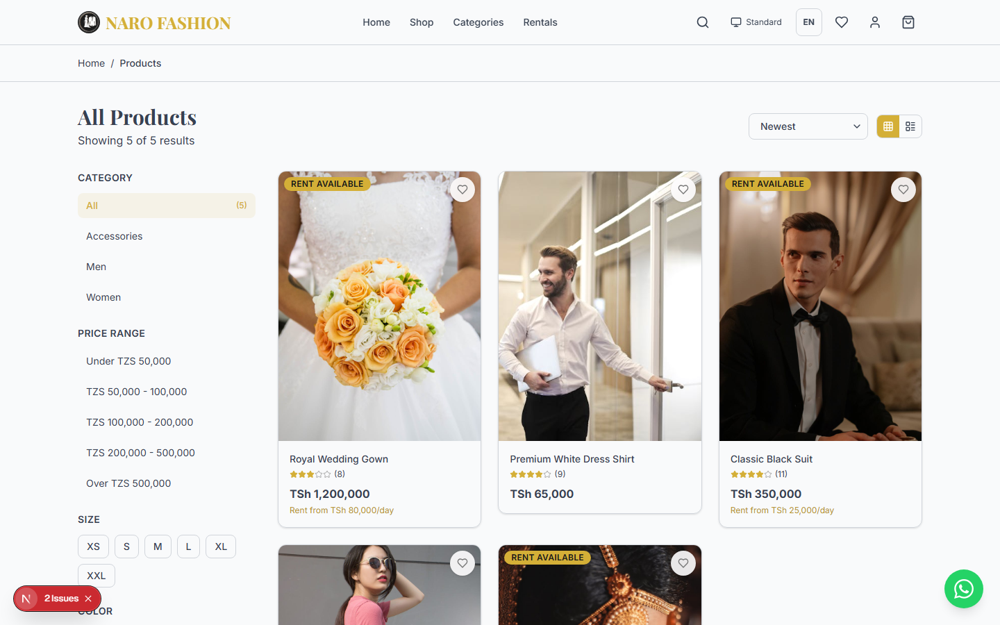
*Figure 3: The shop page showing the product grid with filtering and sorting options. Products display their image, name, price, and rating.*

**Product Grid:**
- Products are displayed in a responsive grid (2 columns on mobile, 3 on tablet, 4 on desktop).
- Each product card shows: thumbnail image, product name, price (in TZS), star rating, and review count.
- Products on sale show the original price crossed out with the sale price highlighted.
- Rental-eligible products display a "Rent" badge and the rental price (a flat price per rental).
- New arrivals display a "New" badge.

**Filtering:**
- **Category** -- Select a specific category from the dropdown to narrow results.
- **Size** -- Filter by available sizes (e.g., S, M, L, XL, XXL).
- **Color** -- Filter by color options.
- **Price Range** -- Set a minimum and maximum price to filter within your budget.

**Sorting:**
- **Newest** -- Most recently added products first.
- **Price: Low to High** -- Cheapest products first.
- **Price: High to Low** -- Most expensive products first.
- **Popular** -- Products with the most sales and highest ratings.

**Search:**
- Use the search bar in the header. Type your query and press Enter.
- You will be redirected to `/products?search=your+query` with matching results.
- Search matches product names, descriptions, and tags.

**Pagination:**
- Products are loaded in pages. Use the pagination controls at the bottom to navigate between pages.

### Category Pages

You can browse products organized by category:

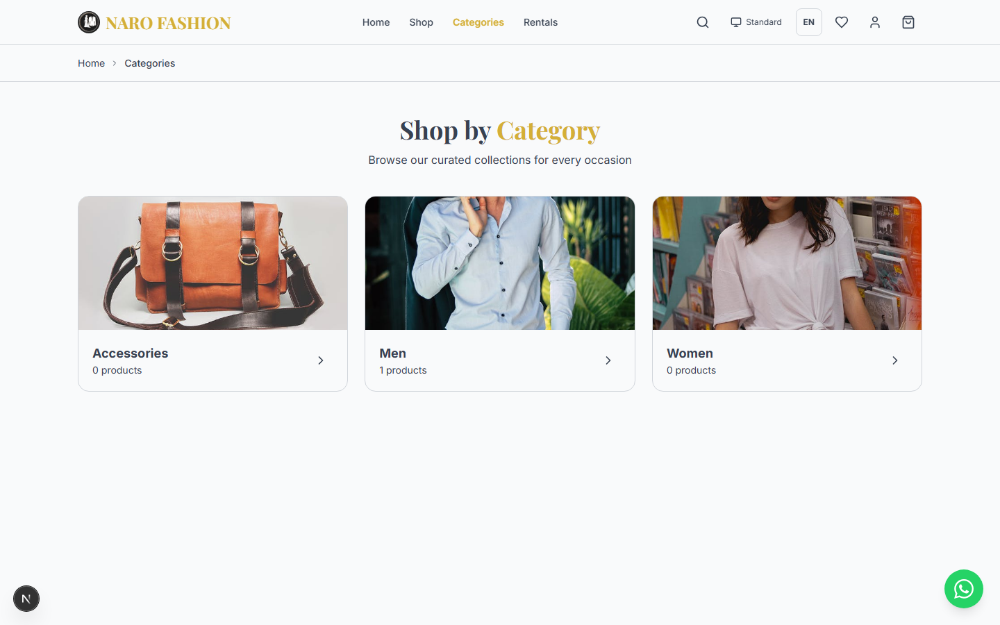
*Figure 4: The categories page displaying all available product categories as image cards in a grid layout.*

1. **Click "Categories" / "Makundi"** in the navigation header.
2. The **categories page** (`/categories`) displays all available categories as image cards in a grid.
3. **Click on a category** to view all products in that category.
4. The category detail page (`/categories/[slug]`) shows the category name, description, and a filtered product grid.
5. Subcategories (if available) appear as additional filter chips at the top.

### Product Detail Page

Click on any product card to view its full details. The product detail page (`/products/[slug]`) provides comprehensive information.

**Key features on the product detail page:**

1. **Image Gallery** -- Swipe or click arrows to browse through product photos. Thumbnails are shown below the main image for quick navigation.

2. **3D Viewer** (if available) -- Some products have a 3D model. You will see two tabs above the image: **"Photos"** and **"3D"**.
   - Click **"3D"** to switch to an interactive 3D view.
   - **Drag** to rotate the model in any direction.
   - **Pinch or scroll** to zoom in and out.
   - On **mobile phones**, tap the **AR button** to place the item in your real-world environment using augmented reality.
   - Click **"Photos"** to switch back to the standard image gallery.

3. **Price Display** -- Shows the current price in TZS. If on sale, the original price appears crossed out with the discount percentage shown. For rental-eligible items, both the purchase price and the rental price (flat, per rental) are displayed.

4. **Size and Color Selection** -- Select your desired size and color variant. Available options appear as clickable buttons. Unavailable sizes or colors are grayed out.

5. **Size Guide** -- If the product (or its category) has a size guide, a **"Size Guide"** tab shows the measurement tables (e.g., bust, waist, hip and length for each size). Some stores also offer a **"Download Size Guide (PDF)"** button.

6. **Add to Cart** -- Adds the selected variant (size + color) and quantity to your shopping cart.

7. **Add to Wishlist** -- Saves the product to your wishlist for later. Requires being logged in.

8. **Customer Reviews** -- Read reviews from other customers with star ratings. To write one, sign in and use the **"Write a Review"** form (Rating, optional Title, Review) and click **"Submit Review"**. Reviews appear after the store approves them. You can review each product once; if you bought the product, your review is marked as verified.

9. **Related Products** -- A row of similar products you might also like, based on the same category.

---

## 1.3 Shopping

### Adding Items to Cart

To add a product to your shopping cart:

1. **Navigate to the product detail page** by clicking on any product card.
2. **Select a size** by clicking the appropriate size button (e.g., S, M, L, XL).
3. **Select a color** by clicking the color swatch (if multiple colors are available).
4. **Adjust the quantity** using the minus (-) and plus (+) buttons. The default quantity is 1.
5. **Click "Add to Cart"** / "Ongeza Kwenye Kikapu".
6. The **cart icon** in the header will update to show the total number of items in your cart (displayed as a gold badge with a number).

> **Tip:** You must be signed in to add items to your cart or wishlist, and you must select a size before adding to cart.

### Managing Your Cart

Access your cart by clicking the **shopping bag icon** in the header, or navigate directly to `/cart`.

**Cart page features:**

- **Item List** -- Each item shows a thumbnail image, product name, selected size/color, unit price, and quantity.
- **Update Quantity** -- Use the (+) and (-) buttons to increase or decrease the quantity of each item.
- **Remove Items** -- Click the trash/remove icon next to an item to remove it from your cart.
- **Promo Code Field** -- Enter a promotional code and click "Apply" to receive a discount (see [Promo Codes](#promo-codes) below).
- **Order Summary:**
  - **Subtotal** -- The total before delivery and discounts.
  - **Discount** -- The amount saved from promo codes (if applied).
  - **Delivery** -- Shown as "From TZS 5,000 -- chosen at checkout". You choose the delivery method (and therefore the fee) during checkout.
  - **Estimated total (excl. delivery)** -- The cart total before the delivery fee.
- **Proceed to Checkout** -- Click to begin the checkout process.
- **Continue Shopping** -- Returns you to the shop page.

### Wishlist

The wishlist lets you save products you are interested in for later:

1. **Adding to Wishlist** -- On any product card or product detail page, click the **heart icon**. The heart fills in to indicate the item has been saved. You must be logged in.
2. **Viewing Your Wishlist** -- Click the heart icon in the header, or go to **Account > Wishlist** (`/account/wishlist`).
3. **Moving to Cart** -- From your wishlist, click "Add to Cart" on any item to move it to your shopping cart.
4. **Removing from Wishlist** -- Click the filled heart icon again to remove the item.

> **Note:** Wishlisted items are **not reserved**. Stock availability may change before you decide to purchase.

### Flash Sales

Flash sales are time-limited promotional events with special discounted prices.

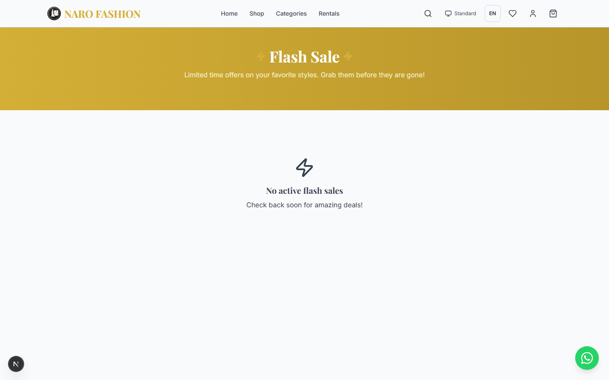
*Figure 5: The flash sales page showing discounted products with a countdown timer indicating when the sale ends.*

**How to find flash sales:**
1. **Homepage** -- Active flash sales appear in a dedicated section with a live countdown timer.
2. **Navigation** -- Click "Flash Sales" in the header (only visible when a sale is active).
3. **Flash Sales Page** (`/flash-sales`) -- View all products included in the current sale.

**How flash sales work:**
- Products in a flash sale display both the **original price** (crossed out) and the **sale price**.
- A **countdown timer** shows how much time remains (Days : Hours : Minutes : Seconds).
- When the timer reaches zero, the sale ends and prices return to normal.
- Flash sale products have limited availability -- once they sell out, they are removed from the sale.

---

## 1.4 Checkout and Payments

### Multi-Step Checkout

The checkout process is divided into four clear steps. A progress bar at the top shows which step you are on.

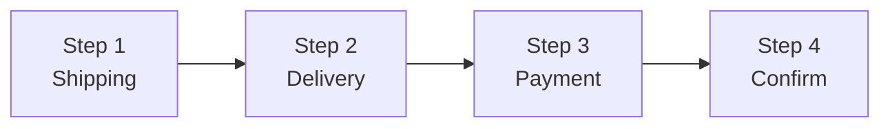

**Step 1: Shipping Address**

Fill in your delivery address:
- **Full Name** -- The name of the person receiving the order.
- **Phone Number** -- A phone number for delivery coordination.
- **Street Address** -- Your full street address.
- **City** -- Your city or town.
- **Region** -- Select your region from the dropdown (e.g., Dar es Salaam, Arusha, Dodoma, Mwanza, etc.).

If you have saved addresses in your account, you can select one from the dropdown instead of typing a new address each time.

Click **"Continue"** to proceed to the next step.

**Step 2: Delivery Method**

Choose how you want to receive your order:

| Method | Delivery Time | Cost (default) |
|--------|--------------|------|
| **Standard Delivery** | 5-7 business days | TZS 5,000 |
| **Express Delivery** | 1-2 business days | TZS 15,000 |
| **Pickup Point** | Ready in 24 hours | Free |

Select your preferred method and click **"Continue"**.

> **Note:** The delivery fee is set by the store and is calculated by the system when your order is placed. The amounts above are the defaults; your store may charge different fees.

**Step 3: Payment Method**

Select how you want to pay:

| Method | Description |
|--------|-------------|
| **Mobile Money** | Pay via M-Pesa, Tigo Pesa, or Airtel Money |
| **Card Payment** | Pay with Visa or Mastercard |
| **Bank Transfer** | Direct bank transfer to store account |
| **Cash on Delivery** | Pay cash when your order arrives |

For **Mobile Money**, enter your **Mobile Money Number** (the phone number registered with your mobile money account). You will receive a USSD prompt on that phone after placing the order.

For **Card Payment**, you will be redirected to a secure payment page after placing the order.

Click **"Continue"** to proceed.

**Step 4: Order Review and Confirm**

Review your complete order before placing it:
- All items with quantities and prices
- Shipping address
- Delivery method and cost
- Payment method
- **Promo code** -- If you applied a code in the cart it is carried over; you can also enter or remove a code here.
- **Total amount** (items + delivery - discounts). Before the order is placed this is labelled an **estimate**; the final amount is confirmed by the store when you place the order (the system applies the delivery fee, promo code and any flash-sale prices itself).

Click **"Place Order"** to finalize your purchase.

**Paying with mobile money:**
1. After you place the order, a screen shows **"Check Your Phone"** with the amount and your phone number.
2. A USSD prompt arrives on your phone. Enter your mobile money **PIN** to confirm.
3. The page shows **"Waiting for Payment"** and checks the status automatically.
4. When the payment is received you see **"Payment Successful!"** and are taken to your order.
5. If the payment fails you see **"Payment Failed"** -- click **"Try Again"** or choose another payment method. If the payment times out but you did pay, it may still be processing -- check the order status in your account.

> **Security:** Never share your mobile money PIN with anyone. The store will never ask for your PIN.

After placing an order you are taken to the order page, which shows **"Order placed successfully!"**, the items, the totals (subtotal, delivery, total) and the payment method.

**Important rules for orders:**
- **Unpaid online orders expire.** If you choose an online payment method (mobile money, card) and do not complete the payment, the order is cancelled automatically after a while (24 hours by default) so the items are released.
- **Cash on Delivery limit.** You can only have a limited number of open Cash on Delivery orders at a time (3 by default). If you reach the limit you will see a message asking you to complete or cancel one before placing another.
- **Cancelling an order.** There is no cancel button on the storefront. Contact the store to cancel an order. Orders that have **already been paid** can only be cancelled by the store, which then arranges your refund.

### Payment Methods

The following payment methods are supported (availability depends on what the store has enabled):

| Method | How It Works |
|--------|-------------|
| **Mobile Money** (M-Pesa, Mixx by YAS / Tigo Pesa, Airtel Money) | Choose "Mobile Money" and enter your phone number. A USSD prompt is sent to your phone. Enter your PIN to confirm. The store decides which payment provider processes the request -- you do not need to choose. |
| **Card Payment** (Visa / Mastercard) | You are redirected to a secure payment page to enter your card details. |
| **Bank Transfer** | Transfer the amount directly to the store's bank account. The store confirms the payment once it is received. |
| **Cash on Delivery (COD)** | No upfront payment required. Pay in cash when your order arrives. A limit applies to how many open COD orders you can have. |

> **Important:** For mobile money payments, make sure your phone has sufficient balance before initiating the payment. The payment prompt expires after a few minutes.

### Promo Codes

Promotional codes (also called coupon codes or discount codes) can save you money on your order.

**How to use a promo code:**

1. **Go to your Cart** (`/cart`).
2. **Find the promo code field** in the order summary.
3. **Type or paste your promo code** (capital or small letters both work).
4. **Click "Apply"** to validate the code.
5. If valid, the discount amount appears in the order summary and the total is reduced. If not, you see a message explaining why (for example, "Invalid or expired promo code" or the minimum order amount required).
6. The code is carried over to checkout, where it is checked again. You can also enter or remove a code on the checkout page. The final discount is confirmed by the store when you place the order.

**Promo code types:**
- **Percentage discount** -- e.g., 20% off the subtotal.
- **Fixed amount discount** -- e.g., TZS 10,000 off.

**Restrictions:**
- Some codes have a **minimum order amount** (e.g., "Spend at least TZS 50,000").
- Some codes have a **maximum number of total uses** across all customers.
- Some codes can only be used **once per customer**.
- Codes have **start and end dates** -- expired codes will not work.

---

## 1.5 Renting Fashion Items

### Understanding Rentals

Some products on the store are available for rental in addition to (or instead of) purchase. This is especially common for designer gowns, formal wear, and wedding attire.

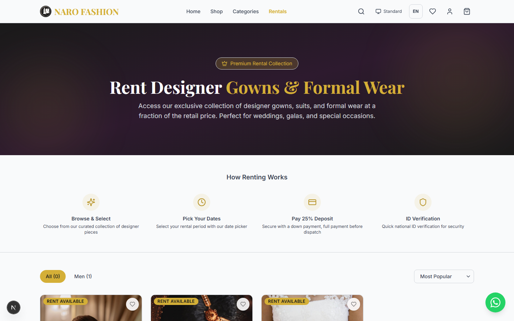
*Figure 6: The rentals browse page showing designer gowns available for rental with their rental prices and availability information.*

Each product has an **availability mode**:

| Mode | Description |
|------|-------------|
| **Purchase Only** | Can only be bought. Standard shopping. |
| **Rental Only** | Can only be rented. Not available for purchase. |
| **Both** | Can be either purchased or rented. Price for both options is displayed. |

On product cards and detail pages:
- Products available for rental display a **"Rent"** badge.
- The **rental price** is shown alongside the purchase price, e.g. "TZS 35,000 / rental". It is a **flat price for the whole rental** -- up to the item's maximum rental days (7 by default) -- not a daily rate.
- Rental products are also featured on the dedicated **Rentals** page (`/rentals`).

### ID Verification

Before a rental can be confirmed you must complete **identity verification**. This is a one-time process.

**Steps to verify your ID:**

1. **Log in** to your account.
2. **Navigate to Account > ID Verification** (`/account/id-verification`). The page title is "ID Verification".
3. Under **"Upload Your ID"**, upload:
   - **Front Side of ID** (required)
   - **Back Side of ID** (required)
   - Accepted documents: **National ID (NIDA), Passport, or Driver's License**.
   - Accepted files: **JPG, PNG, WebP or PDF, up to 8MB each**. Make sure the photo is clear, well-lit and all text is readable.
4. **Click "Submit for Verification"**.
5. Your status changes to **"Pending Review" / "Under Review"**. The store's team reviews it, usually within **1-2 business days**.

**Verification statuses:**

| Status | Meaning |
|--------|---------|
| **Not Verified** | You have not uploaded an ID yet. |
| **Pending Review** | Your ID has been submitted and is awaiting review by the store. |
| **Verified** | Your ID has been approved ("You're All Set!"). You can now rent items. |
| **Rejected** | Your ID was rejected. The store gives a reason (e.g., "photo is blurry"). Upload clearer images and submit again. |

> **Privacy:** Your ID documents are stored privately. They are never shown on the website and only authorised store staff can view them.

> **Note:** ID verification is required to protect both you and the store. It is a one-time process -- once verified, later rentals skip this step.

### Booking a Rental

**Before you book**, make sure you are **logged in** and your profile is complete: **full name, phone number, email, and at least one address** (Account > Settings and Account > Addresses). The store needs these to arrange pickup and contact you. If anything is missing, the booking button tells you exactly what to add.

1. **Browse rental items** on the Rentals page (`/rentals`). You can filter by type (e.g., Ball Gowns, Mermaid, A-Line, Wedding Gowns, Suits & Tuxedos) and sort by rental price.
2. **Click on a rental item** to view its detail page (`/rentals/[slug]`).
3. **Select Size** (or variant).
4. **Select Rental Period:**
   - **Pickup Date** -- The day you collect the item.
   - **Return Date** -- The day you bring it back. It must be **at least one day after** the pickup date.
   - The page checks availability as you choose and shows **"Available for selected dates"** or **"Not available for selected dates. Please choose different dates."**
   - A note shows the store's **buffer days** between rentals (default 7) and the **maximum number of rental days**. For example, with a 7-day buffer, if another customer has the item until the 15th, the earliest you can book is the 22nd.
   - If your dates go past the maximum rental days, the page warns that a **late fee** will be added for each extra day.
5. **Review the Price Breakdown:**
   - Rental fee -- the **flat rental price**, covering up to the maximum rental days
   - Security deposit (refundable)
   - Total
   - **Down payment** (25% by default -- pay now)
   - **Remaining** (pay before dispatch)
6. Click **"Book Now"**. If you are not logged in you are taken to the login page first and brought back afterwards. Once booked, you are taken to **Account > My Rentals**, where the booking appears with its status (**Pending ID Verification** until your ID is approved).
7. **Pay the down payment** to secure the booking, and the remaining balance before the item is dispatched. Arrange payment with the store as instructed (the store records the payments; the remaining balance must be paid before dispatch).

> **If booking fails**, the message on screen explains why -- for example a missing phone number or address, dates that were just taken by someone else, or a rental longer than the store allows. Fix the issue and try again.

> **Important -- unpaid bookings expire:** A booking that has not been paid is only held for a limited time (**48 hours by default**). After that it is cancelled automatically and the dates are released for other customers.

### Rental Status Flow

After booking, your rental will progress through the following stages:

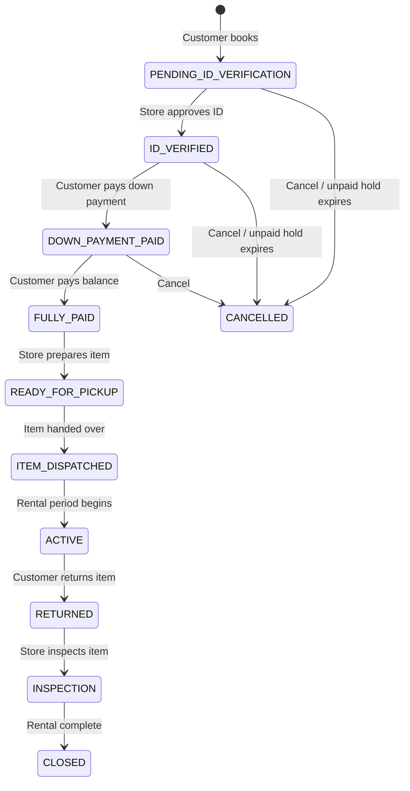

Statuses only move **forward** -- a rental never goes back to an earlier stage. A rental can only be cancelled **before the item is dispatched**.

**What each status means for you:**

| Status | What Is Happening | What You Need To Do |
|--------|-------------------|---------------------|
| **Pending ID Verification** | Waiting for your ID to be reviewed | Upload your ID if you have not, then wait for approval |
| **ID Verified** | Your ID is approved | Pay the down payment |
| **Down Payment Paid** | Your down payment is received | Pay the remaining balance before dispatch |
| **Fully Paid** | All payments received | Wait for the store to prepare your item |
| **Ready for Pickup** | Your item is prepared | Pick up from the store or wait for delivery |
| **Item Dispatched** | Item has been handed to you | Enjoy your rental |
| **Active** | Rental period is ongoing | Return the item by the return date |
| **Returned** | Item has been returned to the store | Wait for inspection |
| **Inspection** | Store is checking the item | Wait for completion |
| **Closed** | Rental is complete | Deposit refund processed (if no damage) |
| **Cancelled** | Rental was cancelled (by you via the store, by the store, or automatically because it was not paid in time) | Refund of any payment is handled per store policy |

If you keep an item past the return date, the store sees it as **overdue** and late fees apply.

### Late Fees and Deposits

- **Late Return Fee:** If you return the item after the agreed return date, a **late fee per day** (as set by the store in its rental policies) is charged for each full day late (counted in Tanzania time).
- **Damage Deductions:** If the item is returned damaged, the repair or replacement cost will be deducted from your security deposit.
- **Deposit Refund:** After a successful inspection with no damage, your security deposit is refunded to you.

> **Tip:** Return rental items on time and in the same condition you received them to get your full deposit back. Communicate with the store if you anticipate any delays.

---

## 1.6 Your Account

Your account dashboard (`/account`) provides a central hub for managing all your activities on the store. Access it by clicking your initials in the header and selecting "Account" / "Akaunti".

**Account sections:**

| Section | Path | What You Can Do |
|---------|------|-----------------|
| **Account Dashboard** | `/account` | Overview of your orders, rentals, and wishlist stats |
| **My Orders** | `/account/orders` | View all your orders, track status, see order details |
| **My Rentals** | `/account/rentals` | View active and past rentals, track rental status |
| **Wishlist** | `/account/wishlist` | View saved items, move to cart, remove items |
| **Saved Addresses** | `/account/addresses` | Add, edit, or delete shipping addresses for faster checkout |
| **ID Verification** | `/account/id-verification` | Upload National ID, check verification status |
| **Settings** | `/account/settings` | Update your name and phone, change your password, choose your theme and language, and download a copy of your data |

**Order History details:**
- View order number, date, items, total amount, and current status.
- Track the progress of each order (Pending, Confirmed, Processing, Shipped, Delivered).
- View full order details including items, quantities, prices, and shipping information.
- Orders are listed newest first, with the most recent order at the top.

**Rental History details:**
- View all active and completed rentals.
- See rental dates, item details, payment breakdown, and current status.
- Track the rental through each stage from booking to closure.
- Active rentals appear at the top with a highlighted status badge.

**Saved Addresses:**
- Save multiple shipping addresses for quick checkout.
- Each address includes: name, phone, street, city, and region.
- Set a default address for one-click checkout.
- Edit or delete addresses at any time.

**Account Settings** (`/account/settings`, "Mipangilio"):
- **Profile Information** -- Update your full name and phone number, then click **"Save Changes"**. Your email address is shown but **cannot be changed**.
- **Change Password** -- Enter your **Current Password**, then the **New password** twice (8-128 characters, with a letter and a number), and click **"Update Password"**. Your other devices are signed out.
- **Theme Preference** -- Choose **Device** (follows your phone/computer), **Light**, **Dark**, or **Standard**.
- **Language** -- Choose **English** or **Kiswahili**.
- **Your data** -- Click **"Download my data" / "Pakua taarifa zangu"** to download a copy of the personal data the store holds about you (profile, addresses, orders, rentals, reviews and wishlist) as a file.

**Closing your account:** There is no button to delete or deactivate your own account. If you want your account closed, **contact the store** (Contact page or WhatsApp). Only the store's staff can suspend a customer account.

> **Note:** The user menu dropdown in the header also provides quick access to: Account Dashboard, My Orders, My Rentals, My Wishlist, and Settings. Use these shortcuts for faster navigation.

---

## 1.7 Other Features

### Newsletter Subscription

Stay up to date with the latest fashion arrivals, deals, and promotions:

1. **Scroll to the footer** at the bottom of any page and find the **"Stay in Style"** newsletter strip.
2. **Enter your email address** in the subscription field.
3. **Click "Subscribe"**.
4. You will start receiving newsletters about new arrivals, deals, style tips, and exclusive offers.

**Types of newsletters you may receive:**
- **New Arrivals** -- Showcasing the latest products added to the store, with images and prices.
- **New Deals** -- Current promotions, flash sales, and special offers.
- **Fashion Tips** -- Fashion advice and styling guides.
- **Custom** -- Special announcements, event invitations, or seasonal messages from the store.

**Unsubscribing:**
- Every newsletter email includes an **"Unsubscribe"** link at the bottom.
- Click it to be taken to the unsubscribe page where you can confirm your removal.
- Unsubscription is processed immediately. You will no longer receive newsletters from that store.
- If you change your mind, you can re-subscribe from the storefront at any time.

### Contact and Information Pages

The store provides several informational pages, linked from the footer (a link only appears when the store has published that page):

| Page | URL | Description |
|------|-----|-------------|
| **About** | `/pages/about` | Learn about the business, its story, and mission. |
| **Contact Us** | `/pages/contact` | Contact details, business hours, a contact form, and (if the store has set its location) a map. |
| **FAQ** | `/pages/faq` | Frequently asked questions and detailed answers. |
| **Terms of Service** | `/pages/terms` | Legal terms of service governing your use of the store. |
| **Privacy Policy** | `/pages/privacy` or `/pages/privacy-policy` | How your personal data is collected, used, stored, and protected. |
| **Size Guide** | `/pages/size-guide` | Sizing information and measurement tables. |
| **Shipping Info** | `/pages/shipping-info` | Delivery areas, times, and costs. |
| **Returns & Exchanges** | `/pages/returns-exchanges` | Return policy, exchange procedures, and refund timeline. |

Pages are shown in English or Swahili, depending on your selected language (where the store has provided a translation). Measurement charts on the Size Guide page and on product pages are shown as proper tables.

**Submitting a Contact Form Inquiry:**
1. Open **Contact Us** from the footer.
2. Fill in **Full Name**, **Email**, **Phone** (optional), choose a **Subject** (e.g., General Inquiry, Order Inquiry, Rental Question, Returns & Exchange, Size Help), and type your **Message**.
3. Click **"Send Message" / "Tuma Ujumbe"**. You will see **"Message Sent!"**.
4. The store's team receives your inquiry and replies to your email address. You can also click **"WhatsApp Instead"** to send the message through WhatsApp.

If the store has set its location, a **"Find Us"** map is shown on the Contact page.

> **Tip:** For urgent matters, use the floating **WhatsApp** button available on every page.

### Customer Events (Real Weddings)

Share your special moments with the community:

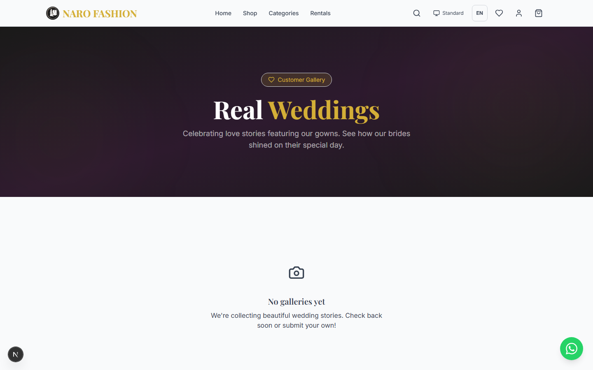
*Figure 7: The customer events page showcasing real weddings and events featuring fashion from the store.*

1. **Navigate to the Real Weddings page** (`/events`), via **"Real Weddings"** in the header.
2. **View approved events** -- Browse galleries of real weddings and events featuring the store's fashion. Click **"Load More Stories"** to see more.
3. **Submit your own event** (you must be signed in):
   1. Click **"Submit Your Gallery"** in the "Share Your Story" box (or go to `/events/submit`).
   2. Fill in **Title**, **Description**, **Event Date**, **Location**, optional social links (Instagram, Facebook, TikTok) and the product you wore (**Product Name or ID**).
   3. Add your photos as **links** (web addresses starting with `https://`) using **"Add URL"** -- photos are linked, not uploaded.
   4. Click **"Submit Gallery"**. You will see **"Gallery Submitted!"**.
   5. The store reviews your submission before it is published. Revisit the page to see its status (Pending Review, Approved, or Rejected with a reason). Each customer can make one submission.

---

# PART 2: TENANT ADMIN GUIDE

This section covers everything a store administrator needs to know about managing their fashion business through the Naro Fashion admin dashboard. Whether you are a Super Admin, Manager, or Staff member, this guide covers all the tools available to you.

---

## 2.1 Getting Started

### Logging In

To access the admin dashboard, follow these steps:

1. **Navigate to the admin URL** -- For the default installation this is `admin.narofashion.co.tz`. For your specific store, it may be `admin.yourdomain.com`.
2. You will see the **admin login page** (`/login`) -- "Welcome back / Sign in to your admin account".

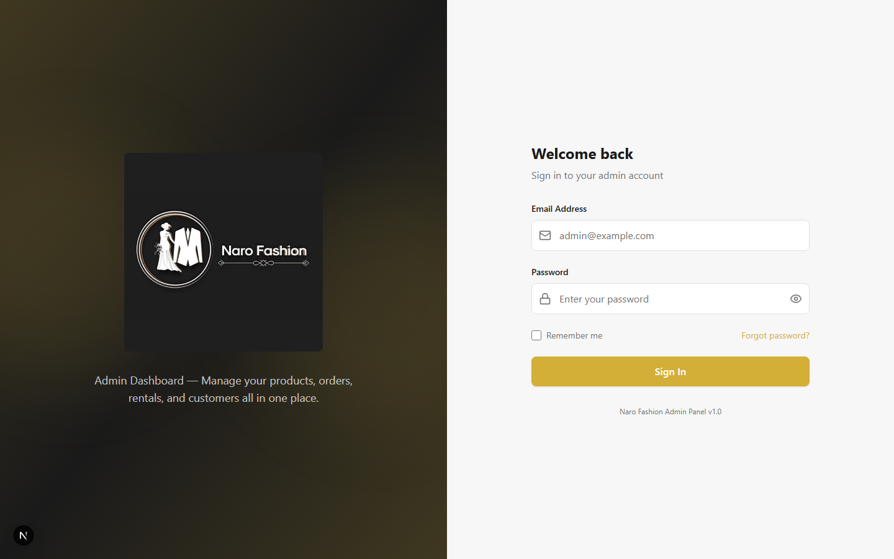
*Figure 8: The admin login page featuring the elegant dark and gold Naro Fashion branding. Enter your credentials here to access the dashboard.*

3. **Enter your Email Address** and **Password** -- use the credentials provided by your administrator (or by the platform team, for a new store's first account).
4. **Remember me** (optional):
   - **Ticked** -- you stay signed in after closing the browser. Tick this only on a device used by you alone (it is also needed for working offline after the browser is closed -- see [2.17 Working Offline](#217-working-offline)).
   - **Not ticked** (default) -- you are signed out when the browser is closed.
5. **Click "Sign In"**.
6. **If two-factor authentication is on for your account**, a second screen appears: **"Two-factor authentication -- Enter the 6-digit code from your authenticator app, or use a recovery code."**
   - Open your authenticator app (e.g., Google Authenticator, Microsoft Authenticator) and type the current **6-digit code** in **"Authentication code"**.
   - Lost your phone? Click **"Use a recovery code"** and type one of your saved recovery codes (format `ABCDE-FGH23`). Each recovery code works only once.
   - Click **"Verify and sign in"**. This step expires after 5 minutes -- click **"Back"** and sign in again if it does.
7. After successful sign-in, you will be redirected to the main dashboard.

> **Important Security Notes:**
> - If you were given a temporary password, change it right after your first login (Settings > Admin Settings > Change Password).
> - Passwords must be **8-128 characters and include at least one letter and one number**.
> - After **5 failed attempts** (wrong password or wrong 2FA code), your account is **locked for 30 minutes**. For security, the message is always the same: **"Invalid credentials or account temporarily locked"**. Wait for the lock to expire, or ask a Super Admin to unlock you from User Management > Admin Users.
> - We strongly recommend turning on **two-factor authentication** (see [2.14 Settings](#214-settings)).
> - The system records all login attempts for security monitoring.

**Forgot Password:**
1. Click **"Forgot password?"** on the login page.
2. Enter your **Email Address** and click **"Send Reset Link"**.
3. Check your email for the reset link (it expires after **30 minutes**).
4. Click the link, enter your **New Password** twice, and click **"Reset Password"**.
5. When you see **"Password Reset!"**, click **"Go to Login"** and sign in.

> **Note:** Changing or resetting your password signs you out of all your other sessions.

### Dashboard Overview

After logging in, you arrive at the main dashboard (`/dashboard`). This is your command center providing a real-time overview of your store's performance.

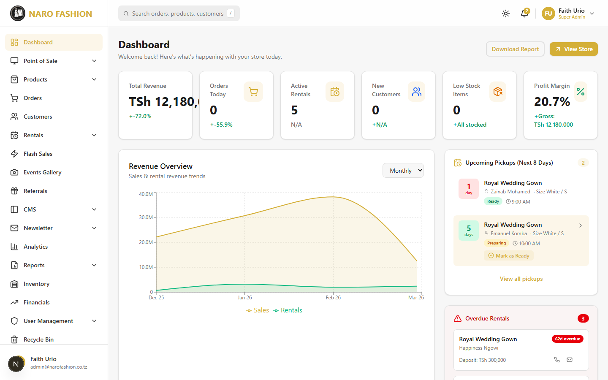
*Figure 9: The admin dashboard showing stats cards (Revenue, Orders, Active Rentals, Profit Margin), the Revenue Overview chart, upcoming pickups, and overdue rentals.*

*Figure 10: Full dashboard view with all widgets including top products chart, payment methods breakdown, inventory health, and recent orders table.*

**Dashboard cards (top row):**

1. **Total Revenue** -- Total sales revenue with percentage change compared to the previous period. Displayed as a large number with a green (up) or red (down) trend indicator.
2. **Orders Today** -- Number of orders received today with trend indicator.
3. **Active Rentals** -- Number of currently active rental bookings and how many are due for return.
4. **New Customers** -- New customer sign-ups with trend indicator.
5. **Low Stock Items** -- Count of products with low or zero stock (with out-of-stock count highlighted).
6. **Profit Margin** -- Current profit margin percentage with gross profit amount.

**Charts section:**
- **Revenue Overview** -- An area chart showing revenue trends. Toggle between Daily, Weekly, and Monthly views using the dropdown selector at the top of the chart.
- **Top Products** -- A horizontal bar chart showing your best-selling products by revenue.
- **Payment Methods** -- A donut chart showing revenue distribution by payment method (M-Pesa, Cash, Card, etc.).
- **Inventory Health** -- A bar chart showing stock status distribution (In Stock, Low Stock, Out of Stock).

**Rental widgets (right column):**
- **Upcoming Pickups (Next 8 Days)** -- Rentals due for pickup soon, badged Preparing, Ready or Urgent, showing customer name, item, and pickup date.
- **Overdue Rentals** -- Rentals that have not been returned on time, with days overdue, call/email buttons and the late fee in the detail view. Hidden when there are none.

**Recent Orders table:**
- Shows the latest orders with ID, customer name, item count, total, status, and date.
- Click "View All" to go to the full orders page.

**Quick actions:**
- **Download Report** -- Generates a text report of current dashboard stats.
- **View Store** -- Opens the storefront in a new browser tab so you can see what customers see.

### Sidebar Navigation

The sidebar on the left provides access to all admin features. It is organized into logical groups.

**Main Navigation:**
- **Dashboard** -- The overview page described above.
- **Point of Sale** (requires POS module)
  - Open POS -- Launch the point-of-sale interface
  - Sales History -- View completed POS transactions
- **Products**
  - All Products -- Product list and management (including CSV import)
  - Add Product -- Create a new product
  - Categories -- Manage product categories
  - Sizes -- Manage the list of sizes used by product variants
- **Orders** -- Order management, fulfillment and refunds
- **Customers** -- Customer list, suspend/reactivate
- **Rentals** (requires Rentals module)
  - Active Rentals -- Rental bookings by tab (Active, Requests, Overdue, Cancelled)
  - Rental Requests -- Pending requests and the **ID verification** review queue
  - Checklists -- Dispatch and return checklist templates
  - Policies -- Rental policies and terms
- **Flash Sales** (requires Flash Sales module) -- Create and manage flash sales
- **Events Gallery** (requires Events module) -- Customer event/wedding galleries
- **Referrals** (requires Referrals module) -- Referral program statistics

**Content and Communication:**
- **CMS** (Content Management)
  - Hero Slides -- Homepage hero images
  - Parallax Sections -- Scrolling background images behind homepage sections
  - Banners -- Promotional banners
  - Instagram Posts -- Instagram connection and feed management
  - Pages -- CMS pages (About, FAQ, Terms, etc.)
  - Size Guides -- Size guide creation and management
  - Contact Submissions -- Customer contact form messages and replies
  - Settings -- Storefront settings ("Site Settings": default theme, features, homepage text)
- **Newsletter**
  - Dashboard -- Newsletter statistics
  - Compose -- Create and send newsletters
  - Sent -- View sent newsletters
  - Subscribers -- Manage subscriber list

**Analytics and Finance:**
- **Analytics** (requires Analytics module)
  - Business -- Sales, rentals, inventory, customer and product analytics
  - Visitors -- Storefront visitor traffic (page views, countries, devices)
- **Reports** (requires Reports module)
  - Rental Reports -- Rental performance reports
- **Inventory** (requires Inventory module) -- Stock management
- **Financials** (requires Expenses module) -- Income statement, expenses and expense categories

**Administration:**
- **User Management**
  - Admin Users -- Create and manage admin accounts
  - Roles & Permissions -- RBAC role management
  - Audit Log -- History of administrative actions
- **AI Agent**
  - Assistant -- Chat with the AI assistant about your store
  - Approvals -- Review approval requests opened by the AI agent
  - Role Assignments -- Give admins the AI operator/approver roles
- **Recycle Bin** -- Restore deleted items
- **Settings**
  - Admin Settings -- Your profile, password, two-factor authentication, session timing, appearance, notifications
  - Business Profile -- Business identity, branding, contact info, map location, social links
  - Payment Methods -- Configure accepted payment methods

> **Note:** Sidebar items with "(requires X module)" only appear if that module is enabled for your store. Your platform administrator controls which modules are available. Other items are visible to all admins, but **actions you do not have permission for are refused** with the message "You don't have permission to perform this action" -- ask a Super Admin to grant the permission (see [2.13 User and Role Management](#213-user-and-role-management)).

On mobile devices, the sidebar is hidden by default. Tap the **hamburger menu icon** in the top-left corner to open it. Tap the X button or the overlay to close it.

**Top bar:** Besides the menu, the top bar shows the **sync status badge** (see [2.17 Working Offline](#217-working-offline)), the theme switcher (Light / Dark / Luxury), notifications, and your user menu (**Profile**, **Settings**, **Sign out**).

---

## 2.2 Product Management

### Product List

Navigate to **Products > All Products** (`/dashboard/products`) to see your entire product catalog.

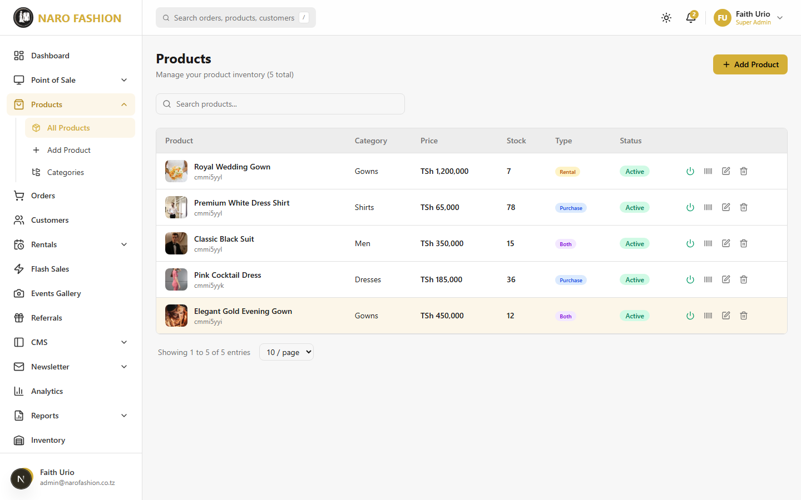
*Figure 11: The products list page showing all products in a table with image thumbnails, names, SKUs, prices, stock levels, statuses, and action buttons.*

**The product list table shows:**
- **Product** -- Thumbnail, product name and SKU
- **Category** -- The product's category ("Uncategorized" if none)
- **Price** -- Base price in TZS
- **Stock** -- Total stock across all variants (amber when 5 or fewer, red at 0)
- **Type** -- Purchase, Rental, or Both
- **Status** -- Active or Inactive
- **Actions** -- Activate/Deactivate (power icon), Barcode, Edit, and Delete

**Features:**
- **Search** -- Type in "Search products..." to filter by name or SKU.
- **Toggle Active/Inactive** -- Click the power icon to hide or show a product on the storefront.
- **Delete** -- Click the trash icon to soft-delete a product (moves to Recycle Bin, can be restored later).
- **Barcode** -- Click the barcode icon to generate and print barcode labels for that product.
- **Template** and **Import CSV** -- Add many products at once (see below).

### Importing Products from a CSV File

You can create many products at once from a spreadsheet saved as CSV.

1. On **Products > All Products**, click **"Template"**. A CSV file downloads with all the columns and two example rows ("Blue Silk Gown" and "Classic Mens Suit").
2. Open it in Excel, Google Sheets or LibreOffice and fill in one row per product:
   - **Required columns:** `name`, `description`, `price`, `categorySlug`.
   - Optional columns include Swahili name/description, `compareAtPrice`, `sku`, `availabilityMode` (PURCHASE_ONLY, RENTAL_ONLY or BOTH), `stock`, rental price/deposit/min/max days, `isFeatured`, `published`, and `imageUrls` (several web addresses separated by `;`).
   - **Categories must already exist.** Use the category's **slug** (or its name) in `categorySlug`.
   - Delete the example rows before importing.
3. Save the file as **CSV**.
4. Click **"Import CSV"**. In **"Import Products from CSV"**, choose the file (click or drag and drop) and click **"Import Products"**.
   - Limits: **maximum 500 rows and 5MB per file** (split bigger files).
5. Review the results: **Created**, **Failed** and **Total Rows**, plus an **Errors** table listing the row, field and problem for each failed row (e.g., missing price, unknown category, duplicate SKU). Fix those rows and import them again.

> **Note:** Import needs an internet connection (it is disabled while offline).

### Creating a Product

Navigate to **Products > Add Product** (`/dashboard/products/new`) to create a new product. Hover over the small info icons next to each field for an explanation.

*Figure 12: The create new product form showing the basic information fields, pricing section, and availability mode selector.*

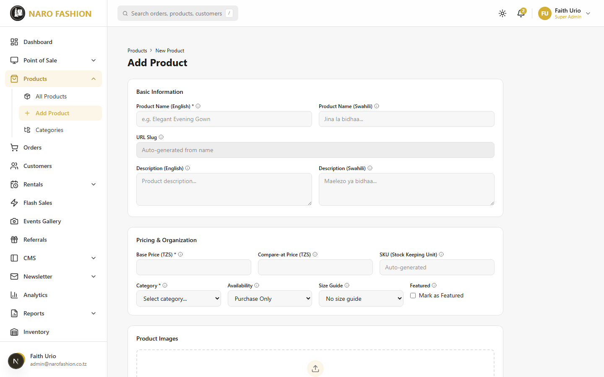
*Figure 13: Full view of the product creation form including variants, images, 3D model upload, and inventory settings.*

**Follow these steps to create a new product:**

**Step 1: Basic Information**

1. **Product Name (English)** (required) -- The display name customers see, e.g., "Elegant Gold Evening Dress".
2. **Product Name (Swahili)** -- Shown when customers switch to Kiswahili.
3. **URL Slug** -- Auto-generated from the English name (read-only), e.g., `/products/elegant-gold-evening-dress`.
4. **Description (English)** and **Description (Swahili)** -- Describe materials, fit, occasion and care instructions.

**Step 2: Pricing & Organization**

5. **Base Price (TZS)** (required) -- The selling price, e.g., `150000` for TZS 150,000. No commas or currency symbols.
6. **Compare-at Price (TZS)** -- An original/higher price shown crossed out to indicate a discount. Leave empty if there is no discount.
7. **SKU (Stock Keeping Unit)** -- Auto-generated in the format `CATEGORY-NAME-NUMBER` (e.g., `GOW-ELE-427`); you can edit it. Must be unique.
8. **Category** (required) -- Choose the category or sub-category (sub-categories are indented under their parent). Create categories first under Products > Categories.
9. **Availability** -- **Purchase Only**, **Rental Only**, or **Purchase & Rental**.
10. **Size Guide** -- Attach a size guide (or "No size guide"). Only active guides are listed; manage them under CMS > Size Guides.
11. **Featured** -- Tick **"Mark as Featured"** to highlight the product on the storefront.

**Step 3: Rental Settings** (only for Rental Only or Purchase & Rental)

12. **Rental Price (TZS)** -- The rental fee (the form describes it as a flat fee for the rental period up to Max Rental Days).
13. **Late Penalty (% per day)** -- Percentage of the rental price charged for each extra day.
14. **Deposit Amount (TZS)** -- Refundable security deposit.
15. **Min Rental Days** / **Max Rental Days**.
16. **Buffer Days Override** -- Overrides the store-wide buffer between rentals (default 7 days).

**Step 4: Product Images**

17. **Drag and drop** photos or **click to browse**. Up to **8 images**; JPEG, PNG or WebP; at least **900x1200 pixels**; up to **5MB** each.
18. For each photo the **"Crop Product photo (3:4)"** window opens. Adjust the portrait crop and the **Quality** slider, then click **"Crop & Upload"**. Photos are saved at 1200x1600 pixels.
19. **Drag images to reorder** them. The first image is marked **PRIMARY** and is used as the thumbnail on the storefront.

**Step 5: 3D Model (Optional)**

20. Upload a **GLB or GLTF** file (max **25MB**). A rotating **3D preview** appears; click **"Remove"** to delete it.
21. On the storefront, customers see a **Photos/3D** toggle on products with a 3D model, including AR view on supported phones.

**Step 6: Variants**

22. Click **"Add Variant"** for each size/colour combination and fill in **Name** (required), **SKU**, **Barcode** (for POS scanning), **Price (TZS)** (required), **Size** (choose from the list -- click "Manage sizes" to add sizes), **Color**, **Color Hex Code**, and **Stock**.
23. Variants that have been used in past orders cannot be removed; they are shown as **Disabled** (hidden from customers) and can be turned back on with the **Re-enable** checkbox.

**Step 7: Save the Product**

24. At the bottom of the form:
    - **Save as Draft** -- Saves the product as unpublished (not visible on the storefront).
    - **Save Product** (or **Update Product** when editing) -- Saves and publishes it.

> **Inventory details** such as purchase cost, minimum stock level and supplier are set on the **Inventory** page (see [2.10 Inventory Management](#210-inventory-management)).

### Editing a Product

1. Navigate to **Products > All Products** (`/dashboard/products`).
2. Find the product you want to edit in the product list table.
3. Click the **Edit (pencil) icon** in the actions column on the right side of the row.
4. You will be taken to the product edit page (`/dashboard/products/[id]/edit`), which has the same form as the create page but is pre-populated with the existing product data.
5. Make your changes to any field -- name, description, pricing, variants, images, etc.
6. Click **"Update Product"** to apply your changes. The updates take effect on the storefront immediately.

If another staff member saved the same product after you opened it, your save is stopped with **"Someone else changed this since you opened it"** -- click **"Reload latest"**, check the changes, and edit again.

> **Tip:** When editing images, you can add new images alongside existing ones. To replace an image, remove the old one first (click the X on the image thumbnail) and then upload the new one. Remember to drag images to set the correct display order.

### Deactivating and Deleting Products

**Deactivating a Product (Temporarily Hiding):**

If you want to temporarily hide a product from the storefront without deleting it:
1. Find the product in the product list.
2. Click the **power icon** (toggle) in the actions column.
3. The product status changes from Active (green) to Inactive (red).
4. The product is now **hidden from the storefront** but remains in your admin catalog for future use.
5. Click the power icon again to reactivate it at any time.

**Deleting a Product (Soft Delete):**

1. Click the **trash icon** in the actions column next to the product you want to delete.
2. A confirmation dialog appears: "This product will be moved to the recycle bin. You can restore it later."
3. Click **"Delete"** to confirm.
4. The product is soft-deleted and moved to the **Recycle Bin**.
5. To restore it later, go to **Recycle Bin > Products** and click "Restore".

### SKU and Barcode

**SKU (Stock Keeping Unit):**
- Each product variant receives an auto-generated SKU in the format `CATEGORY-NAME-NUMBER` (e.g., `GOW-ELE-427`).
- SKUs can be manually edited if you prefer a different naming convention.
- SKUs are unique within your store and are used for inventory tracking and POS scanning.

**Barcode Generation:**
1. Click the **barcode icon** on any product in the product list.
2. A **Barcode Modal** opens showing the barcode label preview.
3. Barcodes use the **CODE128** format, which can be read by standard barcode scanners.
4. Each label shows: the barcode, product name, variant (size/color), and price in TZS.
5. Set the **quantity** of labels to print (how many copies of each variant's label).
6. Click **"Print"** to generate a PDF with labels laid out in a **3-column x 9-row grid** per A4 page.
7. Use a standard printer to print barcode stickers. Adhesive label paper is recommended.

### Categories

Navigate to **Products > Categories** (`/dashboard/products/categories`) to manage product categories.

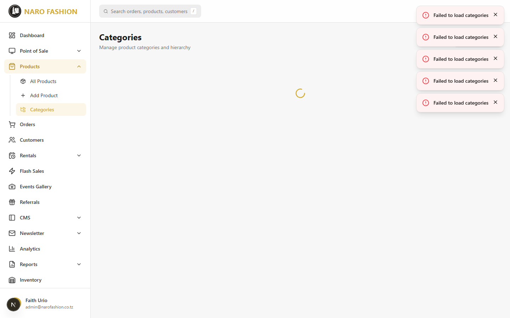
*Figure 14: The category management page showing all product categories with their names, descriptions, product counts, and management actions.*

**Creating a new category:**

1. Click **"Create Category"** (the "+" button or "Add Category" link).
2. **Name** -- Enter a descriptive category name (e.g., "Wedding Gowns", "Men's Suits", "Accessories").
3. **Description** -- Optionally add a description that will appear on the category page on the storefront.
4. **Parent Category** -- If this is a subcategory, select the parent category from the dropdown. For example, "Dresses" might be a child of "Women's Clothing". Leave empty for top-level categories.
5. **Image** -- Upload an image that represents this category (portrait 3:4, at least 900x1200 pixels; you crop it after choosing). It is shown on the homepage category tiles and the category listing page. If a category has no image, the storefront uses a product photo from that category instead.
6. **Sort Order** -- Set a number to control the display order. Lower numbers appear first.
7. Click **"Save"** to create the category.

**Managing categories:**
- **Edit** -- Click the edit icon to modify a category's name, description, image, or parent.
- **Delete** -- Click the trash icon to soft-delete the category. Deleted categories go to the Recycle Bin and can be restored.
- **Nested Structure** -- Categories support parent-child relationships, allowing for a hierarchical catalog structure.

### Size Guides

Navigate to **CMS > Size Guides** (`/dashboard/cms/size-guides`) to create and manage size guides.

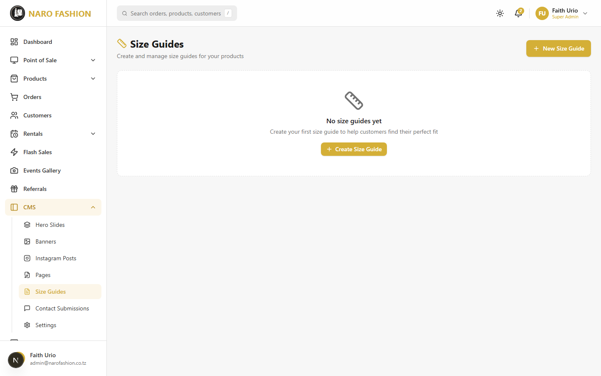
*Figure 15: The size guides management page where you create measurement tables that help customers choose the right size.*

**Creating a size guide:**

1. Click **"+ New Size Guide"**.
2. Enter the **EN Name** (required, e.g., "Women's Clothing") and the Swahili name (**SW Jina**).
3. Optionally tick **"Set as default size guide"** -- the default guide is the one shown on the storefront's `/pages/size-guide` page.
4. **Start from a template** (recommended): under **"Pre-built Templates"** choose **Fashion & Clothing (General)**, **Bridal & Evening Gowns**, or **African & Kitenge Fashion**. The template fills in measurement tables in both English and Swahili.
5. **Edit the content** using the **EN / SW** buttons to switch language and the **Edit / Preview** tabs. Because size guides contain **tables**, the editor opens in **HTML mode** with a live preview (see [Pages](#pages) for how table content is edited).
6. Optionally attach PDF versions under **"PDF Attachments"** (**English PDF** / **Swahili PDF** -- "Upload PDF"). Customers then see a download button.
7. Click **"Create"** (or **"Update"**).

**Managing size guides:** use the power icon to **Activate/Deactivate**, the star to **Set as default**, **Edit**, or delete.

**Assigning to products:** when creating or editing a product, choose the guide in the **Size Guide** dropdown. Customers see a **"Size Guide"** tab on the product page with the measurement tables.

---

## 2.3 Order Management

### Order List

Navigate to **Orders** (`/dashboard/orders`) to manage all customer orders.

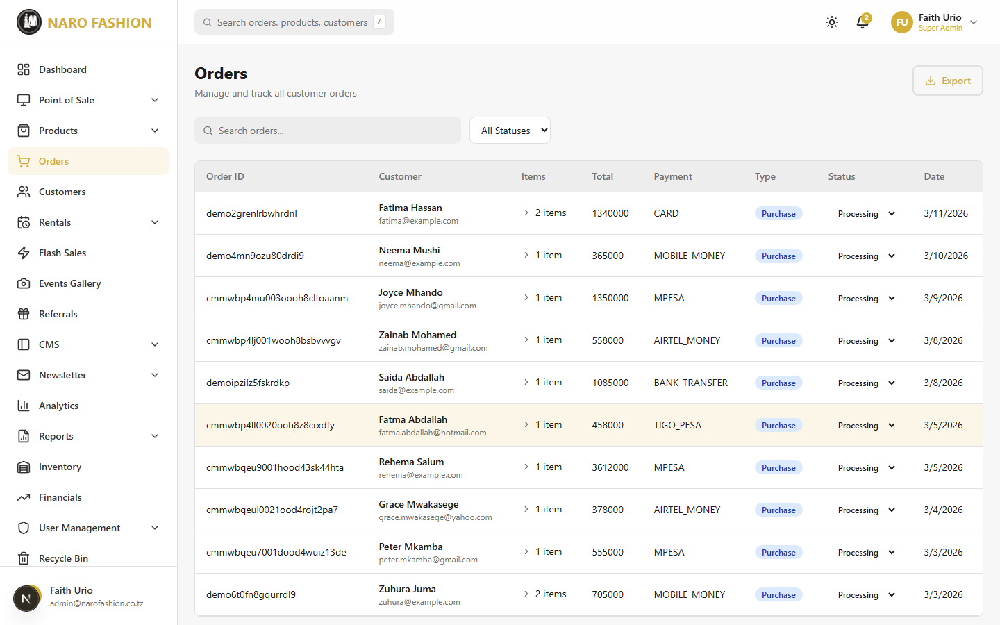
*Figure 16: The orders list page showing all customer orders with expandable rows. Each row displays the order ID, customer name, item count, total, payment method, status badge, and date.*

**The order list table shows:**
- **Order #** -- Unique order number.
- **Customer** -- Customer name and email or phone.
- **Items** -- Number of items (click to expand the order).
- **Total** -- Order total in TZS.
- **Payment** -- Payment method plus a **payment status** badge (see below).
- **Channel** -- **Online** (storefront) or **POS** (in-store).
- **Status** -- The order status, changed with an inline dropdown.
- **Date** -- Date the order was placed.

**Filtering and Search:**
- **Search** -- "Search order #, customer name or email...".
- **Status Filter** -- All Statuses, Pending, Confirmed, Processing, Shipped, Delivered, Cancelled.
- Results are shown 25 per page.

**Expanding an Order:**
Click a row to expand it and see:
- **Order Items** -- Product, variant, quantity, unit price and subtotal.
- **Payment** -- Method and payment status. A cancelled-after-payment order shows "Order was cancelled after payment -- refund the customer."
- **Shipping** -- The delivery address, "In-store (POS)", or "No shipping address on file".
- **Notes** (if any).
- **Refunds** panel (see [Recording a Refund](#recording-a-refund)).

**Payment status badges:**

| Badge | Meaning |
|-------|---------|
| **Unpaid** | No payment received yet |
| **Processing** | Payment in progress (e.g., waiting for the customer's mobile money PIN, or held for review) |
| **Partially paid** | Part of the amount received |
| **Paid** | Fully paid |
| **Refund pending** | The order was cancelled after payment -- the customer must be refunded |
| **Partially refunded** | Part of the collected money has been refunded |
| **Refunded** | Everything collected has been refunded |
| **Failed** / **Cancelled** | The payment failed or was cancelled |

### Order Status Workflow

Orders progress through the following lifecycle. Statuses only move **forward**:

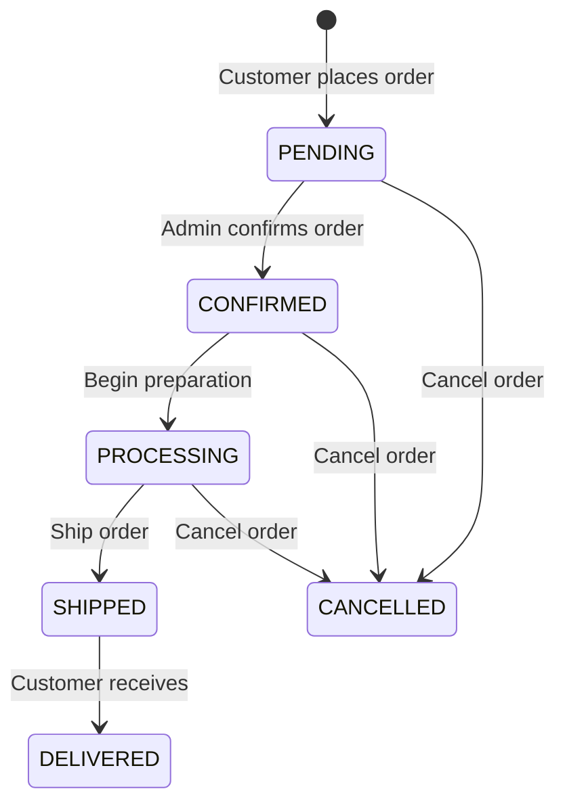

**Status descriptions:**

| Status | Description | Admin Action |
|--------|-------------|-------------|
| **Pending** | Order placed, awaiting confirmation | Review order details and payment, then set to **Confirmed** |
| **Confirmed** | Order accepted | Begin preparing the order, set to **Processing** |
| **Processing** | Order is being prepared and packed | Pack the items, set to **Shipped** when dispatched |
| **Shipped** | Order dispatched to customer | Set to **Delivered** when delivery is confirmed |
| **Delivered** | Customer has received the order | Complete. No further status changes. |
| **Cancelled** | Order was cancelled | Final. If money was collected, the payment status becomes **Refund pending** -- record the refund. |

**Automatic cancellations:** Unpaid online orders (mobile money/card) are cancelled automatically after 24 hours by default, and their stock is released. Cash on Delivery orders are not auto-cancelled, but each customer can only have a limited number (3 by default) of open COD orders.

### Updating Order Status Step by Step

**1. New Order Arrives (Pending):**
1. Find the new order in the list (status **Pending**).
2. Click the row to expand it and check the items, quantities, shipping address and payment status.
3. In the **Status** dropdown choose **Confirmed**. A message confirms "Order marked Confirmed".

**2. Begin Preparation (Processing):**
1. Choose **Processing** while you gather and pack the items.
2. Check that sizes and colours match the order exactly.

**3. Ship the Order (Shipped):**
1. When the order is handed to the delivery service, choose **Shipped**.
2. The customer sees the updated status in their account.

**4. Confirm Delivery (Delivered):**
1. When the customer has received the order, choose **Delivered**. The order is complete.

**Cancelling an Order:**
1. Orders can be cancelled while Pending, Confirmed or Processing. Choose **Cancelled** in the Status dropdown.
2. Stock is returned for online orders.
3. If the order was already paid, its payment status changes to **Refund pending**. Pay the customer back and record it (next section).

> **Note:** Customers cannot cancel orders themselves on the storefront -- they contact you. Paid orders can only be cancelled by the shop.

### Recording a Refund

Neither payment gateway (Selcom or ClickPesa) can send refunds automatically. You **send the money back yourself** (e.g., by M-Pesa, bank transfer or cash) and then **record** the refund in the system. You need the **Refund Orders** permission (`orders:refund`); otherwise the Refunds panel is not shown.

1. Expand the order. The **Refunds** panel shows **Collected**, **Refunded** and **Refundable** amounts and a history of refunds.
2. Send the money to the customer.
3. Click **"Record refund"**. In **"Record refund -- {order number}"** fill in:
   - **Amount (TZS)** -- pre-filled with the refundable balance; you can enter a smaller amount for a partial refund (it can never exceed the refundable balance).
   - **Method** -- **Mobile money (sent manually)**, **Bank transfer**, or **Cash**. (The "Payment gateway (automatic)" option is not available yet -- the form will tell you to use another method.)
   - **Reference (optional)** -- e.g., the M-Pesa receipt or bank reference.
   - **Note (optional)**.
4. Click **"Record refund"**. You will see "Refund of TZS X recorded for {order}".
5. The payment status becomes **Refunded** (everything returned) or **Partially refunded** / stays **Refund pending** (part returned).

Refunds are available for online orders. POS sales are handled from the POS screen (see [2.6 Point of Sale](#26-point-of-sale-pos)). Recording refunds needs an internet connection.

---

## 2.4 Rental Management

### Rental Dashboard

Navigate to **Rentals > Active Rentals** (`/dashboard/rentals`) to manage all rental bookings.

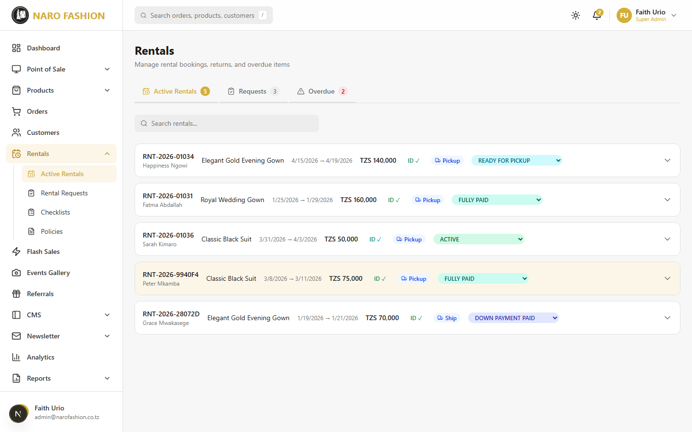
*Figure 17: The rental dashboard showing active rentals with customer information, item details, rental dates, payment status, and current rental stage.*

The rental page has four tabs (each with a count):
- **Active Rentals** -- Rentals from Down Payment Paid through Active (not overdue). This is the default view.
- **Requests** -- New bookings waiting for ID verification or payment.
- **Overdue** -- Active rentals past their return date, for urgent attention.
- **Cancelled** -- Cancelled rentals.

**Each rental card shows:** rental number, customer, item, dates, total, ID status (ID ✓ / ID ✗), Ship or Pickup, the **status dropdown**, and (before dispatch) a **"Cancel rental"** button.

**Expanded rental details include:**
- **Rental Details** (click **"Edit"** to change): Pickup Time, Wedding Date, Wedding Location, Region, Delivery Modality (**Hand Picked** or **Shipped**). For shipped items: Shipping Date, Shipping Address, Transport Mode (Air, Bus, Train, Courier, Other) and **Transport Receipt** ("Upload Receipt"), plus Notes.
- **Dispatch & Return Checklist** (see [Checklists](#checklists) below).

**Changing the status:** open the status dropdown ("Update Status"), which shows a progress bar ("Step X of 10") and marks the **Next** step. Statuses only move **forward**:
- Before **Active**, you may skip ahead (e.g., straight from ID Verified to Fully Paid).
- From **Active** onward the steps are strict: Active → Returned → Inspection → Closed. Marking **Returned** records the return date and calculates any late fee.
- **Closed** and **Cancelled** are final.

**Cancelling a rental:** click **"Cancel rental"** (only available before the item is dispatched) and confirm. The dates are released for other bookings. This cannot be undone. Unpaid bookings are also cancelled automatically after 48 hours (default).

> If someone else changed the rental at the same moment, you see a message and the page reloads -- check the status and try again.

### Processing a Rental Request

Here is the complete workflow for processing a rental from start to finish:

**Step 1: Customer Books**
- The new rental appears under **Rentals > Rental Requests** (`/dashboard/rentals/requests`) and the **Requests** tab, with status **Pending ID Verification**.

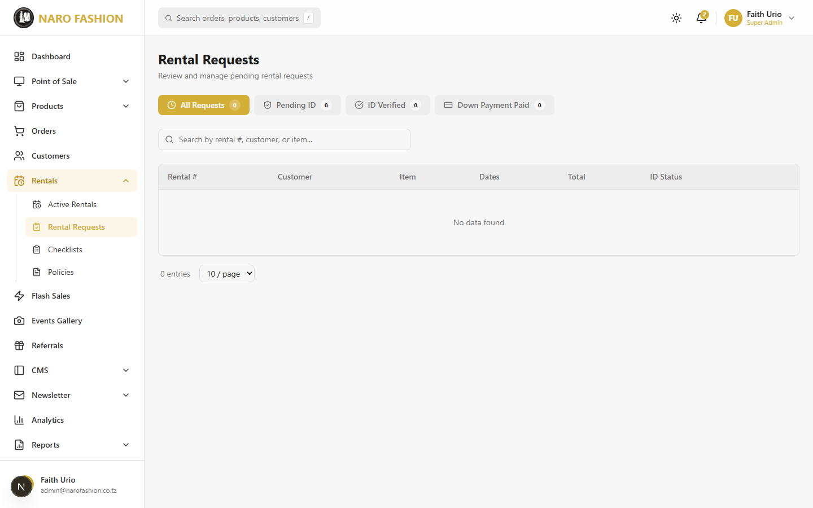
*Figure 18: The rental requests page showing pending rental applications awaiting admin review and processing.*

**Step 2: Verify the Customer's ID**
- At the top of **Rental Requests**, the section **"ID verifications awaiting review (N)"** lists customers who uploaded ID documents (name, email, phone, ID number, date, and the **Front** and **Back** images or PDF).
- The documents are private: they open only inside the admin for signed-in staff and are never public links.
- Click **"Approve"** if the ID is valid and readable (you see "ID verified"), or **"Reject"**, type a **reason shown to the customer** (e.g., "photo is blurry") and click **"Confirm reject"**.
- Then set the rental's status to **ID Verified**.

**Step 3: Down Payment**
- When the customer pays the down payment (25% by default), set the status to **Down Payment Paid**.

**Step 4: Remaining Balance**
- When the rest is paid (before dispatch), set the status to **Fully Paid**.

**Step 5: Prepare the Item**
- Expand the rental and complete the **Dispatch** checklist (see [Checklists](#checklists) below).
- Set the status to **Ready For Pickup**.

**Step 6: Hand Over to Customer**
- When the customer picks up the item (or it is shipped), set the status to **Item Dispatched**.
- If shipping, click **"Edit"** in Rental Details and record Delivery Modality **Shipped**, the Shipping Date, Shipping Address, Transport Mode, and upload the **Transport Receipt**.

**Step 7: Rental Period Active**
- Set the status to **Active**. The system sends automated reminders before the return date.

**Step 8: Customer Returns Item**
- Set the status to **Returned**. Any late fee (for each full day past the booked return date) is calculated automatically.

**Step 9: Inspect the Item**
- Set the status to **Inspection** and complete the **Return** checklist. Note any damage.

**Step 10: Close the Rental**
- Set the status to **Closed**.
- Refund the deposit if there is no damage; if there is, deduct repair costs before refunding the remainder.

### Checklists

Checklists are quality control templates used during the dispatch and return of rental items.

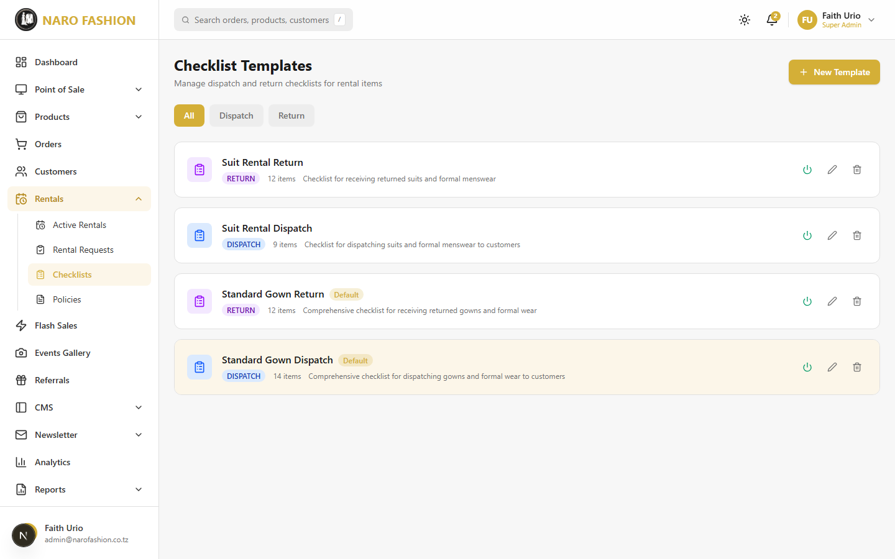
*Figure 19: The rental checklists management page showing checklist templates for dispatch and return inspections.*

**Navigate to Rentals > Checklists** (`/dashboard/rentals/checklists`) -- the "Checklist Templates" page. Use the **All / Dispatch / Return** filter to narrow the list.

**Creating a checklist template:**

1. Click **"New Template"**.
2. **Name** the template (e.g., "Standard Gown Dispatch", "Evening Dress Return") and add an optional **Description**.
3. Choose the type: **Dispatch** (when the item leaves the store) or **Return** (when it comes back). Tick **"Set as default"** if this should be the usual template for that type.
4. **Add items** with **"Add Item"** -- each item has an English label and an optional Swahili label (e.g., "Garment has been dry-cleaned", "All buttons are intact", "Zipper works properly"). Common items include:
   - Garment condition (stains, tears, missing parts)
   - Accessories (belt, sash, veil, jewelry)
   - Packaging (garment bag, hanger, box)
   - Documentation (rental agreement signed)
5. Save the template.
6. Use the toggle to **activate or deactivate** a template. Only active templates can be assigned to rentals. Deleting a template moves it to the Recycle Bin.

**Using checklists on a rental:**

1. Expand the rental on the Rentals page.
2. In **"Dispatch & Return Checklist"**, click **"Assign Checklist Template"** and pick from **"Select Active Template"**.
3. The items appear grouped under **Dispatch** and **Return**, with "x/y completed".
4. **Tick each item** as you physically verify it. The system records who ticked it and when ("by {name} · time").
5. Use **"Assign additional checklist template"** if you need more than one.

### Rental Policies

Navigate to **Rentals > Policies** (`/dashboard/rentals/policies`) to configure your rental business rules.

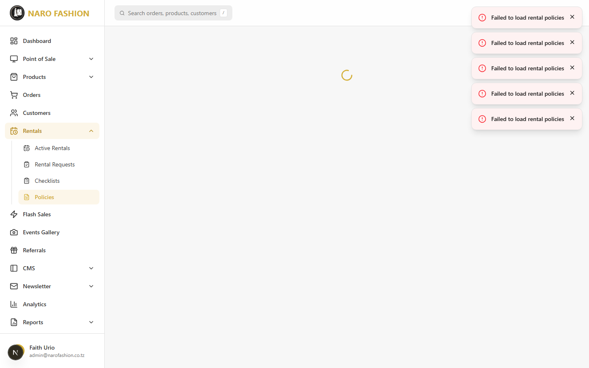
*Figure 20: The rental policies configuration page where you set buffer days, down payment percentage, late fees, and maximum rental duration.*

| Policy | Default Value | Description |
|--------|--------------|-------------|
| **Buffer Days Between Rentals** | 7 days | Minimum gap between when one customer returns an item and the next customer can rent it. Allows time for cleaning and inspection. |
| **Down Payment Percentage** | 25% | The percentage of the rental cost that must be paid upfront to confirm a booking. |
| **Late Return Fee Per Day** | TZS 15,000 | The daily fee charged when a customer returns an item after the agreed return date. |
| **Maximum Rental Duration** | 30 days | The longest period a single rental can span. |
| **Advance Preparation Reminder** | 8 days | How many days before pickup the preparation reminder starts. |

A **"Current Policy Summary"** box shows the active values. Modify these values and click **"Save Policies"** (or **"Reset to Defaults"**). Changes apply to all new rentals.

### Automated Reminders

The system sends automated reminders every morning:

| Time | Reminder Type | Description |
|------|--------------|-------------|
| **8:00 AM** | Preparation Reminders | Alerts for rentals that need to be prepared within the next 8 days. Ensures items are cleaned, inspected, and ready. |
| **8:30 AM** | Return Reminders | Notifications for items due for return within the next 3 days. Reminds customers to plan their return. |
| **9:00 AM** | Overdue Alerts | Alerts for items that should have been returned but have not been. Notifies both admin and customer. |

These reminders run automatically every day. No manual intervention is needed.

---

## 2.5 Customer Management

Navigate to **Customers** (`/dashboard/customers`) to view and manage your customer base.

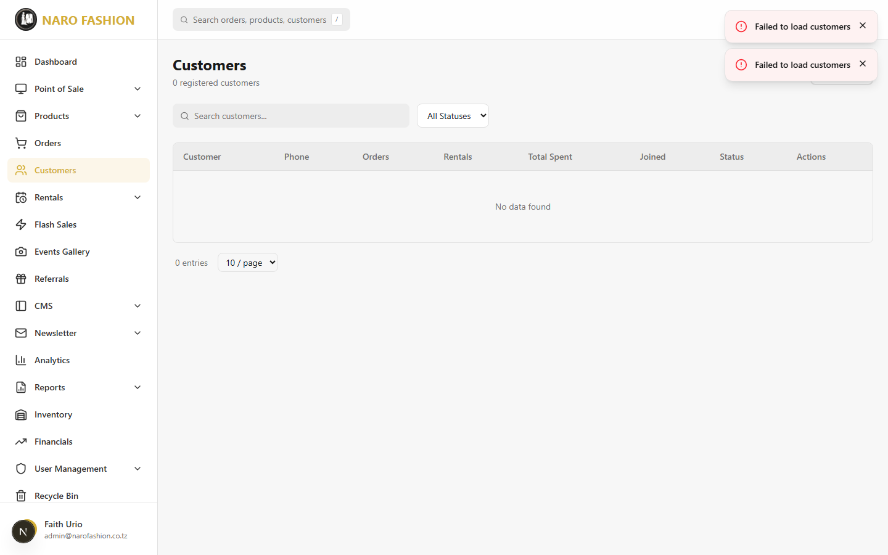
*Figure 21: The customer management page showing all registered customers with their names, emails, phone numbers, registration dates, order counts, and account statuses.*

**Customer list features:**

- **Search** -- "Search customers..." by name, email, or phone.
- **Status filter** -- All Statuses, Active, Suspended, VIP, New, Inactive.
- **Customer Table** -- Customer (name and email), Phone, Orders, Rentals, Total Spent, Joined, Status, and Actions.
- **Pagination** -- 25 customers per page.

**Suspending a customer:**
1. Find the customer and click the **"Suspend customer"** icon.
2. Confirm **"Suspend {name}? They will not be able to log in."** by clicking **"Suspend"**.
3. The customer is signed out everywhere and can no longer sign in or place orders. Their status shows **Suspended**.

**Reactivating a customer:** click the **"Reactivate customer"** icon. The account works again immediately.

Suspending needs the **Suspend Customers** permission (`customers:suspend`).

> **Closing a customer's account:** Customers cannot delete their own accounts on the storefront. If a customer asks for their account to be closed, **suspend** it here. Customers can download a copy of their own data from their account settings.

**ID verification** for rentals is reviewed under **Rentals > Rental Requests** (see [Processing a Rental Request](#processing-a-rental-request)), not on the Customers page.

---

## 2.6 Point of Sale (POS)

The Point of Sale system allows you to process in-store sales using the admin dashboard. It requires the **POS module** to be enabled. POS sales also work **offline** (see [2.17 Working Offline](#217-working-offline)).

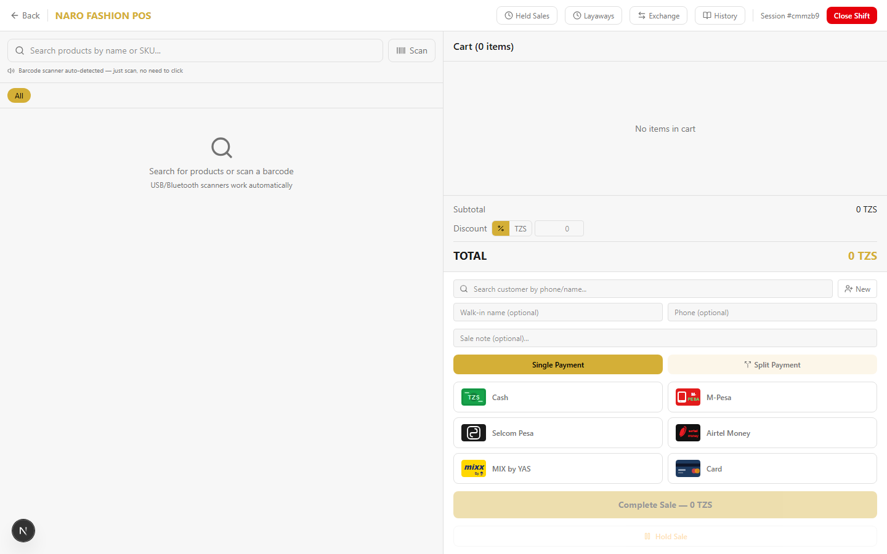
*Figure 22: The Point of Sale (POS) interface with the product search/grid on the left and the cart/payment panel on the right. Designed for fast in-store transaction processing.*

### Opening a Shift

Before you can process any POS sales, you must open a shift:

1. Navigate to **Point of Sale > Open POS** (`/dashboard/pos`).
2. If you have no open shift, the **"Open Shift"** window appears: "Enter the opening cash amount in the drawer".
3. **Count your cash drawer** and enter the total in **"Opening Cash (TZS)"** (e.g., `50000`).
4. **Click "Start Shift"**. The POS interface loads.

> **Note:** You can only have one open shift at a time. Cash sales, cash refunds, cash layaway payments and cash exchange settlements all need an open shift -- otherwise you see a message such as "No open session. Please open a shift first." Open your shift **while online** if you might need to sell offline.

### POS Interface

**Top bar:** **Back**, the sync status badge, **Held Sales** (with a count), **Layaways**, **Exchange**, **History** (Sales History), your session number, and **Close Shift**.

**Left panel -- Product Search and Grid:**
- **Search bar** -- Type a product name to search instantly.
- **Barcode scan** -- Use a connected barcode scanner (in keyboard mode); the scanned product is added to the cart.
- **Category filter chips** -- Filter the product grid by category.
- **Product grid** -- Click a product to add it to the cart.

**Right panel -- Cart:**
- Cart items with variant, unit price and quantity (+/- buttons, remove).
- **Discount** per line, and an overall discount (% or fixed amount).
- **Subtotal**, **Discount**, **TOTAL**.
- **Customer** -- Optionally link the sale to a customer (search by name, email or phone); defaults to walk-in.
- **Sale note (optional)**.

### Key POS Operations

**Processing a Standard Sale:**

1. **Add products** by searching, scanning, or clicking product cards. Choose the variant if asked.
2. **Adjust quantities** and apply any **discount**.
3. Optionally assign a **customer** and add a **note**.
4. In the payment panel choose **"Single Payment"** and the method: **Cash, M-Pesa, Selcom Pesa, Airtel Money, MIX by YAS**, or **Card**.
   - **Cash**: enter **"Cash Received"**; the **"Change Due"** is calculated.
   - **Other methods**: enter the **Transaction Reference** from the customer's payment confirmation.
5. Click **"Complete Sale -- X TZS"**.
6. A **Receipt** is shown. Click **"Print"** to print it on your receipt printer.

**Split Payment:**

1. Choose **"Split Payment"**.
2. Pick a method, enter an amount (it cannot exceed what is left) and click **"Add Payment"**.
3. Repeat until the panel shows **"Fully covered"**, then complete the sale.

**Hold Sale:**

1. Click **"Hold Sale"** to park the current cart (e.g., while the customer keeps shopping).
2. Click **"Held Sales"** in the top bar and **"Resume"** to bring it back, or discard it.

**Layaways (pay in instalments):**

Click **"Layaways"** to open **Layaway Management** (tabs ACTIVE / COMPLETED / CANCELLED). For each layaway you can **"Record Payment"** (amount, method, reference), **"Complete"** it when the balance is zero (this creates the order and deducts stock), or **"Cancel"** it.

**Exchange:**

Exchanges need the **Issue POS Refunds** permission (`pos:refund`), which Managers have by default.

1. Click **"Exchange"** to open **Product Exchange**.
2. Enter the **original sale order number**.
3. **Select the items being returned**, then choose the replacement items.
4. The summary shows the **Return Credit**, **New Items** and whether the **Customer Owes**, a **Refund Due**, or it is an **Even Exchange**.
5. Click **"Process Exchange"** (or **"Next: Settlement"** to choose the settlement method and an optional reason), then **"Complete Exchange"**.

Returns and exchanges are limited to the quantity originally sold and are valued at the price the customer actually paid (after discounts).

### Closing a Shift

1. Click **"Close Shift"** in the top bar.
2. Review the shift summary: **Total Sales, Transactions, Items Sold, Discounts Given** and the **Payment Breakdown**.
3. Count the drawer and enter **"Closing Cash Count (TZS)"**, plus optional **Notes**.
4. Click **"Close Shift"**.

### Sales History

**Point of Sale > Sales History** (`/dashboard/pos/sales`) lists POS sales with cards for Today's Sales, Transactions, Items Sold and Net Sales. Filter by search, date range and payment method; click the receipt icon to reopen a receipt.

---

## 2.7 Marketing and Promotions

### Flash Sales

Navigate to **Flash Sales** (`/dashboard/flash-sales`) to create time-limited promotional events.

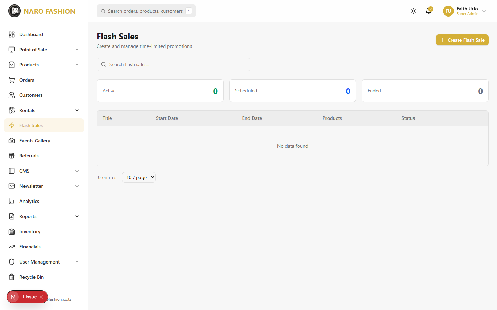
*Figure 23: The flash sales management page showing active and scheduled flash sales with their dates, product counts, and statuses.*

The page shows **Active / Scheduled / Ended** counts and a list (Title, Start Date, End Date, Products, Status) with search.

**Creating a flash sale:**

1. Click **"+ Create Flash Sale"**.
2. Enter **Title (English)** (required) and **Title (Swahili)**.
3. Set **Start Date & Time** and **End Date & Time** (both required).
4. Under **"Sale Products"**, click **"+ Add Product"** and, for each row, choose the **Product** and enter the **Original Price (TZS)** and **Sale Price (TZS)**.
5. Save the flash sale.

The sale appears on the storefront (homepage section and Flash Sales page) with a countdown while it is running. Sale prices are applied by the system when the customer places an order.

> **Known limitation (October 2026):** the flash sale form is still being completed -- the product picker does not yet list your real catalogue, and the view/edit buttons are not active. Check with your platform administrator before relying on it. Deleting a flash sale works and moves it to the Recycle Bin.

### Promo Codes

Customers can enter promo codes in the cart and at checkout (percentage or fixed-amount discounts, with optional minimum order amount, total usage limit, per-customer limit and validity dates). The system checks every code again when the order is placed.

> **Note:** There is currently **no Promo Codes page in the admin dashboard**. To create or change a promo code, contact your platform administrator.

### Referral Program

Navigate to **Referrals** (`/dashboard/referrals`) to view the referral program (requires the Referrals module).

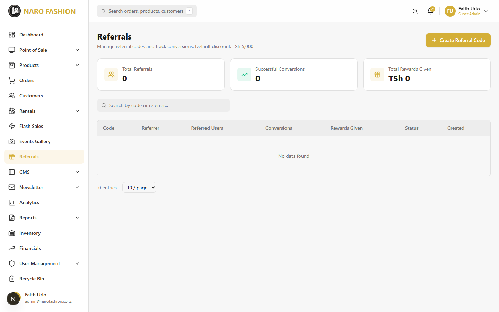
*Figure 24: The referral program management page showing referral codes, referrer-referee relationships, reward statuses, and overall program statistics.*

The page shows **Total Referrals**, **Successful Conversions** and **Total Rewards Given**, and a table of referral codes (Code, Referrer, Referred Users, Conversions, Rewards Given, Status, Created) with search. It is currently **view-only** -- creating referral codes from this page is not yet available, and customers do not yet see a referral section in their storefront account.

### Customer Events

Navigate to **Events Gallery** (`/dashboard/events`) to manage customer event galleries (the storefront's "Real Weddings").

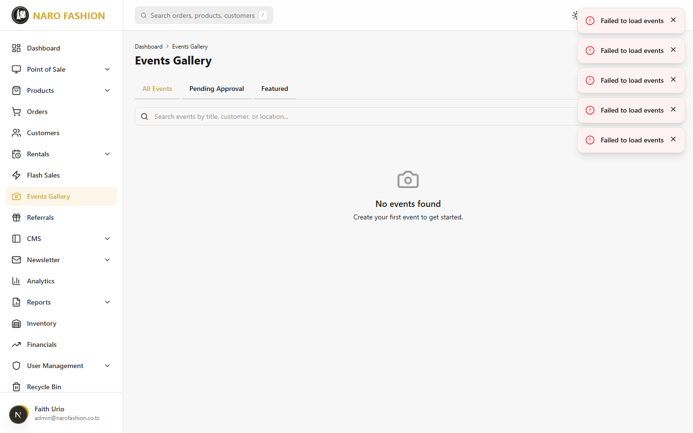
*Figure 25: The customer events management page showing event submissions from customers with their photos, titles, statuses, and approval actions.*

The page has tabs **All Events**, **Pending Approval** (with a count) and **Featured**, and a search box.

**Reviewing customer submissions:**

1. Signed-in customers submit galleries from the storefront. They appear under **Pending Approval**.
2. Check the photos, title, description, date and location.
3. Click **"Approve"** to publish it on the storefront, or **"Reject"** and enter a **Reason for rejection** (required) -- the customer sees the reason.

**Creating or editing an event yourself:** click **"Create Event"** (or **"Edit"**) and fill in Title (and Swahili title), Description (and Swahili), Event Date, Location, Customer Name, an optional linked Product ID, a **Cover Image** (16:9 landscape), Social Links, and **Featured Event**. After the event is saved, use **"Media"** > **"+ Add Media"** to add gallery images (3:4 portrait) or video links.

**Event statuses:**

| Status | Description |
|--------|-------------|
| **Draft** | Not yet submitted for review. |
| **Pending** | Submitted for review. Awaiting your decision. |
| **Approved** | Published on the storefront for all visitors to see. |
| **Rejected** | Not approved for publication. The customer sees the rejection reason. |

---

## 2.8 CMS (Content Management)

The CMS section lets you manage the content that appears on your storefront. Navigate to the **CMS** group in the sidebar.

### Hero Slides

**Path:** CMS > Hero Slides (`/dashboard/cms/hero-slides`)

Manage the featured images shown in the homepage hero section. They are displayed as a **portrait card (3:4)** over a blurred version of the same photo, so tall bridal photos look their best.

**Adding a new hero slide:**

1. Click **"+ Add Hero Slide"**.
2. **Title (optional)** -- e.g., "Summer Fashion 2026".
3. **Sort Order** -- Lower numbers appear first.
4. **Hero Image** (required) -- Choose a JPEG, PNG or WebP photo of at least **1000x1333 pixels** (max 5MB). Crop it in the **3:4 portrait** cropper and click **"Crop & Upload"**. It is saved at 1200x1600.
5. Click **"Create Slide"**.

**Managing slides:**
- **Activate / Deactivate** -- Use the eye icon on a slide card. Inactive slides are faded and not shown on the storefront.
- **Reorder** -- Change the **Sort Order** number (edit the slide).
- **Edit** -- Change the title, order or image.
- **Delete** -- Moves the slide to the Recycle Bin.

> **Tip:** Slides uploaded before the 3:4 change (older wide images) still work, but re-uploading them at 3:4 gives a sharper result.

### Parallax Sections

**Path:** CMS > Parallax Sections (`/dashboard/cms/parallax-sections`)

Parallax sections add a background image that moves gently as visitors scroll, behind seven homepage areas: **Hero Backdrop, Shop by Category, New Arrivals, Rental Showcase, Real Weddings, Instagram Feed,** and **Footer Band**.

**First, switch the feature on:** go to **CMS > Settings > Features** and set **"Enable Parallax Scroll Effects"** to **true** (it is off by default). In the same place, **"Default Background (no image uploaded)"** chooses a brand-coloured background for sections without their own image (BRAND_GRADIENT, BRAND_RADIAL, BRAND_MESH, or NONE).

**Adding a section background:**

1. Click **"+ Add Section"** (or **"+ Add Backdrop"** on a section's placeholder card).
2. **Section** -- choose which homepage area (each area can be configured once).
3. **Title (optional admin label)**.
4. **Backdrop Image** -- a 16:9 landscape image, at least 1600x900 (1920x1080 recommended).
5. **Effect Type** -- choose one:
   - **Translate Vertical** -- backdrop drifts up slower than the content
   - **Translate Horizontal** -- pans sideways as you scroll
   - **Fixed** -- image stays locked while the content scrolls past
   - **Zoom on Scroll** -- scales up as the section comes into view
   - **Mirror** -- moves opposite to the scroll
   - **Mouse Tilt** -- shifts slightly with the mouse pointer
   - **Static** -- background image with no animation
6. Adjust **Scroll Speed** (for the moving effects), **Overlay Opacity**, **Overlay Color** and **Blur** so text stays readable. The **Live Preview** on the right shows the result.
7. Tick **"Visible on storefront"** and click **"Create Section"**.

Effects are switched off automatically on small phones and for visitors whose device asks for reduced motion. Deleted sections go to the Recycle Bin.

### Banners

**Path:** CMS > Banners (`/dashboard/cms/banners`)

Promotional banners with English/Swahili title and subtitle, a 16:9 image, a link URL and a sort order.

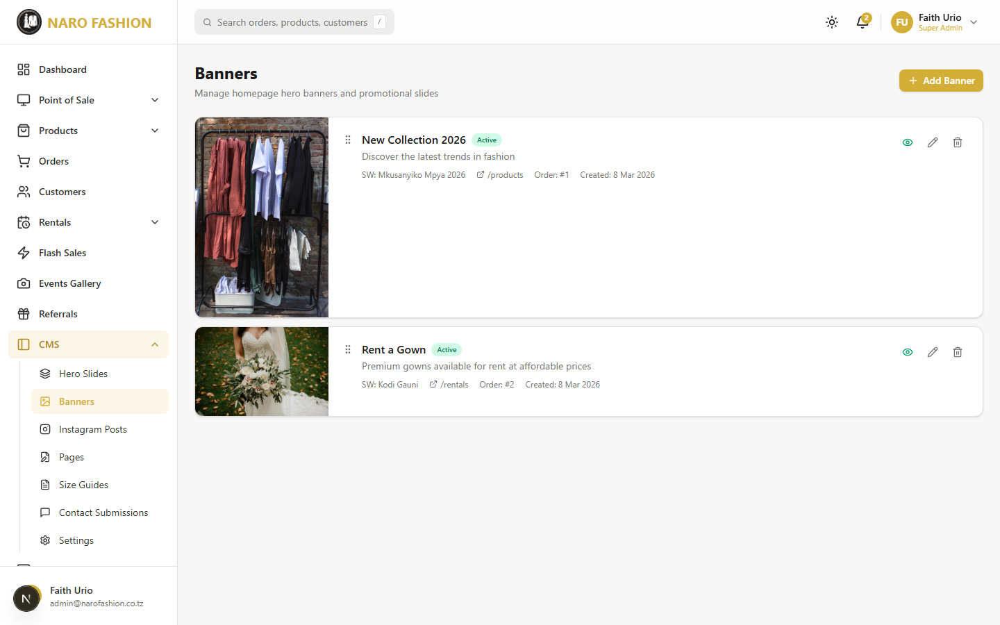
*Figure 26: The banners management page showing promotional banners with their images, titles, link URLs, and display settings.*

**Adding a new banner:** click **"+ Add Banner"**, fill in **Title (English)** (required), **Title (Swahili)**, subtitles, **Banner Image**, **Link URL** and **Sort Order**, and save. Deleted banners go to the Recycle Bin.

> **Note:** The current storefront design does not display banners (the homepage hero uses Hero Slides). Banners are kept for future layouts.

### Instagram Posts

**Path:** CMS > Instagram Posts (`/dashboard/cms/instagram-posts`)

Posts from your Instagram Business account are shown in the storefront's Instagram feed.

**Instagram Connection card**

At the top of the page, the **"Instagram Connection"** card shows whether the feed can sync. The store uses a **Facebook Page token that does not expire**, so once connected it keeps working.

| Status | Meaning | What to do |
|--------|---------|------------|
| **Connected** (green) | Everything is working. | Nothing. |
| **Connected -- last sync had an error** (amber) | Connected, but the most recent sync failed. | Read "Last error" and click **"Check"**; re-connect if needed. |
| **Connected (temporary token -- re-connect for a permanent one)** or **Expiring soon -- re-connect** (amber) | An older, expiring token is in use. | Click **"Re-connect Instagram"**. |
| **Not connected** or **Token invalid -- re-connect** (red) | The feed cannot sync. | Click **"Connect Instagram"**. |

The card also shows the token type (e.g., "Page (permanent)"), the Facebook Page, the Instagram account, expiry, last checked and last sync. Click **"Check"** to re-check the connection with Facebook.

**Connecting (or re-connecting) Instagram** -- this needs the person who is an **admin of the shop's Facebook Page** (about 5 minutes):

1. Click **"Connect Instagram"** (or **"Re-connect Instagram"**). The card shows five steps.
2. Open **Graph API Explorer** (link in the card) and log in with the Facebook account that is an admin of the shop's Page.
3. In **Meta App** choose the store's app as shown in the card; in **User or Page** choose **User Token**.
4. Add the permissions listed in the card (`instagram_basic`, `pages_show_list`, `pages_read_engagement`, `business_management`).
5. Click **Generate Access Token**, approve the Facebook pop-up (select the shop's Page and Instagram account), and copy the token.
6. Paste it into the box and click **"Connect"**. The system swaps it for a permanent Page token (the pasted token is not stored) and syncs the posts. You will see which Page and Instagram account were connected and how many posts were synced.

> The connection stops working if the person who connected it changes their Facebook password, loses admin rights on the Page, or removes the app. Re-connect in that case. Connecting needs the **Manage Settings** permission.

**Other features:**
- **Sync from Instagram** -- Fetch the latest posts now.
- **Auto-Sync Schedule** -- How often posts refresh automatically: Off (Manual only), Every hour, Every 3 hours, **Every 6 hours** (default), Every 12 hours, Once a day, Once a week.
- **Pin / Unpin** -- Pinned posts always appear first on the storefront.
- **Activate / Deactivate** -- Hide a post without deleting it.
- **+ Add Post** -- Add a post by hand (square 1:1 image, caption, Instagram post URL, likes, sort order). Badges show **IG** (synced) or **Manual**.
- **Delete** -- Remove posts you do not want displayed.

Synced images are copied to your store's server, so the feed keeps showing even after Instagram's own image links expire. The feed **layout** (one row or several rows, and the maximum number of posts) is set in **CMS > Settings > Features**.

### Pages

**Path:** CMS > Pages (`/dashboard/cms/pages`)

Create and edit static content pages that appear on the storefront (About, FAQ, Terms, Privacy, Shipping Info, Returns & Exchanges, Size Guide, etc.).

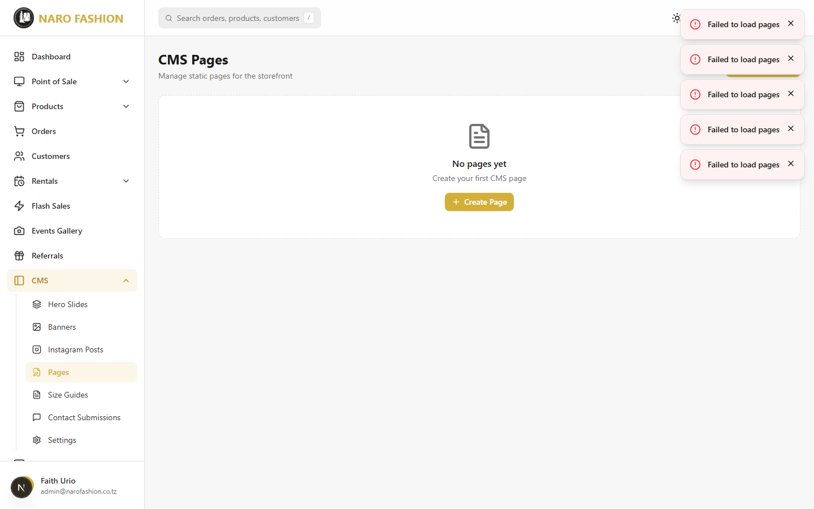
*Figure 27: The CMS pages management showing all static content pages with their titles, URL slugs, and edit actions.*

**Creating a new page:**

1. Click **"+ Create Page"**.
2. **Title (English)** (required) and **Title (Swahili)**.
3. **Slug** -- filled in automatically from the English title when creating (e.g., `about`); the page appears at `/pages/<slug>`. Use the standard slugs (`about`, `faq`, `terms`, `privacy`, `shipping-info`, `returns-exchanges`, `size-guide`) so the footer links to them.
4. **Content (English)** and **Content (Swahili)** -- write in the editor (see below).
5. Turn **Published** on to make the page visible (otherwise it is a **Draft**).
6. Click **"Create Page"** (or **"Update Page"**).

**The content editor -- Visual and HTML modes:**
- **Visual** mode is a word-processor-style editor (headings, fonts, bold/italic, colours, lists, alignment, links, images, video, quotes). Use the upload icon to insert an image (JPEG/PNG/WebP, at least 300x200, max 5MB; it is resized automatically, no cropping).
- **HTML** mode lets you edit the page's code directly.
- **Content with tables** (such as size charts): the visual editor cannot keep tables, so content that contains a table **opens in HTML mode automatically**, the **Visual** button is greyed out, and a notice explains: "This content contains a table, so it can only be edited as HTML. The preview below shows how it will look." A live **Preview** below the box shows the result as you type. Edit the text between the tags carefully and check the preview before saving.

All content is cleaned of unsafe code automatically when saved.

**Managing pages:**
- **Publish / Unpublish** -- Use the eye icon. Badges show **Published** or **Draft**.
- **Edit** -- Update both language versions when making changes.
- **Delete** -- Moves the page to the Recycle Bin.

### Size Guides (CMS)

**Path:** CMS > Size Guides (`/dashboard/cms/size-guides`)

See the [Size Guides](#size-guides) section in Product Management above for detailed instructions on creating and managing size guides.

### Contact Submissions

**Path:** CMS > Contact Submissions (`/dashboard/cms/contact-submissions`)

View and answer messages submitted through the storefront's contact form.

- **Counts** -- Total, Pending, In Progress, Closed, Unattended.
- **Search and filter** -- by name, email or subject, and by status.
- **View & Reply** -- Open a message to read it, change its **Status** (click the status badge), and type a reply under **"Send Reply"**. The reply is emailed to the customer and kept with the message.
- **Delete Submission** -- Permanently deletes the message (it does not go to the Recycle Bin).

### Site Settings

**Path:** CMS > Settings (`/dashboard/cms/settings`) -- page title "Site Settings"

Configure storefront options. Make your changes, then click **"Save Settings"**.

> **Note:** Business name, logo, contact details and social links have moved to **Settings > Business Profile** (see [2.14 Settings](#214-settings)).

**General**
- **Default Theme** -- What storefront visitors see until they choose a theme themselves:
  - **Device default (follows the visitor's light/dark setting)** -- recommended; switches automatically with the visitor's phone or computer setting.
  - **Light**, **Dark**, or **Standard**.

**Features**
- **Show Instagram Feed on Storefront** (true/false).
- **Instagram Feed Layout** -- `single_row` (up to 6 posts) or `multi_row`.
- **Instagram Feed Rows (multi-row only)** -- 2 to 5 rows of 6 posts.
- **Max Instagram Posts (hard cap)** -- 6, 12, 18, 24 or 30.
- **Show Rental Section on Homepage** (true/false).
- **Enable Parallax Scroll Effects** (true/false, default false) and **Default Background (no image uploaded)** -- see [Parallax Sections](#parallax-sections).

**Homepage Sections** (each with English and Kiswahili boxes)
- **New Arrivals Title**, **New Arrivals Subtitle**, and **New Arrivals Layout** (single or multi row).

**Rental Section** (English and Kiswahili)
- **Badge Text**, **Title**, **Description**, **Button Text**.
- **Features (one per line)** -- each line becomes a feature "pill" on the storefront (e.g., "Designer gowns", "Cleaning included", "25% down payment").

---

## 2.9 Analytics and Reports

### Analytics Dashboard

**Path:** Analytics > Business (`/dashboard/analytics`) -- Requires the Analytics module.

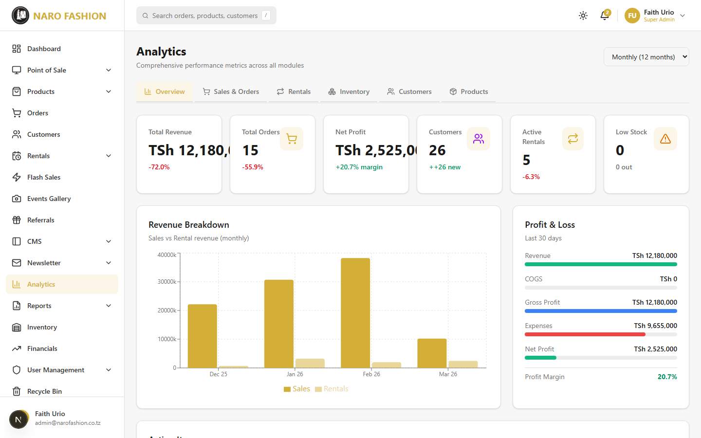
*Figure 28: The analytics dashboard with interactive charts showing revenue trends, category sales distribution, order status breakdown, payment method usage, customer growth, and daily order volume.*

The analytics page provides visual insights into your store's performance, organised in tabs:

| Tab | What it shows |
|-----|---------------|
| **Overview** | Total Revenue, Total Orders, Net Profit, Customers, Active Rentals, Low Stock; revenue breakdown; profit and loss for the last 30 days; **Action Items** (low stock, pending orders, overdue rentals, upcoming returns, pending event approvals). Use the period dropdown -- Daily (30 days), Weekly (3 months), Monthly (12 months). |
| **Sales & Orders** | Sales revenue, average order value, cancellation rate, pending orders; daily orders, order status, sales by category, payment methods, top products, recent orders. |
| **Rentals** | Rental revenue, active and overdue rentals, average duration, rental status, utilisation rate, upcoming returns. |
| **Inventory** | Total SKUs, cost value, retail value, unrealised profit, stock status, recent restocks. |
| **Customers** | Total customers, new this month, returning rate, customer growth, top customers. |
| **Products** | Total, published and draft products, category performance, top-rated products. |

**Using the analytics charts:**
- **Hover** over any data point or chart segment to see detailed values.
- All charts use your store's real data.

> **Tip:** Review analytics regularly (at least weekly) to spot trends and act on the Action Items.

### Visitor Analytics

**Path:** Analytics > Visitors (`/dashboard/analytics/visitors`) -- Requires the Analytics module.

See how many people visit your storefront, where they come from and what they look at. The data is collected by the platform itself (no third-party tracking service), is anonymous (visitors' IP addresses are never stored), and excludes search-engine robots.

1. Choose the period at the top: **Last 24 hours**, **Last 7 days**, **Last 30 days**, or **Last 90 days**.
2. Read the cards: **Page views**, **Unique visitors**, and **Avg pages/visit** (how deeply visitors explore), each compared with the previous period.
3. Explore the sections:
   - **Traffic over time** -- page views and visits per day.
   - **Top pages** -- the most-viewed pages and products.
   - **Visitors by country** -- with flags and percentages.
   - **Devices**, **Browsers**, **Operating systems**.
   - **When do they visit?** -- a day-of-week by hour-of-day heat map (useful for timing promotions and newsletters).
   - **Top referrers** -- websites and apps that sent visitors (e.g., Instagram, Google).

Visitors whose browser sends "Do Not Track" are not counted.

### Rental Reports

**Path:** Reports > Rental Reports (`/dashboard/reports/rentals`) -- Requires the Reports module.

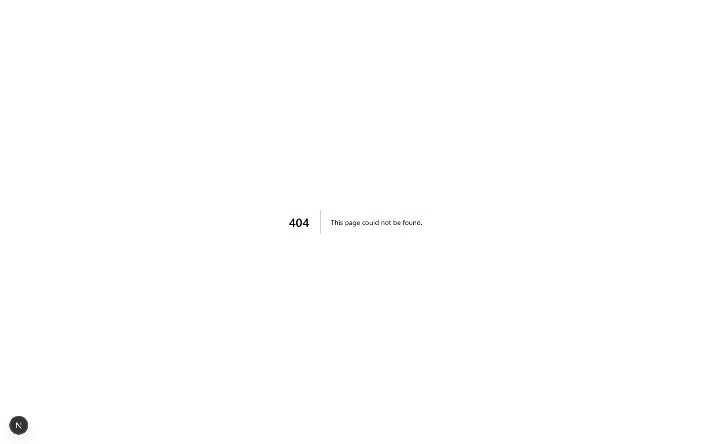
*Figure 29: The reports page showing rental performance data with per-item rental counts, cumulative income figures, and rental history details.*

The **Item Performance** table shows, for each rental product: category, **Rental Count**, **Cumulative Income**, average per rental, and when it was last rented. Click an item to see its full rental history (rental number, customer, phone, dates, amount, status).

---

## 2.10 Inventory Management

**Path:** Inventory (`/dashboard/inventory`) -- Requires the Inventory module.

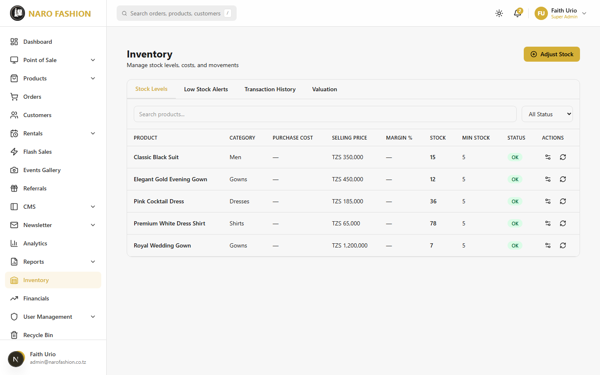
*Figure 30: The inventory management page showing stock levels across all products and variants, with summary cards for total products, in-stock, low-stock, and out-of-stock counts.*

The inventory page ("Manage stock levels, costs, and movements") gives you full control over your stock.

**Summary cards:** Cost Value, Retail Value, Unrealized Profit, Total SKUs, Out of Stock. A banner warns when products are below their minimum stock ("View Items").

**Tabs:**
- **Stock Levels** -- Search and filter (All Status / In Stock / Low Stock / Out of Stock). Columns: Product, Category, Purchase Cost, Selling Price, Margin %, Stock, Min Stock, Status, and actions (**Edit settings**, **Adjust stock**).
- **Low Stock Alerts** -- Products below their minimum stock threshold.
- **Transaction History** -- Choose a product to see every stock movement (date, type, quantity before/after, change, unit cost, note, and who made it).
- **Valuation** -- The value of your stock at cost and at selling price.

**Inventory settings for a product** (Edit settings): **Purchase Cost (TZS)**, **Minimum Stock Threshold** (low-stock alert level), **Supplier Name**, **Supplier Contact**.

**Manual Stock Adjustment:**

1. Click **"Adjust Stock"** (top of the page, or on a product row).
2. Choose the **Product** and **Variant** (or "All variants").
3. Choose the **Adjustment Type**: **Restock (+)**, **Manual Adjustment**, or **Damage (-)**.
4. Enter the **Quantity**.
5. Add a **Note / Reference** (e.g., "Received new shipment from supplier", "Stock count correction").
6. Save. The change is recorded in the Transaction History.

Sales, rentals and returns update stock automatically.

---

## 2.11 Financial Management

**Path:** Financials (`/dashboard/financials`) -- Requires the Expenses module. Page title: "Financial Management".

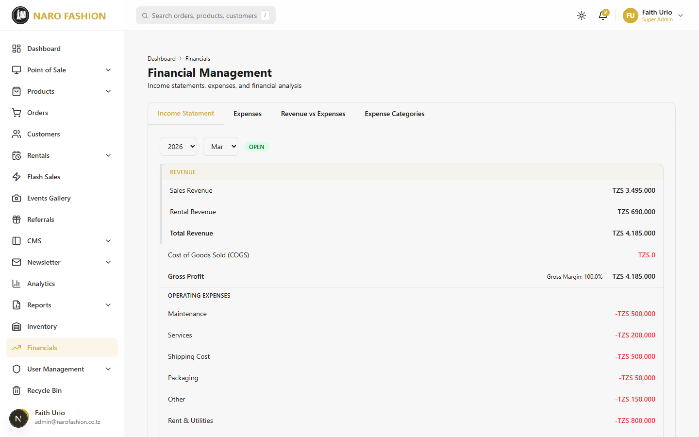
*Figure 31: The financial management page showing the income statement (P&L), revenue vs expenses chart, and expense tracking tools.*

The page has four tabs.

**Income Statement** -- Choose the year and month. The period's status (e.g., OPEN or CLOSED) is shown. The statement lists:
- **Revenue** -- Gross Sales, Refunds, Net Sales Revenue, Rental Revenue, Total Revenue.
- **Cost of Goods Sold (COGS)** and **Gross Profit** (with Gross Margin).
- **Operating Expenses** by category, and **Total Operating Expenses**.
- **Net Profit / (Loss)** (with Net Margin).

All dates use Tanzania (East Africa) time.

**Expenses** -- Choose the year and month to see that month's expenses and total.

1. Click **"Add Expense"**.
2. In **"Record Expense"** fill in **Category** (required), **Amount (TZS)** (required), **Date** (required), **Vendor / Supplier**, **Description** and an optional **Receipt URL**.
3. Click **"Save Expense"** (offline: **"Save on this device"**).

Expenses cannot be added to a period that has been closed or locked.

**Revenue vs Expenses** -- Choose a year to see a monthly bar chart and table of Revenue, Expenses, Net Profit and Margin.

**Expense Categories** -- Click **"Add Category"** and enter a unique **Category Name**, the **Type** (**Operating**, **Cost of Goods Sold**, **Tax**, or **Other**), a Description and Sort Order. Categories can be edited, deactivated, deleted, and restored (tick **"Show deleted"**).

> **Permissions:** Managing expenses and expense categories needs the matching permissions (Managers have them by default).

---

## 2.12 Newsletter

The newsletter system lets you communicate with your customers via email campaigns.

### Newsletter Dashboard

**Path:** Newsletter > Dashboard (`/dashboard/newsletter`)

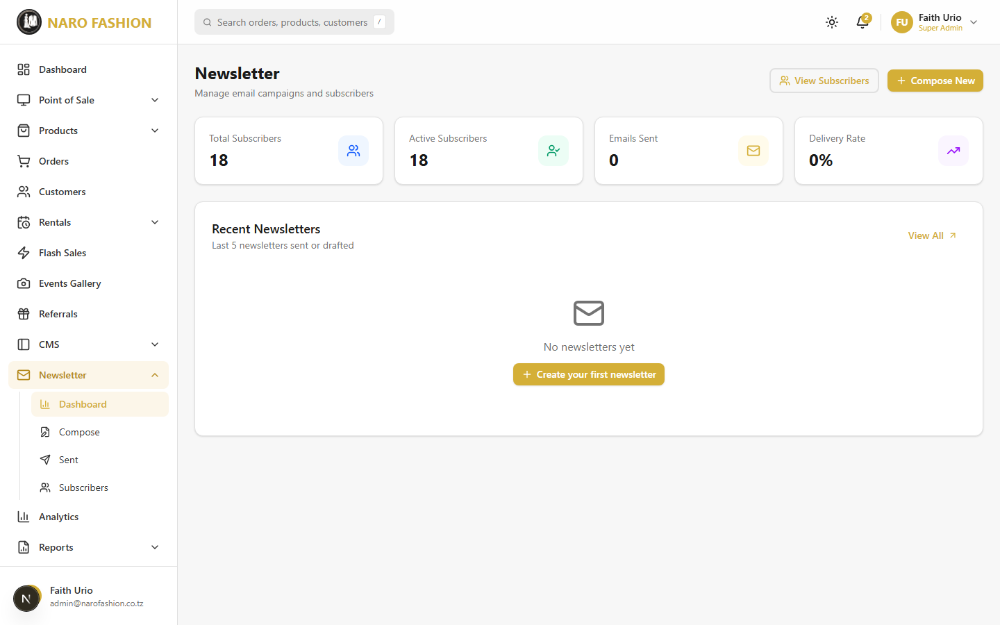
*Figure 32: The newsletter dashboard showing subscriber count, total newsletters sent, and a list of recent campaigns with delivery statistics.*

Overview of your newsletter program:
- **Total Subscribers** -- Number of active email subscribers.
- **Newsletters Sent** -- Total campaigns sent to date.
- **Recent Newsletters** -- List of your most recent campaigns with delivery statistics (sent count, success rate).

### Subscribers

**Path:** Newsletter > Subscribers (`/dashboard/newsletter/subscribers`)

Manage your subscriber list:
- **Search** -- Find subscribers by email address.
- **View subscriber details** -- Email, subscription date, status (Active/Unsubscribed).
- **Pagination** -- Navigate through large subscriber lists.
- **Stats Bar** -- Total subscribers, active subscribers, unsubscribed count.

### Compose Newsletter

**Path:** Newsletter > Compose (`/dashboard/newsletter/compose`)

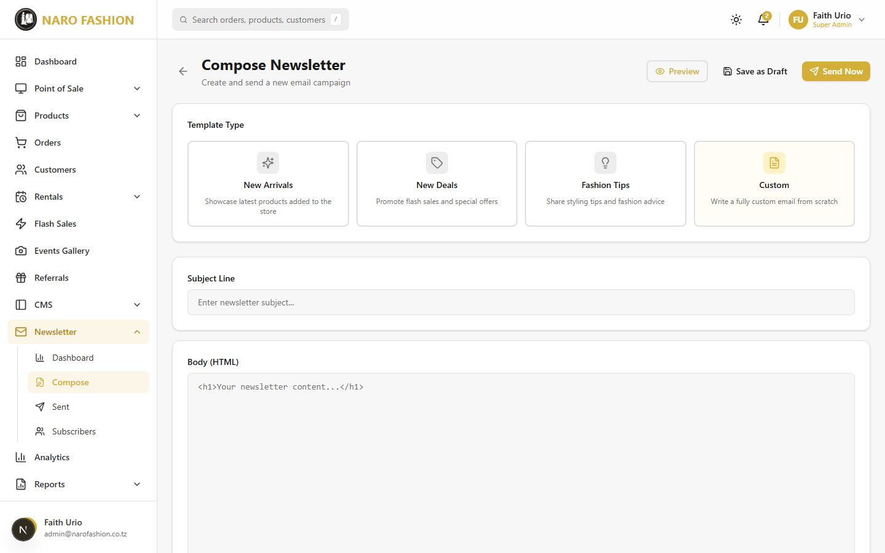
*Figure 33: The newsletter compose page where you select a template type, write the subject line, compose content, preview the email, and send to all subscribers.*

**Creating and sending a new newsletter:**

1. **Choose a Template Type** by clicking one of the template cards:

| Template | Description |
|----------|-------------|
| **New Arrivals** | Showcase the latest products added to the store. Products are included automatically (a "New Arrivals Preview" shows which). |
| **New Deals** | Promote flash sales and special offers. |
| **Fashion Tips** | Share styling tips and fashion advice. |
| **Custom** (default) | Write a fully custom email from scratch. |

2. **Subject Line** -- Enter a compelling subject (e.g., "New Arrivals This Week", "Flash Sale: Up to 50% Off").
3. **Body** -- Write your content in the editor (Visual or HTML mode, with image upload -- see [Pages](#pages) for how the editor works).
4. **Preview** -- Click **"Preview"** to see how the email will look.
5. **Save as Draft** -- Save without sending. You can return and edit it later (open it from Sent and click **"Edit Draft"**).
6. **Send Now** -- Sends the newsletter to all active subscribers. Confirm the message "This will send the newsletter to all active subscribers. This action cannot be undone."

> **Permission:** Sending (and resending failed emails) needs the **Send Newsletter Campaigns** permission (`newsletter:send`). Managers have it by default; without it the send is refused.

### Sent Newsletters

**Path:** Newsletter > Sent (`/dashboard/newsletter/sent`)

View all previously sent newsletters:
- Campaign name, subject, send date, and delivery statistics.
- Click on any newsletter to see detailed delivery data.

**Newsletter Detail** (`/dashboard/newsletter/[id]`):
- **Delivery Stats** -- Sent count, delivered count, failed count, and success rate.
- **Failed Deliveries Table** -- List of recipients whose delivery failed, with error details.
- **Resend Failed (N)** -- Click to retry sending to failed recipients only.

---

## 2.13 User and Role Management

### Admin Users

**Path:** User Management > Admin Users (`/dashboard/users`)

Manage the staff accounts that can access the admin dashboard. The page shows **Total Admins**, **Active**, **Inactive** and **Locked Accounts**, a search box, and a role filter. The table lists Name (a lock icon marks locked accounts), Email, Role, Assigned Roles, Status, Created and actions.

**Creating a new admin user:**

1. Click **"Add Admin User"**.
2. **First Name**, **Last Name** and **Email Address** (all required). The email must be unique across the whole platform -- it is the staff member's login.
3. **Primary Role** (required) -- **Staff** (default), **Manager**, or **Super Admin**. Only a Super Admin (or the platform team) can see and choose Super Admin.
4. **Assign Roles** -- Tick one or more roles (e.g., MANAGER, STAFF, or a custom role such as "Cashier"). **These roles decide what the person is allowed to do** (see [Roles and Permissions](#roles-and-permissions)). Super Admins automatically have every permission.
5. **Password** (optional) -- 8-128 characters with a letter and a number. **Leave it blank** to have the system create a temporary password.
6. Click **"Create Admin User"**. If a temporary password was generated, it is shown **once** -- share it with the person securely and ask them to change it at first login.

> **Tip:** Assigned roles are chosen when the account is created. Choose them carefully; the Edit window does not change roles.

**Managing admin users:**
- **Edit** -- Change first name, last name, email, or set a **New Password** (leave blank to keep the current one; setting one signs the user out everywhere).
- **Disable / Enable** -- A disabled admin cannot sign in. Use this when someone leaves the team.
- **Unlock account** -- Shown only while an account is locked after 5 failed sign-in attempts. Click it to restore access immediately.
- **Delete** -- Removes the admin account (after confirmation).

**Safety rules:**
- You **cannot disable or delete your own account** -- those buttons are hidden on your own row.
- You cannot change your own roles.
- Only a Super Admin can create, change, enable/disable, or grant the Super Admin role. Super Admin accounts cannot be deleted.

### Roles and Permissions

**Path:** User Management > Roles & Permissions (`/dashboard/users/roles`)

The Role-Based Access Control (RBAC) system controls what each admin user can do. The table shows each role's Name, Type (**System** or **Custom**), Description, number of Permissions and Users, and Status. Tick **"Show deleted roles"** to see and **Restore** deleted custom roles.

**System roles** (shared by all stores and kept up to date automatically -- they cannot be renamed, edited or deleted):

| Role | Description |
|------|-------------|
| **SUPER_ADMIN** | Full access to all system features. There is a single, shared Super Admin role. |
| **MANAGER** | Access to all features except admin management and system settings. By default it does **not** include payment-method settings, manual payment handling, or permanent purging. |
| **STAFF** | Read-only access plus checklist and order status management. |
| **AI_AGENT_OPERATOR** | Can use the AI agent, create drafts and open approval requests. Cannot approve. |
| **AI_AGENT_APPROVER** | Can review and approve risky AI actions opened by operators. Cannot create drafts. |

**Creating a custom role:**

1. Click **"Create Role"**.
2. Enter a unique **Role Name** (e.g., "Cashier", "Content Editor", "Inventory Manager") and a **Description**. Names of system roles are reserved.
3. Save. Then click the **key icon (Manage Permissions)** on the new role.
4. In **"Permissions: {role}"**, permissions are grouped by area (Products, Orders, Rentals, Customers, CMS, and so on). Tick individual permissions or use **"Select all"** for a group.
5. Click **"Save Permissions"**.

**Examples of permissions:**

| Permission | What it allows |
|-----------|-------------|
| View / Create / Update / Delete Products | Product catalogue management |
| Update Order Status, Cancel Orders | Order fulfilment |
| **Refund Orders** | Record refunds on orders |
| Update Rental Status, Manage Rental Checklists | Rental handling |
| **Suspend Customers** | Suspend and reactivate customer accounts |
| Manage CMS, Moderate Reviews | Content and review moderation |
| **Issue POS Refunds** | POS returns and exchanges |
| Manage Expenses, Manage Expense Categories, **Close Financial Periods** | Finance |
| View Reports, Export Reports | Reports |
| **Send Newsletter Campaigns** | Sending newsletters |
| **Manage Payment Methods & Gateway Credentials** | Payment method settings (Super Admin only by default) |
| **Manage Payments (manual confirm / refund)** | Manual payment handling (Super Admin only by default) |
| **Permanently Purge Recycle Bin Items** | Permanent deletion (Super Admin only by default) |
| View / Create / Update / Delete Admin Users, Unlock Admin Accounts, View Roles, Manage Roles | Staff management |
| View Audit Logs, Export Audit Logs | Audit trail |
| Manage Settings | Store settings (e.g., connecting Instagram) |
| Use AI Admin Agent, AI Agent -- Read Tools / Create Drafts / Approve Risky Actions | AI features |

**What happens without permission:** pages still open, but an action you are not allowed to do is refused with the message **"You don't have permission to perform this action"**. Permission changes take effect within about a minute.

### Audit Log

**Path:** User Management > Audit Log (`/dashboard/audit-log`) -- needs the **View Audit Logs** permission.

The audit log records important administrative actions (who did what, when, and from where).

- **Filters** -- Admin, Entity, Action, Date From / Date To, and a search box.
- **Table** -- Date/Time, Admin, Action, Entity, Entity ID, IP Address. Click a row to see **Full Details**.
- **Export CSV** -- Download the filtered log (needs the **Export Audit Logs** permission).

---

## 2.14 Settings

### Admin Settings

**Path:** Settings > Admin Settings (`/dashboard/settings`) -- "Manage your profile, security, and preferences"

**Profile**
- **First Name**, **Last Name** (Email is read-only). Click **"Save Profile"**.
- **Change Password** -- Enter **Current Password**, **New Password** and **Confirm New Password** (8-128 characters, with a letter and a number) and click **"Change Password"**. Your other sessions are signed out; you stay signed in.

**Security -- Two-Factor Authentication (2FA)**

Two-factor authentication adds a 6-digit code from an authenticator app (Google Authenticator, Microsoft Authenticator, Authy, 1Password, etc.) to every sign-in. We strongly recommend it for every admin, especially Super Admins.

*To turn on 2FA:*
1. Install an authenticator app on your phone.
2. Click **"Enable two-factor authentication"**.
3. **Step 1 of 3** -- Enter your **Current password** and click **"Continue"**.
4. **Step 2 of 3** -- Add the account to your app: on your phone tap **"open in authenticator app"**, or in the app choose **"Enter a setup key"** and type the key shown (use **"Copy"** to copy it). There is no QR code -- the key is entered by hand.
5. Type the **6-digit code** your app shows and click **"Verify and enable"**. Your other sessions are signed out.
6. **Step 3 -- Save your recovery codes.** Ten one-time codes are shown **only once**. Click **"Copy"** or **"Download"** and store them somewhere safe (e.g., a password manager), then click **"I've saved them"**.

The status then shows **On** and how many recovery codes are left. When 2 or fewer remain, generate new ones.

*Other actions (each needs your current password and an authenticator or recovery code):*
- **New recovery codes** -- Generates 10 new codes; the old ones stop working immediately.
- **Disable** -- Turns 2FA off ("Disable two-factor"). Other sessions are signed out.

*Lost your phone?* Sign in with a **recovery code** ("Use a recovery code" on the login screen), then set up 2FA again on your new phone. If you have no recovery codes left, ask your platform administrator to reset 2FA for your account.

**Security -- Session Timing** (store-wide setting)

Controls how long admin sessions stay valid for everyone in your store. Changes apply at each person's **next login**.
- **Session Timeout** -- How long a sign-in stays active before it is silently refreshed in the background. Presets: 15m, 30m, 1h, 2h, 4h, 8h, 24h, or a custom value. Default: 15 minutes.
- **Stay-Signed-In Duration** -- How long until staff must sign in again with email and password. Presets: 1d, 7d, 14d, 30d, 90d, or custom. Default: 7 days.
- Limits: Session at most 24h; Stay-signed-in at most 90d; units s, m, h, d. Leave a field empty to use the default.
- Click **"Save Timing"**.

**Appearance** -- Choose the admin theme: **Light**, **Dark**, or **Luxury**. It changes immediately (also available from the theme icon in the top bar).

**Notifications** -- Choose Email/SMS alerts for **Order Alerts**, **Rental Reminders** and **Low Stock Alerts**, then click **"Save Notifications"**.

### Business Profile

**Path:** Settings > Business Profile (`/dashboard/settings/business-profile`)

Update your store's identity. Click **"Save Business Profile"** when done.
- **Business Identity** -- Business Name and Tagline (English and Swahili), Business Type, Currency (TZS by default).
- **Branding** -- **Company Logo** (square, at least 256x256), **Company Icon** (round), and **Favicon** (browser-tab icon). Use **"Upload New"** (with cropping) or **"Reset"**.
- **Contact Information** -- Email Address, Phone Number, WhatsApp Number, Address (English and Swahili). These appear on the storefront's footer and Contact page.
- **Business Location** -- Enter **Latitude** and **Longitude** (at least 2 decimal places, e.g., -6.80 / 39.28), or click **"Use My Current Location"** while at the shop (allow location access in your browser). A **Map Preview** appears, and the storefront's Contact page then shows a map. Fill in both or neither.
- **Social Media** -- Instagram, Facebook, Twitter / X and TikTok URLs.
- **Website** -- Business Domain.

### Payment Methods

**Path:** Settings > Payment Methods (`/dashboard/settings/payment-methods`) -- needs the **Manage Payment Methods & Gateway Credentials** permission (Super Admin by default).

Configure the payment methods your store accepts and their gateway settings.

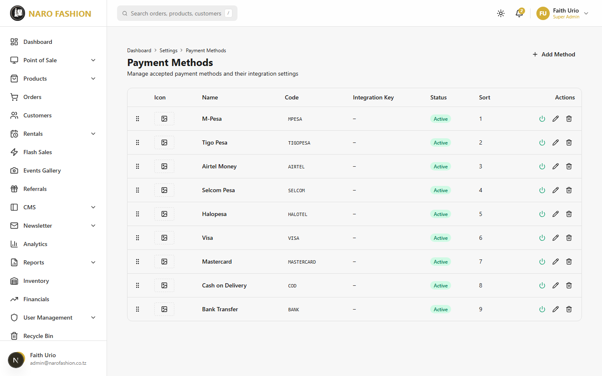
*Figure 34: The payment methods settings page showing all configured payment methods with their icons, names, codes, statuses, and management actions.*

**Adding a payment method:**

1. Click **"+ Add Method"**.
2. **Icon** -- JPEG, PNG, WebP or SVG, max 2MB (no cropping).
3. **Name** -- Display name, e.g., "M-Pesa".
4. **Code** -- Unique code, e.g., `MPESA` (automatically upper-cased). Gateway codes include `SELCOM` and `CLICKPESA_MIXX` (Mixx by YAS via ClickPesa).
5. **Description** -- Optional note shown to customers.
6. **Integration Key** -- Merchant ID, API key or shortcode, if the method needs one.
7. **Sort Order** -- Lower numbers are shown first.
8. **Integration Parameters (JSON)** -- Gateway settings, if needed (your platform administrator or gateway provider gives you these). Leave empty for manual methods like Cash or COD.
9. Tick **"Active (visible to customers)"** and click **"Create Method"**.

**Secret values are hidden:** keys, secrets and tokens are shown masked (e.g., `••••abcd`). When editing, leave a masked value as it is to keep the stored secret, or replace it to change it. You never need to re-enter credentials just to edit other fields.

Use the power icon to activate/deactivate a method, **Edit**, or **Delete** (deleted methods can be restored from the Recycle Bin).

---

## 2.15 Recycle Bin

**Path:** Recycle Bin (`/dashboard/recycle-bin`)

The recycle bin stores deleted items so they can be recovered. Items in it are hidden from customers but still kept in the database. Items are organized by tab:

| Tab | What It Contains |
|-----|-----------------|
| **Products** | Deleted products |
| **Categories** | Deleted categories |
| **Flash Sales** | Deleted flash sales |
| **Checklists** | Deleted rental checklist templates |
| **Banners** | Deleted banners |
| **Pages** | Deleted CMS pages |
| **Events** | Deleted customer events |
| **Parallax Sections** | Deleted parallax section backgrounds |

**Restoring an item:**

1. Open the appropriate tab.
2. Find the item (each row shows its name, ID and deletion date).
3. Click **"Restore"**. The item returns to its original place immediately.

> **Note:** There is no "delete forever" button in the admin -- deleted items stay in the Recycle Bin until restored.

---

## 2.16 Admin Profile

**Path:** Profile (`/dashboard/profile`) -- open it from the user menu in the top bar ("Profile").

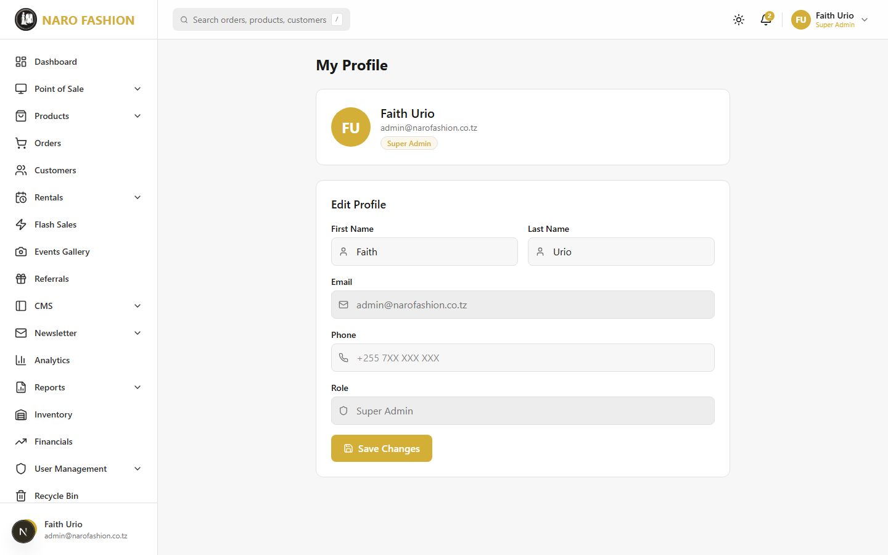
*Figure 35: The admin profile page where you can view your account details and update your personal information and password.*

The **My Profile** page shows your initials, name, email and role badge. In **Edit Profile** you can change your **First Name**, **Last Name** and **Phone**, then click **"Save Changes"**. Email and role are read-only.

To change your password or set up two-factor authentication, go to **Settings > Admin Settings** (see [2.14 Settings](#214-settings)).

---

## 2.17 Working Offline

The admin dashboard keeps working when the shop's internet drops. Changes you make offline are saved on this device and sent to the server automatically when the connection comes back. Nothing you save offline is lost, and nothing is silently overwritten: if someone else changed the same record in the meantime, you decide which version wins.

### What works offline

| Area | Offline | Notes |
|------|---------|-------|
| **POS sales** | Yes | Cash, or mobile money with the customer's transaction reference. Card payments need internet. |
| **Products** | Add and edit | Including photos (they upload later). Delete, activate/deactivate and CSV import need internet. |
| **Categories** | Add and edit | Including the category photo. Delete needs internet. |
| **Order status** | Change status | Cancelling a **paid** order and recording refunds need internet. |
| **Rental status** | Change status, cancel | Editing rental details, uploading the transport receipt and ticking checklist items need internet. |
| **Expenses** | Record and edit | Deleting expenses and managing expense categories need internet. |
| Everything else | Read-only | Pages you opened before show the last data saved on this device. |

Buttons that cannot work offline are greyed out; hover over them to see **"Needs internet"**.

> Only pages and data you have already opened on this device are available offline. A page you have never visited can't be shown until you reconnect.

### The sync status badge

The badge in the top bar (and in the POS header) always tells you where you stand:

| Badge | Meaning |
|-------|---------|
| **Online · Up to date** | Connected; nothing waiting. |
| **Syncing…** | Sending your saved changes to the server. |
| **N waiting to sync** | Changes saved on this device, about to be sent. |
| **Offline · N changes saved** (or just **Offline**) | No connection. Your changes are safe on this device. |
| **N need review** | Some changes could not be applied — open the sync panel. |
| **Sign in again to sync** | Your session expired. Sign in and the waiting changes are sent. |
| **Newer data online** | Someone else changed data since you loaded the page — click to refresh. |

### Pending pills on rows

Records with changes that have not reached the server yet show a small pill:

- **Pending sync** (blue) — saved on this device, waiting to be sent.
- **Needs review** (red) — the server refused it or someone else changed the record; open the sync panel.

When you save offline you see the message **"Saved on this device — will sync when online"** instead of the normal success message. The list updates straight away with your change, and the pill disappears once it has synced.

### The sync panel

Click the badge to open the **Sync status** panel (connection, last synced, how many changes are waiting or need review, and anything changed online since the page loaded). From there:

- **Check now** -- check the connection again.
- **Refresh** -- reload the page's data.
- **Changes on this device (N)** -- opens the **"Changes on this device"** drawer, which has three sections:
  - **Waiting to sync** -- your saved changes in the order they will be sent.
  - **Need review** -- changes that could not be applied:
    - **Failed** -- the server refused the change (for example a duplicate SKU). Fix the cause, then **Retry**, or **Discard** the change. Discarding an offline POS sale needs a second click, because the cash was already taken.
    - **Conflict -- changed online since you edited it** -- someone else changed the record after you. Click **Review** to open **"Review conflict"**, which compares **Your change** with **Online now** field by field:
      - **Keep mine** -- send your change again on top of the latest version.
      - **Keep online** -- throw your change away and keep the server's version.
  - **Recently synced** -- the last changes that went through (an offline sale shows its offline receipt number and the real order number it received).

Use **Sync now** at the bottom of the drawer to send waiting changes immediately (it also happens automatically while online). If your session has expired, the drawer shows **"Sign in again"** -- sign in and the waiting changes are sent.

### When someone else changed the record (online)

Even when you are online, if another staff member saved the same product, category, expense, order or rental after you opened it, your save is stopped with the message **"Someone else changed this since you opened it. Your change was not saved."** Click **Reload latest**, check what changed, and make your change again.

### Product and category photos offline

You can add photos while offline. Pick and crop the photo as usual; you see "Photo saved on this device -- it uploads when you're back online". The photo is kept on this device and is uploaded automatically just before the product or category is saved on the server. If the device runs out of storage you will see a clear message — free up space or reconnect and try again.

### Offline POS rules

1. **Open your shift while online** before the connection drops — offline sales are recorded against the shift that was open on the device.
2. Accept **cash**, or **mobile money with the transaction reference** the customer received (M-Pesa, Airtel Money, Mixx by YAS, Selcom Pesa). Card payments are disabled offline.
3. After payment an **offline receipt** (number like `OFFLINE-3F9A2C`) is shown — print or show it to the customer.
4. Product search and barcode scanning use the catalogue saved on the device. If stock ran short by the time the sale syncs, the sale is still recorded (the money was taken) and flagged **oversold** for review.

### Signing out with unsynced changes

If you sign out while changes are still waiting, you are warned first. You can **Sync now** (if online) or sign out anyway: the changes stay on this device and sync the next time **you** sign in on it. Other staff signing in on the same device never see or send your changes.

### Setting up a device for offline use

1. Open the admin in Chrome or Edge and **install it as an app** (browser menu → *Install Naro Admin* / *Add to Home screen*).
2. Sign in and tick **Remember me** on devices that should keep working offline after the browser is closed (only on devices used by one person).
3. While online, **visit the pages you need offline** at least once — Products, Categories, Orders, Rentals, Financials → Expenses, and POS — so their data is saved on the device.
4. Before an expected outage, open the POS and **start your shift**.

---

## 2.18 AI Assistant and AI Approvals

The **AI Agent** group in the sidebar gives your team an AI helper for everyday questions, with strict controls on anything risky.

### AI Assistant

**Path:** AI Agent > Assistant (`/dashboard/ai/assistant`) -- needs the **Use AI Admin Agent** permission (`ai-agent:use`). This permission is **not** given automatically; a Super Admin must assign it (for example through the AI_AGENT_OPERATOR role -- see [AI Role Assignments](#ai-role-assignments)).

1. Type a question in plain language, or click a suggested prompt, for example:
   - "List the products with low stock"
   - "What rentals are overdue?"
   - "Show me sales for this month"
   - "How many pending orders do we have?"
   - "What's in the recycle bin?"
   - "Draft a new wedding gown product under Wedding Dresses"
2. Press **Enter** (or **"Send"**). Use Shift+Enter for a new line.
3. The answer appears with a small note of the tools it used ("N tool calls").

**What the assistant can do:** read products, categories, sizes, orders, rentals, inventory and low stock, rental policies, size guides, the recycle bin and reports; and create **drafts** (e.g., a draft product, an order note, a size or size-guide entry). Drafts are not visible to customers until a person publishes them.

**What it will not do:** publish, archive or restore products, change order or rental statuses, adjust inventory, issue refunds, manage users or roles, or delete anything. It tells you which admin screen to use instead.

**Good to know:**
- "AI can make mistakes -- verify important results in the admin UI."
- **"Clear"** deletes the conversation from this browser only (the server keeps its audit records).
- There is a daily limit per store (200 requests by default). When it is reached you see "Daily AI assistant limit reached for this store ... It resets at 00:00 UTC."
- If you see **"AI Assistant not configured"**, the feature has not been switched on for the platform -- contact your platform administrator.

### AI Approvals

**Path:** AI Agent > Approvals (`/dashboard/ai/approvals`) -- "Review approval requests opened by the AI agent. Four-eyes review is required for every risky write."

When the AI agent is asked to do something risky -- **publish**, **archive** or **restore** a product, or **update a draft product** -- it does not do it directly. It opens an **approval request**, and two different people must be involved:

1. **The operator** (the person working with the AI agent) asks for the action. A **Pending** request appears on the Approvals page.
2. **A different admin** (the approver) opens the request, checks the **Business summary** and the **Before / After** values, and clicks **"Approve"** -- or **"Reject"** with a reason. **You can never approve your own request** ("You cannot approve your own request. A different admin must approve.").
3. On approval, an **"Approval token issued"** window shows a one-time token. **It is shown only once.** Click **"Copy"**, send it to the operator through a secure channel, and click **"I have shared the token"**.
4. The operator clicks **"Execute"** on the request, pastes the token in **"Approval token (paste here)"**, and confirms. The action is carried out.

**Time limits and safety checks:**
- Publish, archive and restore are **high risk** and must be executed within **2 minutes**; draft updates are **medium risk** with **5 minutes**. The clock starts when the request is created, so the approver and operator should be ready at the same time. Expired requests are marked **EXPIRED** and must be requested again.
- If the product changed after the request was opened, execution is blocked -- request again.
- A request can be executed at most **3 times** (failed attempts count).
- The **operator** can **cancel** their own request while it is pending. The **approver** can **"Revoke approval"** after approving (before it is executed).

**Using the page:** filter by status (Pending, Approved, Consumed, Rejected, Revoked, Cancelled, Expired, Exhausted), risk, and action, or search by title/product. Columns: Status, Action, Risk, Target, Created, Expires, Actions. Click **"Refresh"** to update.

### AI Role Assignments

**Path:** AI Agent > Role Assignments (`/dashboard/ai/role-assignments`)

Give staff the two AI roles:
- **AI_AGENT_OPERATOR** -- can use the AI agent, read data and create drafts/requests. Cannot approve.
- **AI_AGENT_APPROVER** -- can review, approve, reject and revoke risky requests. Cannot create drafts.

Use the toggles in the table to assign or remove each role, and confirm. For the four-eyes rule to work, **give the two roles to different people** -- the page warns if someone holds both. You cannot change your own roles. Super Admins do **not** automatically have approval rights; at least one person must hold AI_AGENT_APPROVER for requests to be approved. Changes apply on the person's next action.

---

## 2.19 Image Upload Guidelines

All image uploaders in the admin check your file before uploading and, where needed, open a **crop window** with the correct shape (title "Crop ..."; adjust the frame and the **Quality** slider, then click **"Crop & Upload"**). Accepted formats are JPEG, PNG and WebP unless stated otherwise.

| Where | Shape | Smallest accepted image | Saved as | Max file size |
|-------|-------|------------------------|----------|---------------|
| Product photos (up to 8) | 3:4 portrait | 900x1200 | 1200x1600 | 5MB |
| Hero slides | 3:4 portrait | 1000x1333 | 1200x1600 | 5MB |
| Category images | 3:4 portrait | 900x1200 | 1200x1600 | 5MB |
| Event gallery images | 3:4 portrait | 900x1200 | 1200x1600 | 5MB |
| Event cover, banners, parallax backgrounds | 16:9 landscape | 1600x900 | 1920x1080 | 5MB |
| Instagram manual posts | 1:1 square | 800x800 | 1080x1080 | 5MB |
| Company logo and icon | 1:1 square | 256x256 | 256x256 PNG | 2MB |
| Favicon | 1:1 square | 128x128 | 256x256 PNG | 1MB |
| Payment method icons (SVG also allowed, no crop) | any | 80x56 | unchanged | 2MB |
| Images inside text editors (no crop) | any | 300x200 | resized to 1200 wide | 5MB |

Common messages: **"Image too small. Minimum WxH. Yours is WxH."**, **"File too large. Max N MB."**, **"Allowed formats: ..."**. Very large images (over 4000x4000 pixels) are rejected for safety. 3D models (GLB/GLTF) can be up to 25MB.

---

# PART 3: PLATFORM ADMIN GUIDE

This section covers the platform-level administration of the Naro Fashion multi-tenant SaaS platform. Platform administrators manage tenants (stores), subscription plans, billing, and the module system. This is a higher level of access above individual tenant administration.

---

## 3.1 Platform Login

Platform administrators have a separate login page from tenant admins:

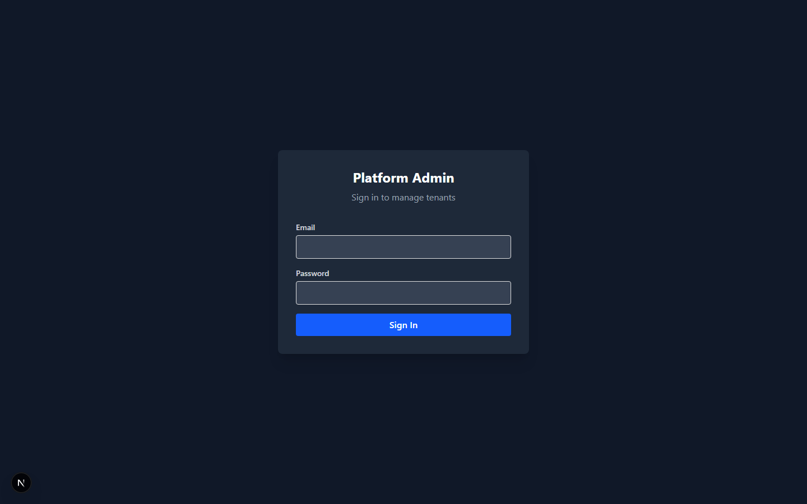
*Figure 36: The platform admin login page. Platform admins use a dedicated login page separate from tenant admin login.*

1. **Go directly to the platform login page:** add `/platform-login` to the admin URL (e.g., `admin.narofashion.co.tz/platform-login`). There is no link to it from the normal admin login page -- bookmark it.
2. **Enter your platform admin credentials** (**Email** and **Password**) as provided to you by the platform owner. Tick **Remember me** only on a private device.
3. **Click "Sign In"**.
4. If two-factor authentication is on, enter the **6-digit code** from your authenticator app (or **"Use a recovery code"**) and click **"Verify and sign in"**.

> **Important:** Platform admin accounts have the highest level of access in the system -- they manage all tenants, subscription plans, billing and modules. Use a strong password and turn on **two-factor authentication** under **Platform Settings** (same steps as for tenant admins -- see [2.14 Settings](#214-settings)). After 5 failed attempts the account is locked for 30 minutes.

After logging in, the sidebar shows the platform options: **Platform Dashboard**, **Tenants**, **Subscription Plans**, **All Payments**, and **Platform Settings**.

---

## 3.2 Platform Dashboard

**Path:** Platform Dashboard (`/platform`)

The platform dashboard provides a bird's-eye view of the entire SaaS platform.

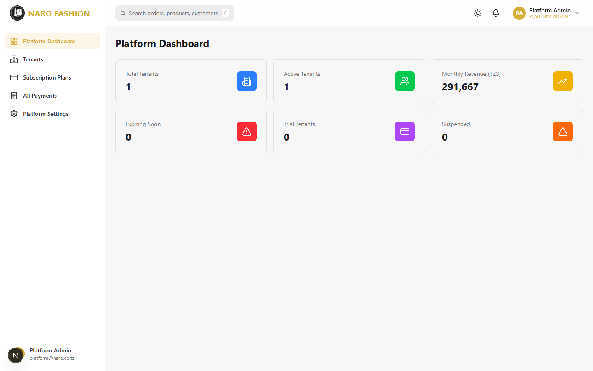
*Figure 37: The platform dashboard showing key metrics: total tenants, active tenants, monthly recurring revenue, expiring subscriptions, trial tenants, suspended tenants, and a recent payments list.*

**Dashboard cards:**

| Card | Description |
|------|-------------|
| **Total Tenants** | Total number of stores registered on the platform. |
| **Active Tenants** | Stores that are currently operational. |
| **Monthly Revenue (TZS)** | Monthly recurring revenue from active subscriptions (yearly plans counted as one-twelfth per month). |
| **Expiring Soon** | Active subscriptions ending within the next 7 days. These tenants need renewal reminders. |
| **Trial Tenants** | Stores on a trial. |
| **Suspended** | Stores that are suspended (expired subscription or manual suspension). |

**Recent Payments:** when there are payments, the most recent ones are listed (tenant name, date, amount in TZS).

---

## 3.3 Tenant Management

### Tenant List

**Path:** Tenants (`/platform/tenants`)

View and manage all stores on the platform.

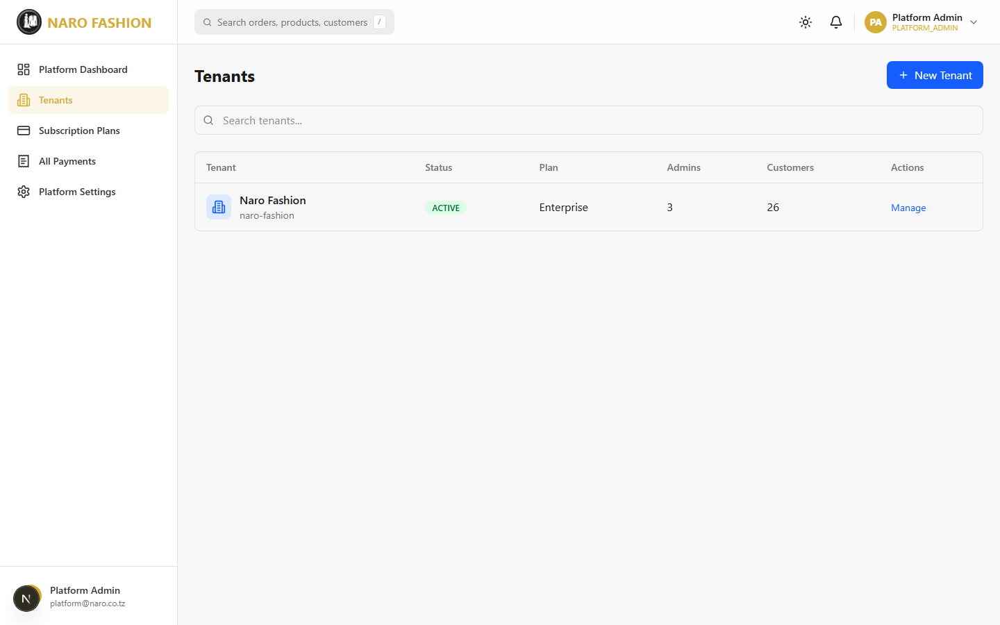
*Figure 38: The tenant management page showing all registered stores with their names, slugs, statuses, and subscription plans.*

**Tenant table columns:**
- **Tenant** -- Business name, with the slug (URL-friendly identifier, e.g., `naro-fashion`) underneath.
- **Status** -- Colour-coded badge (see below).
- **Plan** -- Current subscription plan ("None" if there is none).
- **Admins** and **Customers** -- Counts.
- **Actions** -- **Manage** opens the tenant's detail page.

**Status badges:**

| Status | Color | Description |
|--------|-------|-------------|
| **ACTIVE** | Green | Store is live and fully operational. |
| **TRIAL** | Purple | Store is on a trial with full access. |
| **SUSPENDED** | Amber | Store is suspended (subscription expired or manually suspended). The storefront shows **"This store is temporarily unavailable. Please try again later."** and the store's admins and customers cannot use it. |
| **DEACTIVATED** | Red | Store is permanently closed. The storefront shows **"Store not found"**. |

**Search:** use "Search tenants..." to filter by name.

### Creating a New Tenant

**Path:** Tenants > **New Tenant** (`/platform/tenants/new`) -- page "Create New Tenant"

**1. Company Info**
- **Business Name** (required) -- e.g., "Bridal Dreams Tanzania".
- **URL Slug** (required) -- Filled in automatically from the name; editable. Must be unique.
- **Custom Domain (optional)** -- e.g., `shop.example.co.tz`. The domain's DNS must point to the platform's server (your technical team has the details).
- **Primary Color** (default gold `#D4AF37`) and **Secondary Color** (default black `#1A1A1A`) -- the store's brand colours.

**2. First Admin User** -- this person becomes the store's **Super Admin**
- **First Name**, **Last Name**, **Email** (must be unique across the platform) and **Password** (8-128 characters with a letter and a number). All required.

**3. Subscription**
- **Plan** (required) -- e.g., Starter, Business, Enterprise, or a custom plan.
- **Billing Cycle** -- Monthly or Yearly. The subscription runs one month or one year from today.
- **Status** -- **Active** or **Trial**.

**4. Save** -- Click **"Create Tenant"**. The system creates the store, its Super Admin account and its subscription, switches on the modules included in the plan, and opens the tenant's detail page.

**Checklist after creating a new tenant:**

1. Share the admin login URL and credentials with the store owner through a secure channel, and ask them to change the password and turn on two-factor authentication.
2. Verify the plan and enable any additional optional modules (on the tenant detail page).
3. If using a custom domain, ask your technical team to point the domain's DNS to the platform.
4. Open the storefront to check it loads.

### Tenant Detail

**Path:** Tenants > Manage (`/platform/tenants/[id]`)

The detail page shows the store's name, slug and domain, status badge, **Current Plan** (with expiry date), and the number of **Admin Users** and **Customers**.

**Status actions:**
- **Suspend** (shown for ACTIVE stores) -- immediately blocks the store: the storefront shows "This store is temporarily unavailable", and the store's admins and customers are refused with a "store account is suspended" message (within about a minute). All data is kept.
- **Activate** (shown for SUSPENDED stores) -- restores full access.

**Module Management:** one toggle per module. Click it to **Enable** or **Disable** an optional module. Core modules are marked "Core module -- always enabled" and cannot be switched off. Changes take effect within about 5 minutes.

**Payment History:** a read-only table of the store's subscription payments (Date, Amount, Method, Status, Period).

> **Note:** Branding colours, plan changes/renewals, recording subscription payments and deactivating a store are not available on this page yet -- ask your technical team to make these changes.

---

## 3.4 Subscription Plans

**Path:** Subscription Plans (`/platform/plans`)

Manage the subscription plans available to tenants. Each plan card shows the monthly and yearly price, the product, admin-user and storage limits, and the number of included modules.

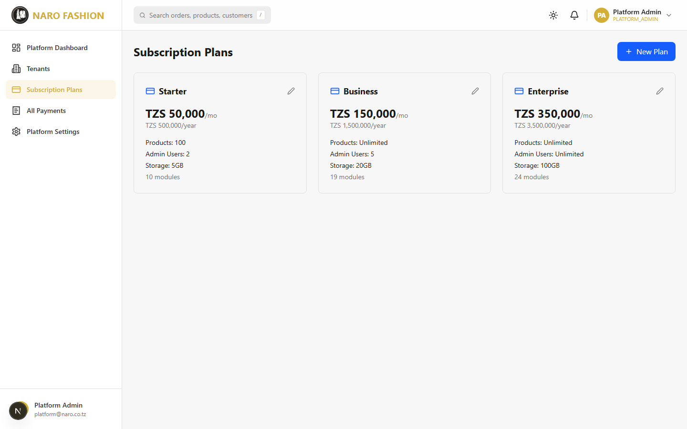
*Figure 39: The subscription plans management page showing all available plans with their names, monthly and yearly prices, product limits, included modules, and management actions.*

**Default plans:**

| Plan | Monthly Price | Yearly Price | Limits | Modules |
|------|-------------|-------------|--------|---------|
| **Starter** | TZS 50,000 | TZS 500,000 | 100 products, 2 admins, 5GB | Core modules |
| **Business** | TZS 150,000 | TZS 1,500,000 | Unlimited products, 5 admins, 20GB | Core plus rentals, inventory, analytics, flash sales, promo codes, ID verification, notifications |
| **Enterprise** | TZS 350,000 | TZS 3,500,000 | Unlimited products and admins, 100GB | All modules |

**Creating or editing a plan:**

1. Click **"New Plan"**, or the edit (pencil) icon on a plan card.
2. Fill in **Plan Name**, **Description**, **Monthly Price (TZS)** (required), **Yearly Price (TZS)**, **Max Products**, **Max Admins** and **Storage GB**.
3. Click **"Save"**.

> **Note:** The modules included in a plan, and deleting plans, are managed by your technical team; the form does not include them.

---

## 3.5 Module Management

The module system controls which features each tenant store can access. There are two categories of modules:

### Core Modules (Always Enabled)

These modules cannot be disabled. Every tenant receives them regardless of their subscription plan:

| Module | Description |
|--------|-------------|
| **Products** | Product catalog management |
| **Categories** | Product categories |
| **Orders** | Order management |
| **Cart** | Shopping cart |
| **Wishlist** | Product wishlist |
| **CMS** | Content management (pages, slides, settings) |
| **Auth** | Sign-in and accounts |
| **Users** | Customer management |
| **Shipping** | Delivery options and fees |

### Optional Modules (Toggleable Per Tenant)

| Module | Description |
|--------|-------------|
| **Rentals** | Gown/fashion rental system with booking and tracking |
| **Rental Checklists** | Dispatch and return checklists for quality control |
| **Rental Policies** | Rental terms, buffer days, late fees configuration |
| **Point of Sale** | In-store Point of Sale system |
| **Analytics** | Business and visitor analytics |
| **Inventory** | Inventory tracking, stock management, alerts |
| **Expenses** | Expense tracking and financial statements |
| **Reports** | Rental reports |
| **Flash Sales** | Time-limited promotional sales with countdown |
| **Referrals** | Customer referral program |
| **Events** | Customer event/wedding galleries |
| **Promo Codes** | Promotional coupon codes |
| **ID Verification** | National ID verification for rental customers |
| **Notifications** | Alert and notification system |
| **Reviews** | Product reviews |

**How modules affect the tenant experience:**
- When a module is **enabled**, its sidebar items appear in the tenant's admin dashboard and the related storefront features become available.
- When a module is **disabled**, its sidebar items are hidden and the features are blocked, even if someone tries to reach them directly.
- Changes take effect within about 5 minutes.

**Toggling modules for a tenant:**
1. Open the tenant (**Tenants > Manage**).
2. In **Module Management**, click the toggle next to an optional module.
3. The change is saved immediately.

---

## 3.6 Billing and Payments

### Subscription Lifecycle

Tenant subscriptions follow an automated lifecycle, checked every morning:

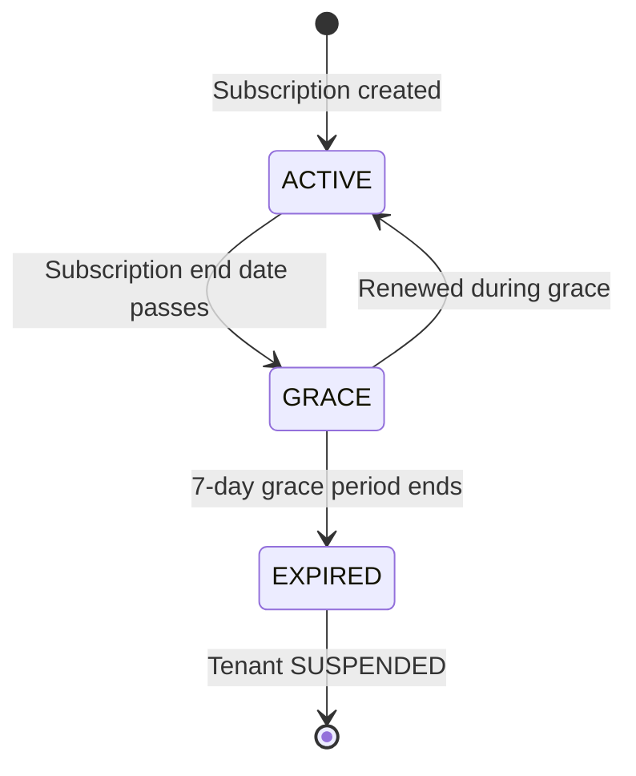

**Lifecycle stages:**

| Stage | Duration | What Happens |
|-------|----------|-------------|
| **ACTIVE** | While the subscription is current | Store is fully operational. |
| **GRACE** | 7 days after the end date | Store keeps working. Payment is overdue. |
| **EXPIRED** | After the grace period | The subscription has ended and the **store is suspended** automatically (storefront unavailable). All data is kept. |
| **CANCELLED** | Permanent | The subscription was terminated. |

Trial stores whose trial end date has passed are also suspended automatically. Renewing the subscription reactivates a trial or suspended store (a deactivated store stays closed).

> **Note:** Subscriptions expiring within 7 days appear under **Expiring Soon** on the Platform Dashboard. Automatic reminder emails to tenants are not sent yet -- contact those tenants yourself.

### Payment Tracking

**Path:** All Payments (`/platform/payments`) -- page "All Tenant Payments"

*Figure 40: The billing and payments page showing all subscription payments across the platform with tenant names, amounts, dates, payment methods, and statuses.*

- **Summary cards** -- **Completed** (total TZS), **Pending** (total TZS) and **Total Records**.
- **Status filter** -- All Statuses, Completed, Pending, Failed.
- **Search** -- "Search by tenant, invoice, or ref...".
- **Table** -- Date, Tenant, Invoice, Amount, Method (Mobile Money / Bank Transfer / Manual), Period, Status, Reference.
- **Export CSV** -- Downloads the filtered list as a spreadsheet file.

### Platform Settings

**Path:** Platform Settings (`/platform/settings`) -- "Your platform administrator account". The **Security** section lets you turn on two-factor authentication and manage your recovery codes, exactly as described for tenant admins in [2.14 Settings](#214-settings).

---

## 3.7 Three-Tier User Hierarchy

The Naro Fashion platform uses a three-tier authentication system that provides clear separation of access levels:

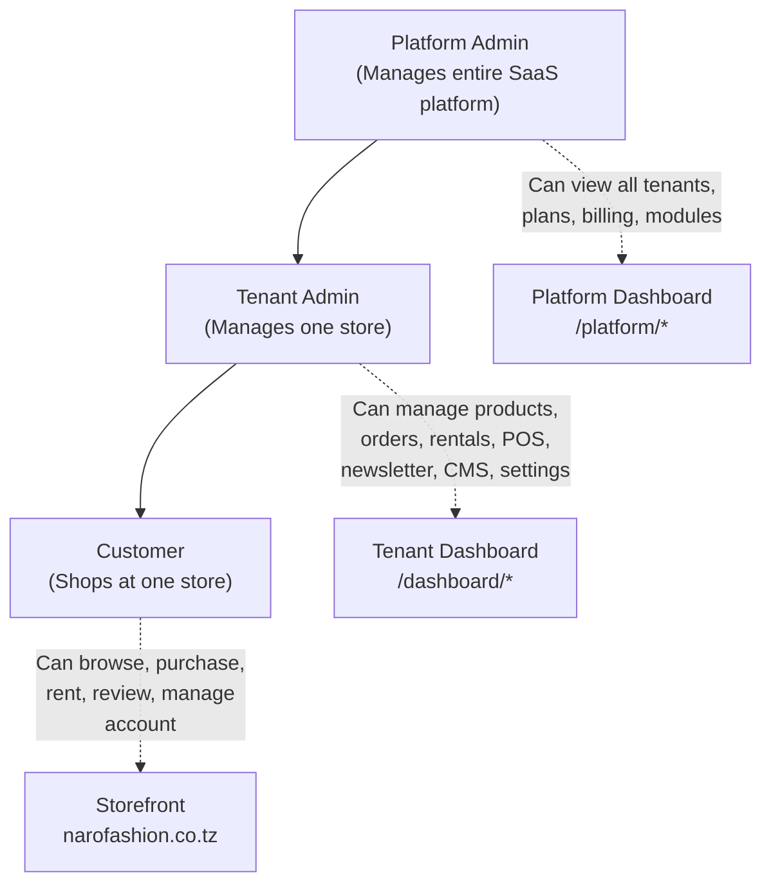

| Level | Login Path | Scope | Key Capabilities |
|-------|-----------|-------|-----------------|
| **Platform Admin** | `/platform-login` | Entire platform | Manage tenants, subscription plans, billing, modules, and their own security settings. |
| **Tenant Admin** | `/login` | One specific tenant | Manage products, orders, rentals, customers, POS, CMS, newsletter, inventory, financials, analytics, users, and all store operations. System roles SUPER_ADMIN, MANAGER, STAFF (plus the AI roles and custom roles). |
| **Customer** | Storefront `/auth/login` | One specific tenant | Browse products, purchase, rent, manage account, download their data, write reviews, submit events, save to wishlist, subscribe to newsletter. |

**Key security features:**

- **Separate logins** -- Customers, store staff and platform admins each have their own login. Staff credentials do not work on the storefront, and customer credentials do not work in the admin.
- **Strong passwords** -- 8-128 characters with at least one letter and one number for everyone.
- **Two-factor authentication** -- Store staff and platform admins can (and should) require a 6-digit authenticator code at sign-in, with one-time recovery codes for emergencies.
- **Account lockout** -- After 5 failed sign-in attempts (password or 2FA code), staff and platform admin accounts are locked for 30 minutes. Super Admins can unlock staff accounts from User Management.
- **Session control** -- Sessions refresh silently in the background. Each store sets how long sessions last (Admin Settings > Session Timing). Signing out, changing or resetting a password, and suspending a customer sign that person out everywhere.
- **Store isolation** -- Each store's data is completely separate. One store can never see another store's products, customers or orders.
- **Module controls** -- Features a store does not have are blocked, not just hidden.
- **Roles and permissions** -- Each admin can only do what their roles allow; sensitive actions (refunds, payment settings, sending newsletters, financial period closing, etc.) need specific permissions.
- **Private ID documents** -- Customers' ID documents are stored privately and can only be viewed by signed-in staff.
- **Audit log** -- Important admin actions are recorded (User Management > Audit Log).
- **HTTPS/SSL** -- All communication is encrypted. Passwords are never transmitted in plain text.
- **Soft deletes** -- Most deleted items go to the Recycle Bin and can be restored.

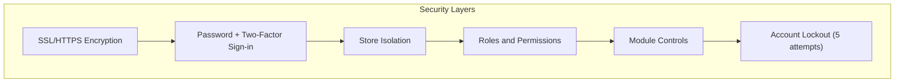

---

## Appendix A: Keyboard Shortcuts

| Shortcut | Location | Action |
|----------|----------|--------|
| **Enter** | Search bar | Execute search |
| **Escape** | Any modal | Close the modal |
| **Tab** | Forms | Move to next field |

---

## Appendix B: Supported Regions (Tanzania)

The following regions are available in address forms and rental delivery:

Arusha, Dar es Salaam, Dodoma, Geita, Iringa, Kagera, Katavi, Kigoma, Kilimanjaro, Lindi, Manyara, Mara, Mbeya, Morogoro, Mtwara, Mwanza, Njombe, Pemba North, Pemba South, Pwani, Rukwa, Ruvuma, Shinyanga, Simiyu, Singida, Songwe, Tabora, Tanga, Unguja North, Unguja South, Zanzibar Central/South.

---

## Appendix C: Payment Method Codes

| Code | Display Label |
|------|--------------|
| `CASH` | Cash |
| `MPESA` | M-Pesa |
| `TIGO_PESA` | Tigo Pesa |
| `AIRTEL_MONEY` | Airtel Money |
| `MIX_BY_YAS` | MIX by YAS |
| `CARD` | Card (Visa/Mastercard) |
| `MOBILE_MONEY` | Mobile Money (generic) |
| `BANK_TRANSFER` | Bank Transfer |
| `COD` | Cash on Delivery |
| `SELCOM` | Selcom payment gateway (mobile money USSD push and card checkout) |
| `CLICKPESA_MIXX` | Mixx by YAS mobile money via ClickPesa |

---

## Appendix D: Order Status Reference

| Status | Color | Description |
|--------|-------|-------------|
| `PENDING` | Yellow | Order placed, awaiting confirmation |
| `CONFIRMED` | Blue | Order confirmed by admin |
| `PROCESSING` | Blue | Order being prepared |
| `SHIPPED` | Amber | Order shipped/dispatched |
| `DELIVERED` | Green | Customer received the order |
| `CANCELLED` | Red | Order was cancelled (by the store, or automatically when an online order was not paid in time) |

**Payment status** (shown separately on each order):

| Badge | Description |
|-------|-------------|
| Unpaid | No payment received |
| Processing | Payment in progress or held for review |
| Partially paid | Part of the amount received |
| Paid | Fully paid |
| Refund pending | Order cancelled after payment; the customer must be refunded |
| Partially refunded | Part of the money refunded |
| Refunded | All collected money refunded |
| Failed / Cancelled | Payment failed or was cancelled |

---

## Appendix E: Rental Status Reference

| Status | Description |
|--------|-------------|
| `PENDING_ID_VERIFICATION` | Waiting for National ID review |
| `ID_VERIFIED` | ID approved, awaiting down payment |
| `DOWN_PAYMENT_PAID` | Down payment (25% by default) received |
| `FULLY_PAID` | All payments received |
| `READY_FOR_PICKUP` | Item prepared for customer |
| `ITEM_DISPATCHED` | Item handed over or shipped |
| `ACTIVE` | Rental period is ongoing ("Overdue" if past the return date) |
| `RETURNED` | Item returned to store; any late fee calculated |
| `INSPECTION` | Store inspecting returned item |
| `CLOSED` | Rental complete, deposit refunded |
| `CANCELLED` | Rental was cancelled (by the store before dispatch, or automatically when unpaid for 48 hours by default) |

Statuses only move forward; Closed and Cancelled are final.

---

## Appendix F: Glossary

| Term | Definition |
|------|-----------|
| **Tenant** | A single store/business on the Naro Fashion platform. Each tenant has its own products, customers, orders, and settings. |
| **Platform Admin** | A superuser who manages the entire SaaS platform (tenants, plans, billing). |
| **Tenant Admin** | A staff member of a specific store who manages that store's operations (products, orders, etc.). |
| **Module** | A feature set that can be enabled or disabled per tenant (e.g., Rentals, POS, Analytics). |
| **SKU** | Stock Keeping Unit. A unique identifier for each product variant. |
| **POS** | Point of Sale. An in-store sales terminal for processing face-to-face transactions. |
| **RBAC** | Role-Based Access Control. A permissions system where admin users are assigned roles with specific permissions. |
| **Two-Factor Authentication (2FA)** | A second sign-in step: a 6-digit code from an authenticator app on your phone, in addition to your password. |
| **Authenticator app** | A phone app (e.g., Google Authenticator, Microsoft Authenticator, Authy) that shows a new 6-digit code every 30 seconds. |
| **Recovery code** | A one-time code (like `ABCDE-FGH23`) used to sign in when you do not have your authenticator app. |
| **Four-eyes rule** | Two different people must be involved in a risky action: one requests it, another approves it. Used for AI approvals. |
| **Approval token** | A one-time secret shown to the approver once, which the requester uses to carry out an approved AI action. |
| **Refund pending** | Payment status of a paid order that was cancelled; the store must refund the customer and record it. |
| **Parallax** | A scrolling background effect where the background moves slower than the page content. |
| **Sync / Outbox** | In offline mode, changes are saved on the device and sent ("synced") to the server when the connection returns. |
| **Conflict** | When someone else changed a record online after you changed it offline; you choose Keep mine or Keep online. |
| **MRR** | Monthly Recurring Revenue. Total monthly income from all tenant subscriptions. |
| **COD** | Cash on Delivery. A payment method where the customer pays when receiving the order. |
| **CMS** | Content Management System. Tools for managing website content (slides, pages, settings). |
| **NIDA** | National Identification Authority. The Tanzanian authority that issues National ID cards. |
| **TZS** | Tanzanian Shilling. The currency used throughout the platform. |
| **GLB/GLTF** | 3D model file formats supported by the platform's 3D product viewer. |
| **PWA** | Progressive Web App. A website that can be installed and used like an app. |
| **CSV** | A simple spreadsheet file format used for bulk product import. |
| **Soft Delete** | Deleting an item by marking it as deleted rather than permanently removing it. Can be restored from the Recycle Bin. |
| **Grace Period** | A 7-day window after subscription expiry during which the store remains operational while awaiting payment. |
| **Down Payment** | The initial partial payment (default 25%) required to confirm a rental booking. |
| **Buffer Days** | The minimum number of days (default 7) between when one rental ends and the next can begin, to allow for cleaning and inspection. |
| **Layaway** | A POS feature where a customer pays in instalments and the store holds the item until the balance is paid. |
| **Split Payment** | A POS feature where a customer pays using multiple payment methods in a single transaction. |

---

## Appendix G: Frequently Asked Questions

### Customer FAQ

**Q: I forgot my password. How do I reset it?**
A: Click "Forgot password?" on the login page, enter your email address, and check your inbox for a reset link. Click the link and set a new password (8-128 characters, with a letter and a number). If you do not receive the email within 5 minutes, check your spam folder.

**Q: Can I cancel an order after placing it?**
A: There is no cancel button on the storefront -- contact the store through the Contact page or WhatsApp. Orders that are already paid can only be cancelled by the store, which then refunds you. Unpaid online orders are cancelled automatically after 24 hours (by default).

**Q: How long does delivery take?**
A: Standard delivery takes 5-7 business days. Express delivery takes 1-2 business days. Pickup is available within 24 hours. Actual times may vary depending on your region.

**Q: What happens if I receive a damaged item?**
A: Contact the store immediately through the Contact page or WhatsApp with photos of the damage. The store will arrange a return and replacement or refund based on their returns policy.

**Q: Can I rent multiple items at the same time?**
A: Yes, as long as your ID is verified and each booking is paid in time.

**Q: How do I know if my payment was successful?**
A: For mobile money, the checkout page shows "Payment Successful!" and you receive a confirmation SMS from your provider. For bank transfers and cash on delivery, the store confirms the payment when it is received.

**Q: Is the 3D viewer available on all products?**
A: No, only on products where the store has uploaded a 3D model. Look for the "Photos/3D" toggle above the product images.

**Q: Can I change my email address?**
A: No. The email address cannot be changed from your account. Contact the store if it is wrong.

**Q: How do I delete my account?**
A: There is no self-service account deletion. Contact the store and ask them to close your account. You can download a copy of your data at any time from Account > Settings > "Download my data".

**Q: Why does the store look dark on my phone?**
A: The store follows your device's light/dark setting by default ("Auto"/"Device"). Click the theme button in the header (Auto → Light → Dark → Standard) or choose a theme in Account > Settings.

**Q: Why does my staff login not work on the storefront?**
A: The storefront is for customers only. Create a separate customer account to shop.

### Admin FAQ

**Q: Why are some sidebar menu items missing?**
A: Sidebar items for optional modules (e.g., POS, Rentals, Analytics) only appear if the module is enabled for your store. Contact your platform administrator to enable additional modules.

**Q: I get "You don't have permission to perform this action". What do I do?**
A: Your roles do not include that permission. Ask a Super Admin to give you a role that includes it (User Management > Roles & Permissions).

**Q: I am locked out of my admin account. What do I do?**
A: After 5 failed attempts, accounts are locked for 30 minutes. Wait, or ask a Super Admin to click "Unlock account" in User Management > Admin Users.

**Q: I lost the phone with my authenticator app.**
A: Sign in with one of your recovery codes ("Use a recovery code"), then disable and re-enable two-factor authentication on your new phone. If you have no recovery codes, contact your platform administrator to reset two-factor authentication for your account.

**Q: Can I import products in bulk?**
A: Yes. On Products > All Products click "Template", fill in the CSV file, and use "Import CSV" (up to 500 rows / 5MB per file).

**Q: How do I record a refund?**
A: Send the money to the customer yourself, then expand the order and use "Record refund" in the Refunds panel (needs the Refund Orders permission).

**Q: Why can't I edit my page in the visual editor?**
A: The page contains a table (e.g., a size chart). Table content is edited in HTML mode with a live preview, because the visual editor cannot keep tables.

**Q: How do I back up my data?**
A: Backups are handled by the platform. Contact your platform administrator about backup schedules and data export.

**Q: How do I change my store's brand colors?**
A: Brand colors are set by the platform team. Contact your platform administrator. Your logo, icon and favicon can be changed in Settings > Business Profile.

**Q: Can I have multiple admin users with different access levels?**
A: Yes. Create custom roles in User Management > Roles & Permissions (e.g., a "Cashier" role with POS permissions only) and tick them under "Assign Roles" when creating the admin user.

**Q: What image sizes should I upload?**
A: See [2.19 Image Upload Guidelines](#219-image-upload-guidelines). Product photos should be at least 900x1200 pixels (portrait), under 5MB, JPEG/PNG/WebP.

**Q: The Instagram feed stopped updating.**
A: Open CMS > Instagram Posts and look at the Instagram Connection card. If it is not green, click "Re-connect Instagram" and follow the steps (the person who is an admin of the shop's Facebook Page must do this).

**Q: Can I keep working when the internet goes down?**
A: Yes -- see [2.17 Working Offline](#217-working-offline). POS sales, product, category, expense and status changes are saved on the device and sync later.

### Platform Admin FAQ

**Q: Can I create a tenant as a trial?**
A: Yes, choose Status "Trial" when creating it. Trial tenants have full access.

**Q: What happens when I suspend a tenant?**
A: The storefront shows "This store is temporarily unavailable. Please try again later.", and the store's admins and customers are refused. All data is kept. Click "Activate" to restore access.

**Q: Can I move a tenant to another subscription plan?**
A: This is not available in the platform screens yet. Ask your technical team to change the plan.

**Q: Is there a limit to how many tenants the platform can support?**
A: There is no fixed limit. The practical limit depends on server resources.

---

## Appendix H: Troubleshooting

### Common Storefront Issues

| Issue | Possible Cause | Solution |
|-------|---------------|----------|
| "This store is temporarily unavailable" | Store is suspended | Contact the store owner or platform admin. The subscription may have expired. |
| "Store not found" | Unknown or closed store address | Check the web address. |
| "Invalid email or password" with staff login | Storefront is for customers only | Use a customer account. |
| Cannot add to cart or wishlist | Not signed in | Sign in first. |
| Payment prompt not received | Phone number incorrect | Check the Mobile Money Number (9 digits after +255) and try again. |
| Mobile money payment timed out | Network delay | If you paid, check your order status in your account before paying again. |
| "You already have N open cash-on-delivery orders" | COD limit reached | Complete or cancel an existing COD order, or choose another payment method. |
| Order disappeared / cancelled | Online payment not completed in time | Unpaid online orders are cancelled after 24 hours by default. Place the order again. |
| Images not loading | Slow connection | Wait or switch to a faster connection. |
| 3D viewer not working | Browser not supported | Use a modern browser (Chrome, Firefox, Safari, Edge). |
| Theme keeps changing between light and dark | Theme set to Auto/Device | Choose Light, Dark or Standard instead. |

### Common Admin Dashboard Issues

| Issue | Possible Cause | Solution |
|-------|---------------|----------|
| "Invalid credentials or account temporarily locked" | Wrong password/2FA code, or account locked | Check your details. After 5 failures wait 30 minutes or ask a Super Admin to unlock you. |
| 2FA code rejected | Phone clock wrong, or old code | Make sure your phone's time is set automatically; use the newest code, or a recovery code. |
| "You don't have permission to perform this action" | Missing permission | Ask a Super Admin to assign a role with that permission. |
| Signed out unexpectedly | Session timing, password change, or 2FA change | Sign in again. Session lengths are set in Admin Settings > Session Timing. |
| "Someone else changed this since you opened it" | Another staff member saved the same record | Click "Reload latest" and redo your change. |
| Button greyed out with "Needs internet" | Device is offline | Reconnect; that action does not work offline. |
| Dashboard shows no data | New store | Add products, categories, and other content. |
| Image upload fails | File too small, too large or wrong format | See [2.19 Image Upload Guidelines](#219-image-upload-guidelines). |
| 3D model upload fails | File too large | GLB/GLTF files must be under 25MB. |
| CSV import has failed rows | Missing/invalid fields or unknown category | Read the Errors table, fix those rows and import them again. |
| Product not visible on storefront | Product inactive or draft | Activate/publish it in the product list. |
| Module menu item missing | Module disabled | Contact platform admin to enable the module. |
| POS will not sell | No open shift | Open a shift first (open it while online if you may go offline). |
| Barcode scanner not working | Scanner not configured | Set the scanner to keyboard (HID) mode. |
| Instagram feed not updating | Connection broken or token invalid | Check the Instagram Connection card and re-connect. |
| AI Assistant not configured | Feature not switched on for the platform | Contact your platform administrator. |
| AI approval "expired" | Not executed within 2 (or 5) minutes | Request again and execute promptly after approval. |

### Common Platform Admin Issues

| Issue | Possible Cause | Solution |
|-------|---------------|----------|
| Cannot create tenant | Duplicate slug or email | Use a unique slug and admin email. |
| Tenant storefront "temporarily unavailable" | Tenant is suspended | Click "Activate" on the tenant detail page. |
| Module toggle not taking effect | Cache delay | Wait up to 5 minutes. |
| MRR looks wrong | Only active subscriptions are counted | Check tenant and subscription statuses. |

---

## Appendix I: Screenshot Index

For quick reference, here is an index of all screenshots used in this guide (captured March 2026):

| Figure | Screenshot | Description | Section |
|--------|-----------|-------------|---------|
| 1 | `store-06-register.png` | Customer registration page | Creating an Account |
| 2 | `store-05-login.png` | Customer login page | Logging In |
| 3 | `store-02-shop.png` | Shop page | Shop Page |
| 4 | `store-03-categories.png` | Categories page | Category Pages |
| 5 | `store-08-flash-sales.png` | Flash sales page | Flash Sales |
| 6 | `store-07-rentals.png` | Rentals page | Understanding Rentals |
| 7 | `store-09-events.png` | Customer events page | Customer Events (Real Weddings) |
| 8 | `admin-01-login.png` | Admin login page | Logging In |
| 9 | `admin-03-dashboard.png` | Admin dashboard | Dashboard Overview |
| 10 | `admin-03-dashboard-full.png` | Full admin dashboard | Dashboard Overview |
| 11 | `admin-04-products.png` | Products list page | Product List |
| 12 | `admin-05-product-new.png` | Create new product form | Creating a Product |
| 13 | `admin-05-product-new-full.png` | Full create product form | Creating a Product |
| 14 | `admin-06-categories.png` | Category management | Categories |
| 15 | `admin-32-size-guides.png` | Size guides management | Size Guides |
| 16 | `admin-07-orders.png` | Orders list page | Order List |
| 17 | `admin-09-rentals.png` | Rental dashboard | Rental Dashboard |
| 18 | `admin-10-rental-requests.png` | Rental requests | Processing a Rental Request |
| 19 | `admin-11-rental-checklists.png` | Rental checklists | Checklists |
| 20 | `admin-12-rental-policies.png` | Rental policies | Rental Policies |
| 21 | `admin-08-customers.png` | Customer list | 2.5 Customer Management |
| 22 | `admin-14-pos.png` | POS interface | 2.6 Point of Sale (POS) |
| 23 | `admin-15-flash-sales.png` | Flash sales management | Flash Sales |
| 24 | `admin-16-referrals.png` | Referral program | Referral Program |
| 25 | `admin-27-events.png` | Customer events | Customer Events |
| 26 | `admin-19-cms-banners.png` | CMS banners | Banners |
| 27 | `admin-21-cms-pages.png` | CMS pages | Pages |
| 28 | `admin-24-analytics.png` | Analytics dashboard | Analytics Dashboard |
| 29 | `admin-25-reports.png` | Reports page | Rental Reports |
| 30 | `admin-13-inventory.png` | Inventory management | 2.10 Inventory Management |
| 31 | `admin-26-financials.png` | Financial management | 2.11 Financial Management |
| 32 | `admin-17-newsletter.png` | Newsletter dashboard | Newsletter Dashboard |
| 33 | `admin-18-newsletter-compose.png` | Newsletter compose | Compose Newsletter |
| 34 | `admin-28-payment-methods.png` | Payment methods settings | Payment Methods |
| 35 | `admin-33-profile.png` | Admin profile | 2.16 Admin Profile |
| 36 | `platform-01-login.png` | Platform admin login | 3.1 Platform Login |
| 37 | `platform-02-dashboard.png` | Platform dashboard | 3.2 Platform Dashboard |
| 38 | `platform-03-tenants.png` | Tenant management | Tenant List |
| 39 | `platform-04-plans.png` | Subscription plans | 3.4 Subscription Plans |
| 40 | `platform-05-billing.png` | Billing and payments | Payment Tracking |

---
